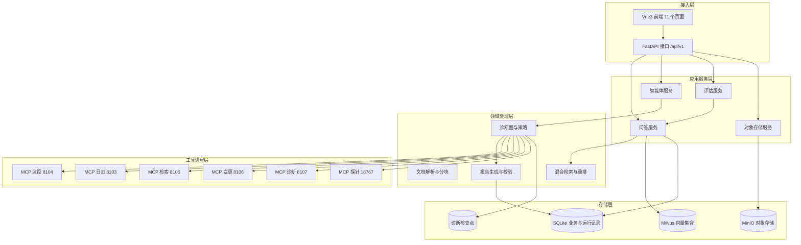
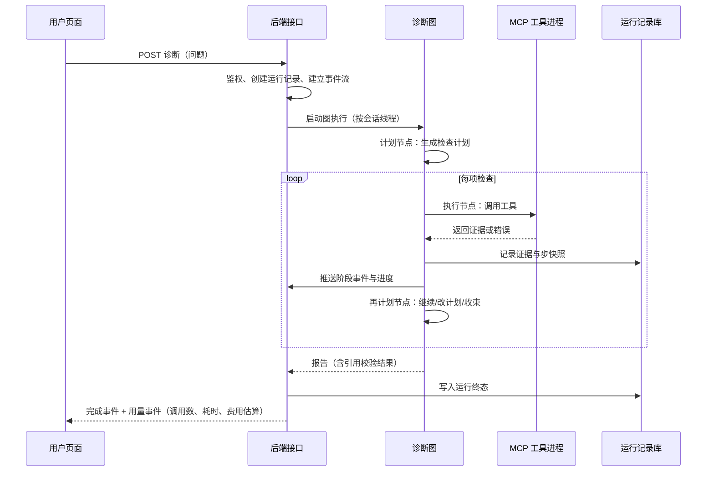
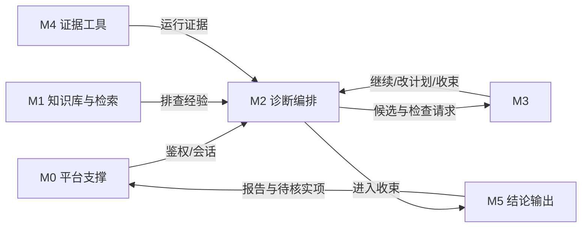

# 三、系统需求及总体设计

> 工作稿说明：本章对应导师版开题报告写作提纲第三章（系统需求分析、系统总体设计、功能模块划分）。本章只描述"要做什么"与"怎么分层"，不含实验结果与效果评价（留第五章）。文中标注"源码"的位置为实际实现落点，用于后续核对；需求编号 FR/NFR 为本章自建，便于第四、五章引用。

上一章说明了技术基础与本文的取用边界。本章据此展开三件事：先把使用场景、角色与需求条目化，再给出分层架构、部署形态、数据流与状态设计，最后按功能模块划分职责并说明模块之间的协作方式。

## （一）系统需求分析

### 1. 使用场景与用户角色

开题报告把目标场景限定为两个条件：**缺少专职运维支持的小公司或个人开发者**，以及**小型微服务系统中由单一主要故障引起的异常**。这两个限定决定了需求重点：系统不需要处理大规模集群与多故障并发，但必须在"没人能解读原始遥测"的条件下，把诊断过程与依据说清楚。

系统设三类角色：

| 角色 | 主要动作 | 可访问资源 |
| --- | --- | --- |
| 普通用户 | 上传文档、提问、发起诊断、查看本人诊断报告与证据摘要 | 本人知识库与文档、本人会话、本人诊断运行记录、证据摘要（不含原始载荷） |
| 管理员 | 维护知识库分类、查看队列与依赖健康、管理助手与智能体配置 | 平台级配置与运行状态 |
| 审计员 | 逐条复核一次诊断的证据链路 | 诊断证据明细，含原始引用指针 |

角色差异直接落在接口上：证据查询接口对普通用户隐藏 `raw_ref` 字段，只有管理员与审计员可见；会话与诊断运行都按创建者校验归属，跨用户访问一律视为不存在（返回 404 而非 403，避免泄露存在性）。

### 2. 功能需求

功能需求按开题报告的五个功能模块组织，另设一组平台支撑需求。需求只描述可观察的行为，不绑定实现方式。

**知识库与经验检索模块**

| 编号 | 需求 | 依据 |
| --- | --- | --- |
| FR-01 | 支持上传 pdf、docx、xlsx、pptx、md、txt 等格式文档，入库前做扩展名与文件头双重校验 | 开题"整理来源明确的故障案例与排查手册" |
| FR-02 | 文档入库异步处理：解析、分块、向量化与索引；处理状态可查，失败可重试 | 同上，"文档分段、建立向量索引" |
| FR-03 | 检索支持语义与关键词两路并按融合结果排序，可再经重排取前若干条 | 同上，"检索增强生成" |
| FR-04 | 回答中标注所依据片段的编号，读者可回查原文 | 同上，"保留资料出处" |

**诊断编排模块**

| 编号 | 需求 | 依据 |
| --- | --- | --- |
| FR-05 | 接收用户问题后生成有序检查计划，每项检查对应一次明确的工具调用 | 开题"依次执行检查安排、工具调用与结果分析" |
| FR-06 | 逐项执行计划，把工具返回写入可回溯的执行历史 | 同上，"根据新信息调整后续步骤" |
| FR-07 | 每轮结束重新判断：继续执行、修改计划、或收束并生成结论 | 同上 |
| FR-08 | 三个结束条件：证据足以支持结论、没有可继续的检查项、达到调用次数上限；最后一条由程序保证 | 同上，"三个结束条件之一" |
| FR-09 | 诊断过程以流式方式推送至页面，含阶段事件、进度与最终用量 | 同上（页面展示排查记录） |

**假设管理模块**

| 编号 | 需求 | 依据 |
| --- | --- | --- |
| FR-10 | 为每个候选原因分别记录支持依据、反对依据与待核实事项 | 开题"为每个候选记录支持依据、反对依据及待核实事项" |
| FR-11 | 尚缺证据但仍有检查价值的候选，在限定轮数内保留，不被过早淘汰 | 同上，"在限定轮数内暂时保留" |
| FR-12 | 已有明确反证的候选予以排除，且排除理由可追溯 | 同上，"对于已有明确反证的候选，则予以排除" |
| FR-13 | 新证据与当前主要判断矛盾时，安排针对性的补充检查 | 同上，"若新证据与当前主要判断矛盾，则安排针对性的补充检查" |
| FR-14 | 候选均不能解释现象时，可提出新候选或维持原因未知 | 同上 |

**证据工具模块**

| 编号 | 需求 | 依据 |
| --- | --- | --- |
| FR-15 | 提供指标、日志、变更记录查询与知识库检索四类能力 | 开题"指标、日志、变更记录查询与知识库检索" |
| FR-16 | 每次查询记录所用条件、返回结果与调用状态 | 同上 |
| FR-17 | 运行数据标注所属服务与采集时间 | 同上 |
| FR-18 | 工具超时或不可用时单独记录缺失信息，并利用其余可用工具继续排查 | 同上 |
| FR-19 | 同一结果不得重复计入以提高判断可信度 | 同上 |

**结论输出模块**

| 编号 | 需求 | 依据 |
| --- | --- | --- |
| FR-20 | 报告给出可疑服务、候选原因及各自依据，并保留排查过程记录 | 开题"说明可疑服务、候选原因及依据" |
| FR-21 | 报告区分"当前运行数据"与"历史资料"两类信息来源 | 同上 |
| FR-22 | 证据不足或重要矛盾未解决时标为待核实，并列出需补充的检查 | 同上 |
| FR-23 | 报告中每处引用必须能在本次证据集合中找到，且引用文字为证据原文子串 | 由 FR-20、FR-22 推出的可审计要求 |

**平台支撑**

| 编号 | 需求 | 依据 |
| --- | --- | --- |
| FR-24 | 用户注册、登录与令牌鉴权；受保护接口未认证一律拒绝 | 系统基础能力 |
| FR-25 | 问答会话可创建、查看历史与删除 | 同上 |
| FR-26 | 文档可生成问答对并下载，用于构建评估数据集 | 同上 |
| FR-27 | 评估任务可上传数据集、执行并产出报告 | 同上 |

### 3. 非功能需求

| 编号 | 需求 | 说明 |
| --- | --- | --- |
| NFR-01 | 可审计 | 诊断的每一步、每次工具调用、每条被引证据都可回查；缺证据时能指出缺什么 |
| NFR-02 | 诚实 | 不可得的数据必须报为不可得，不得以"未发现异常"代替；配置了真实后端但不可达时不得回退模拟数据 |
| NFR-03 | 可降级 | 任一查询工具缺失时，诊断仍应产出一个说明缺口的结论，而不是整体失败 |
| NFR-04 | 可控开销 | 单轮诊断有调用次数上限与费用上限，超限即停并如实记录 |
| NFR-05 | 可复现 | 同一输入的重放不依赖模型随机性；关键判定规则配有离线回放语料作为回归门禁 |
| NFR-06 | 安全 | 启动时校验密钥强度并拒绝弱默认值；凭据不写入日志与版本库；跨用户资源不可见 |
| NFR-07 | 可观察 | 健康、依赖、模型列表与任务队列可查询；服务日志带追踪标识 |

其中 NFR-02 是本文与同类工作差别最大的地方，它来自一次具体教训：早期使用模拟日志时，模拟数据里带有内存溢出的堆栈片段，模型据此给出了与真实原因无关的结论。此后系统确立一条纪律——数据源的真实性与数据的可用性同等重要，宁可报"不可得"。这一条在第三章是需求，在第五章是验证项。

### 4. 约束与边界条件

- 部署形态为单机（Windows 环境），外部依赖（向量库、消息队列、对象存储、模型 API）可缺省运行。
- 诊断能力依赖模型 API，成本按调用计费，因此实验必须固定模型、固定参数、固定调用上限。
- 测试故障为"单一主要故障"：停机、配置错误两类已实现；延迟类尚未提供注入能力（第五章说明）。三个以上故障并发不在本文范围。
- 开发与测试案例分离：测试答案不进入模型输入，也不进入知识库。

## （二）系统总体设计

### 1. 设计原则

四条原则决定了后面的分层：

1. **证据唯一来源**：关于被诊断系统的事实只能来自工具返回；模型的推断必须能指回某条证据，否则只能作为待核实候选。
2. **结论边界先于结论**：先确定"能说到什么程度"，再写结论；定级由证据状态推出，不由模型自行声明。
3. **工具进程隔离**：查询工具独立进程、独立端口，单个工具失效不带走主流程，且失效本身可被记录与展示。
4. **状态可回溯**：执行历史追加而非覆盖；运行记录与检查点分离，前者供人查、后者供图恢复。

### 2. 总体架构

系统分为五层。接入层负责页面与接口；应用服务层承担一次请求的业务编排；领域处理层是解析、检索与诊断三块核心能力；存储层提供关系、向量、对象三类持久化；工具进程层是被调用的外部能力。

架构上的一个刻意选择是：**问答链路与诊断链路互不调用**。二者都需要检索与模型能力，但诊断的失败模式（工具缺失、证据不足、结论定级）与问答完全不同，合并会让两条链路互相拖累。因此诊断链路有独立的接口入口、独立的事件流与独立的结果存储。

### 3. 部署视图

系统由若干可独立启动的进程组成，职责与启动方式如下。

| 进程 | 默认端口 | 职责 | 缺失时的影响 |
| --- | --- | --- | --- |
| 后端主服务 | 8200 | 全部 HTTP 接口、诊断图执行、事件流 | 系统不可用 |
| 前端 | 开发服务器 | 页面与交互 | 只能用接口 |
| Celery worker | — | 文档解析、分块、向量化、问答对生成 | 上传的文档停在待处理状态 |
| 消息队列 | — | 任务投递 | 降级为进程内后台任务 |
| 缓存 | — | 队列状态与临时数据 | 队列监视不可用 |
| Milvus | — | 向量检索 | 检索降级为关键词检索 |
| MinIO | — | 原始文件存储 | 文件相关功能不可用 |
| MCP 监控 / 日志 / 检索 / 变更 | 8104 / 8103 / 8105 / 8106 | 被诊断系统的指标、日志、经验资料、变更记录 | 对应用户证据源被标记为不可用 |
| MCP 诊断 / 探针网关 | 8107 / 18767 | 诊断数据收集、现场探针 | 相应证据源不可用 |
| MCP 受控终端 | 18766 | 受控命令执行（默认关闭） | 终端类检查不可用 |

工具进程与主服务之间走网络协议，因此"哪个工具没起来"在系统里是一个可观察状态，而不是一个异常堆栈。这一点是第五部分"工具部分不可用"实验的前提。

### 4. 关键数据流

**（1）文档入库流**：上传 → 扩展名与文件头校验 → 原始文件落对象存储、元数据落数据库（状态 0）→ 投递异步任务 → worker 解析出文本与页码信息 → 分块 → 逐块向量化 → 写入向量集合并回写数据库（状态 1 → 2，失败 3）→ 页面轮询进度。若消息队列不可用，同一段处理逻辑可同步执行，避免"功能依赖中间件存在"。

**（2）问答流**：问题 → 轻量意图判定（问候类直接回答、含诊断词走诊断能力、其余走检索问答）→ 混合检索 → 重排 → 拼接上下文（含历史轮次、检索片段、系统要求）→ 生成 → 返回答案与来源片段。检索片段按"段落 n（标识）"编号进入上下文，答案要求引用编号。

**（3）诊断流**：页面发起诊断 → 主服务建立事件流 → 诊断图开始执行 → 每步事件实时下发 → 图结束后落库（运行记录、证据、审批记录）→ 下发完成事件与用量事件。时序如下。

其中"引用校验"是硬性环节：报告里每条引用都必须能在本次证据集合中找到，且引用文字必须是该证据原文的子串；校验失败时不是删除个别句子，而是整份报告降级为"证据核验未通过"的说明。这一设计的理由是：部分正确的引用比没有引用更危险，读者会误以为整份报告都已核实。

### 5. 数据与状态设计

数据库共 20 张表，按用途分为五组：

| 分组 | 表 | 说明 |
| --- | --- | --- |
| 用户与权限 | users | 账号、口令摘要、角色 |
| 知识库 | knowledge_bases、knowledge_documents、document_chunks、generated_qa_pairs | 库、文档、分块、生成问答对；文档含状态位与来源地址 |
| 对话 | chat_sessions、chat_interactions | 会话与单轮问答（含引用与耗时） |
| 评估 | evaluation_tasks、evaluation_dataset_items、evaluation_results | 任务、数据集条目、结果 |
| 助手与智能体 | assistants、assistant_versions、agents、agent_execution_logs | 助手配置与版本、智能体配置、执行日志 |
| 诊断运行 | aiops_runs、aiops_approvals、aiops_step_snapshots、aiops_evidence | 运行、审批、步快照、证据 |
| 探针 | probe_targets、probe_snapshots | 登记的目标与快照（含过期时间与原始摘要） |

诊断运行的状态机为：`running` →（需人工复核时）`pending_review` →（批准/拒绝）`approved`/`rejected` → `completed`；异常路径任意状态 → `failed`。终态只写一次，避免重复收敛。检查点与运行记录是两套数据：检查点用于图内恢复（按会话标识），运行记录用于对外查询，前者可以丢，后者必须留。

证据表的设计要点有三：一是证据有稳定标识（便于报告引用与去重）；二是保存原始引用指针与摘要，审计员可回查原文；三是带新鲜度时限，过期证据不得用于当前结论——"上次采到的日志"不能证明"现在仍然如此"。

## （三）功能模块划分

### 1. 模块清单

| 模块 | 名称 | 职责 | 主要落点 |
| --- | --- | --- | --- |
| M1 | 知识库与经验检索 | 文档解析、分块、向量化、混合检索与重排、出处标注 | 解析与分块：`src/processors/`；检索与重排：`src/retrieval/`；接口：知识库路由 |
| M2 | 诊断编排 | 计划生成、执行调度、再计划、终止控制、事件流 | 图与节点：`src/agent/aiops/graph.py`、`planner.py`、`executor.py`、`replanner.py` |
| M3 | 假设管理 | 候选维护、保护期、反证排除、矛盾触发、结论定级 | `src/agent/aiops/strategies/investigation.py`、`dynamic_classification.py`、`hypothesis.py` |
| M4 | 证据工具 | 四类查询工具、调用记录、缺失记录、证据去重 | 工具进程：`mcp_servers/`；调用封装与守卫：`src/agent/aiops/tools.py`、`tool_guards.py` |
| M5 | 结论输出 | 报告结构、引用校验、待核实项与补充检查建议 | `src/agent/aiops/reporting.py`、`recommendations.py` |
| M0 | 平台支撑 | 鉴权、会话、评估、对象存储、健康与队列 | 路由层 `src/api/routers/`、服务层 `src/services/` |

### 2. 模块间协作

协作上有一条明确的单向依赖：M2 只从 M4 取事实、从 M1 取经验，M3 只读 M2 的状态并回写判断，M5 只消费 M2 的终态。反向依赖（例如 M1 调用诊断、M4 直接改状态）在设计上被禁止，目的是保证"证据—判断—结论"的流向可追踪。

### 3. 与开题报告五模块的对应

| 开题报告模块 | 本文模块 | 需求条目 | 说明 |
| --- | --- | --- | --- |
| 知识库与经验检索模块 | M1 | FR-01 至 FR-04 | 只提供经验，不充当证据 |
| 诊断编排模块 | M2 | FR-05 至 FR-09 | 含三个结束条件与事件流 |
| 假设管理模块 | M3 | FR-10 至 FR-14 | 保护、排除、矛盾触发、候选更新 |
| 证据工具模块 | M4 | FR-15 至 FR-19 | 含缺失记录与去重 |
| 结论输出模块 | M5 | FR-20 至 FR-23 | 含引用校验与待核实 |
| （开题未单列） | M0 | FR-24 至 FR-27、NFR-01 至 NFR-07 | 平台支撑与横切需求 |

M0 不在开题五模块之内，原因是它不体现方法贡献，但没有它系统无法独立运行、也无法通过角色区分验证"原始证据只对审计角色可见"这类需求。本文将其列为支撑模块，不计入方法贡献。

### 4. 本章未覆盖的设计

以下两项虽属设计范畴，但直接服务实验方案，故放在第五章展开，本章只记录其存在：

1. **故障注入与控制**：测试环境通过可替换的应用运行时配置制造停机与配置错误两类故障，配套的故障夹具与验收脚本属于实验设计。
2. **对照与消融的开关**：假设保护与矛盾触发各有独立开关，四组对照（全开、只开保护、只开矛盾补查、全关）通过运行时切换开关实现，切换方式属实验设计而非系统设计。

## 本章小结

本章把开题报告的目标场景收敛为 27 条功能需求与 7 条非功能需求，并给出五层架构、部署视图、三条关键数据流与数据状态设计，最后按六个模块划分职责并建立与开题报告五模块的对应关系。其中三处设计选择直接决定了第五章的验证方式：工具进程隔离使"部分工具不可用"成为可测条件；引用子串校验使"报告可审计"成为可判定的失败；检查点与运行记录分离使"重放已通过轮次"成为零成本回归手段。