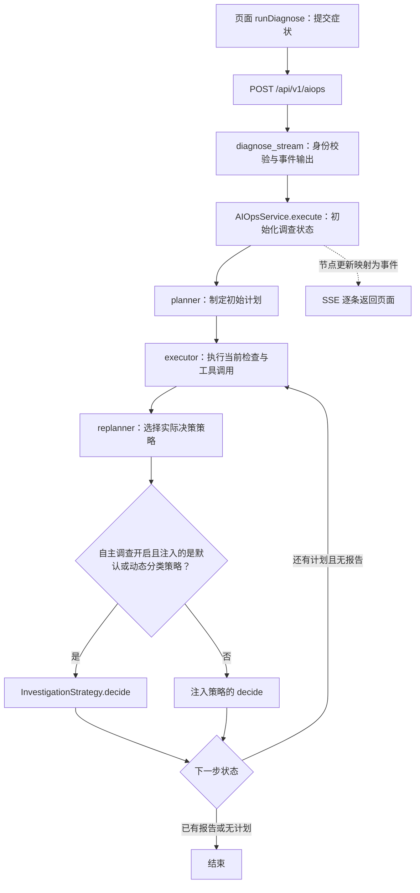

# 第 1 天：从页面找到真正执行的诊断策略

核对日期：2026-10-20。对应[毕设路线阶段 A](undergraduate-aiops-roadmap-20261020.md)。今天只带读和核对源码，不修改业务逻辑。

2026-10-22 更新：用户已复述主流程并要求转入开发；自主调查已有[首轮机制接入](aiops-investigation-mechanisms-20261022.md)。下文保留 10 月 20 日的源码快照说明和行号，关于旧动态分类被绕过的分支仍需与当前调查机制分开理解，不能再据此推断当前调查没有新机制。

**今天的目标：你能沿着代码找到请求入口、图的装配和最终策略分支，解释为什么打开动态分类开关不等于创新点已经参与现场调查。**

进度：调用链与带读材料已准备；你的理解等待本页最后三题确认。阶段 A 的历史运行带读、离线基线和机制接入尚未在本次完成。

## 一、先把五个词换成你能理解的话

| 代码里的词 | 今天只需要理解到这个程度 |
| --- | --- |
| API / 接口 | 页面把症状发给后端的入口，负责接收请求和验证身份 |
| state / 状态 | 一次调查携带的数据，如症状、计划、已执行步骤、证据和报告 |
| graph / 图 | 规定哪些函数先运行、之后走哪个分支；这里不是知识图谱 |
| node / 节点 | 图里承担一项工作的函数，如制定计划、执行检查、重新决策 |
| strategy / 策略 | 根据当前状态决定下一步检查或结束的实现 |

`async def` 定义异步函数，`await` 等待异步操作的结果并允许事件循环处理其他工作；它不表示这一行自动并行。SSE 是后端逐条传回事件的方式，页面据此显示进度。今天先认出它们，不展开学习整个异步框架。

## 二、当前源码的简化调用图



图中省略审批、暂停恢复、异常分支；结束条件按 HITL 关闭的普通流程表示。并非每次运行都会完成全部节点：例如已经形成报告时，replanner 有提前返回分支。默认后端 API_PREFIX 是 `/api/v1`，前端 URL 当前也使用此前缀；这里没有检查正在运行的服务配置。

## 三、你今天亲自打开的三处核心入口

以下行号以核对当天源码为准。后续改代码可能移动行号，优先按函数名搜索。路径从项目根目录起算。

### 入口 1：症状怎样进入后端

打开 `src/api/routers/aiops.py`，找到 `diagnose_stream`（第 41 行）和第 71—75 行的调用：

```python
async for event in aiops_service.execute(
    user_input=request.query, session_id=session_id,
    user_id=current_user.id,
    terminal_enabled=request.terminal_enabled,
):
```

你输入的文字在请求中叫 `query`，传给服务时叫 `user_input`。这段代码把请求交给诊断服务，再逐条接收事件；具体诊断策略还没有在这里决定。

从页面往前核对：`frontend/src/views/AIOps.vue` 第 661 行的 `runDiagnose` 在第 673 行调用 `streamSSE`，发送 `query`、`session_id`、`terminal_enabled`。`frontend/src/utils/chat.js` 第 16 行的 `getAiopsStreamUrl` 返回 `/api/v1/aiops`；`frontend/src/utils/sse.js` 第 19—25 行通过 fetch 发起 POST。后端 `src/main.py` 第 263 行挂载路由，`src/settings.py` 第 11 行给出默认前缀。

### 入口 2：图怎样把工作串起来

打开 `src/agent/aiops/graph.py`：

- `_build_graph`（第 151 行）装配图；第 154—156 行注册 planner、executor、replanner。
- 第 206—207 行设置从 planner 开始，随后进入 executor。
- `execute`（第 309 行）开始一次调查；第 348 行构造初始状态，其中 `input` 来自 `user_input`。
- `_stream_events` 中第 276 行调用图的 `astream`；服务把节点更新转成页面可接收的事件。

今天最需要理解的是初始化状态中的这一行（第 354 行）：

```python
"autonomous_investigation": terminal_enabled or settings.PROBE_ENABLED,
```

`or` 表示任意一个为真，结果就为真。这里的 terminal_enabled 已在第 324 行与服务端 TERMCP_ENABLED 合并判断；API 还会拒绝请求开启但服务端未启用的终端功能。因此，不应只看页面复选框就判断自主调查是否开启。**只要 PROBE_ENABLED 为真，这个状态值就为真，即使页面终端开关关闭。**本次没有读取凭据文件，也没有据此宣称当前运行服务的 Probe 配置一定开启。

### 入口 3：最终到底调用哪个策略

打开 `src/agent/aiops/replanner.py`，先读 `create_replanner`，再读第 40—48 行：

```python
if state.get("autonomous_investigation") and isinstance(
    _strategy, (DefaultReplanStrategy, DynamicClassificationStrategy)
):
    from src.agent.aiops.strategies.investigation import InvestigationStrategy
    return await InvestigationStrategy().decide(state)
# 中间还有恢复策略 checkpoint 的处理
update = await _strategy.decide(state)
```

`_strategy` 是装配图时传进来的策略对象。`isinstance` 检查它属于哪类策略；`return` 表示直接返回，因此命中自主调查分支后，不会继续执行下面 `_strategy.decide(state)`。第 36—37 行还有“报告与 diagnosis 都已存在”时提前返回的判断，推理时也需要留意。

你可以用下面的表手动推演；假定没有命中前面的报告提前返回，且注入对象确实是表中的类型：

| 状态 autonomous_investigation | 装配时注入的对象 | replanner 最终委托 |
| --- | --- | --- |
| False | DefaultReplanStrategy | DefaultReplanStrategy.decide |
| False | DynamicClassificationStrategy | DynamicClassificationStrategy.decide |
| True | DefaultReplanStrategy | InvestigationStrategy.decide |
| True | DynamicClassificationStrategy | InvestigationStrategy.decide |

其他自定义注入策略需要按实际类型判断，不能把这个表扩大成“自主调查无条件替换所有策略”。

## 四、这和你的毕设创新有什么关系

旧动态分类链路在 `strategies/dynamic_classification.py` 中使用 HypothesisManager、EvidenceJudge；其 `decide` 从第 613 行开始，矛盾触发调度分支在第 775 行附近。保护状态及消耗位于 `core/hypothesis.py`。这些短路径均相对 `src/agent/aiops/`。

自主调查命中上述分支时，执行的是 `strategies/investigation.py` 第 571 行的 `InvestigationStrategy.decide`，随后进入第 601 行的 `decide_from_evidence`。该文件有矛盾记录和证据校验；这些能力的存在，不能直接证明旧动态分类中的假设保护和显式矛盾改向规则已接入这里。

因此，当前可以由源码确认的是：**指定条件下 replanner 会绕过 DynamicClassificationStrategy.decide；仅打开 ENABLE_DYNAMIC_CLASSIFICATION 不足以证明两项创新参与现场调查。**这不是对整个系统诊断效果的实验结论。

也不要直接删除这段委托来“接入创新”。现有自主调查有现场证据与结论门槛，旧策略的领域假设与结束条件需要逐一核对。后续应让两项机制进入同一调查实现，并保留结论门槛，才能做四组开关实验；今天不做这个改动。

## 五、今天的一小时怎样用

| 时间 | 你亲自做什么 | 留下什么结果 |
| --- | --- | --- |
| 0—10 分钟 | 看简化图，用自己的话解释 API、图、策略 | 三句自己的解释 |
| 10—30 分钟 | 按顺序打开 API、graph、replanner；找到上述函数 | 标出 query → user_input → input |
| 30—50 分钟 | 不运行系统，手算两组配置：Probe 关/终端关、Probe 开/终端关；假设注入动态分类 | 写出自主调查状态和最终 decide |
| 50—60 分钟 | 关掉说明，回答下面三题 | 回复答案和仍不理解的一处 |

今天的动手是沿源码找变量、手算分支，不需要改配置、启动服务或发起模型请求。可在编辑器全局搜索函数名；如果行号变化，以实际代码为准。

## 六、验收题：用你自己的话回答

1. 页面输入的症状进入后端后，在哪个函数交给诊断服务？请求字段、服务参数、初始状态字段分别叫什么？
2. 假设 Probe 开启、页面终端关闭，装配图时注入动态分类策略，且没有已有报告提前返回：replanner 最终调用谁的 decide？请指出决定答案的两处代码。
3. 为什么“打开动态分类开关”还不能证明论文中的假设保护和矛盾触发参与了真实调查？接下来应该追查哪一层，而不是只检查页面展示？

回答不完整时先补对应概念，不把材料生成视为你已掌握。下一次从 `PlanExecuteState` 和一个节点返回的状态更新入手，再结合真实历史事件理解 async/await 与 SSE。

## 七、本次核对的边界

本页基于当前工作树静态源码核对；代码本身已有多处修改，不代表一个已提交的固定版本。本次只新增带读文档并为路线加入入口，校验文档引用文件和关键代码位置；没有执行业务测试、端到端诊断、服务启动、故障注入或付费调用。既有报告和测试结果不算本次验证结果。
