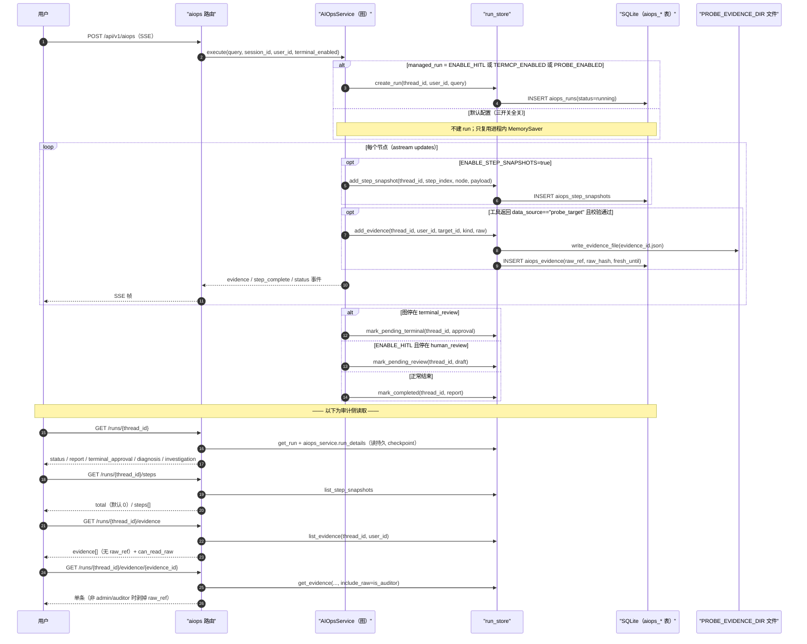
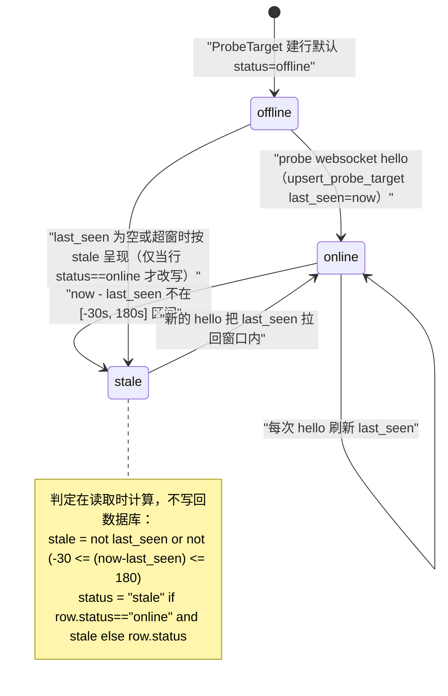

# aiops-audit · 运行记录 / 证据 / 审计 / 探针

- 模块：`aiops-audit`，前缀 `AUDIT`
- 基线提交：`bf789d9e4fff51b7a2c0b661046f9e5c72b6e483`（`main`，2026-11-11）
- 上游依据：`requirements/project-card.md`（业务对象与决定 D1–D10）、`requirements/_conventions.md`（ID/三态/证据规则）
- 本模块**只**负责：诊断跑完之后能被查到的那些东西——`aiops_runs` 运行记录、`aiops_approvals` 审批记录、`aiops_step_snapshots` 步快照、`aiops_evidence` 证据台账与原始证据文件、`probe_targets`/`probe_snapshots` 探针注册与基线、以及读这些数据的 7 个 HTTP 端点中的 6 个（`/runs/{id}`、`/steps`、`/evidence`、`/evidence/{eid}`、`/targets/{id}/status`、`/continue` 的状态判定）。
- 本模块**不**负责：诊断怎么跑（见 `requirements/modules/aiops-diagnosis.md`）、模型判定规则、chat/RAG 链路。
- 三态提示：本文严格区分「已实现（代码里有）」「已启用（默认配置下真的会跑）」「已验证（有文档记录的实测）」。**默认配置下本模块大部分能力实际上是空的**——见 §3。

---

## 0. 一句话

诊断跑完后，运维和审计要能回答四个问题：这次跑出了什么结论（运行记录）、结论引用了哪些现场证据（证据台账）、每一步发生了什么（步快照）、现场探针现在是活的还是死的（探针状态）。当前实现里，前两个在默认配置下**不落库**，第三个**默认不采集**，只有第四个的部分字段可用。

---

## 1. 流程

### 1.1 FLOW-AUDIT：运行记录 / 证据 / 步快照的写入与读取

### 1.2 探针目标状态生命周期（`/targets/{target_id}/status` 的取值来源）

---

## 2. 需求正文

### REQ-AUDIT-001 运行记录只在受管运行时落库

**用户预期**：每次诊断都能事后查到"谁在什么时候问了什么、跑出什么结论"。

**系统实际处理**：

1. `managed_run = settings.ENABLE_HITL or settings.TERMCP_ENABLED or settings.PROBE_ENABLED`（`src/agent/aiops/graph.py:348`）。
2. 为真时：`run_store.create_run(unique_session, user_id, user_input)`（`src/agent/aiops/graph.py:353`），写 `aiops_runs`，并按节点把状态推进到 `pending_review` / `pending_terminal` / `completed` / `failed`。
3. 为假时：直接复用 `self.graph`（`MemorySaver`，`src/agent/aiops/graph.py:106`），**不写任何 run 行**。

**用户实际看到**：默认配置（三开关全 `False`，`src/settings.py:187`、`:213`、`:220`）下，拿 SSE 流里的 `thread_id` 去 `GET /api/v1/aiops/runs/{thread_id}` 得到 **404「诊断不存在」**（`src/api/routers/aiops.py:127-128`）。这不是 bug，是"没建记录"。

**三态**：已实现 是；已启用 **否（默认配置）**；已验证 是（`docs/aiops-goal-handover-20261108.md:18` 记录 15 轮受管运行时"刷新可读、同轮次重启可读"）。

**basis**：observed　**锚点**：`src/agent/aiops/graph.py:348-353`、`src/api/routers/aiops.py:123-129`、`src/settings.py:187`

---

### REQ-AUDIT-002 运行状态有 7 个，但两处文档只写 6 个

**用户预期**：状态机在多处文档里一致，能照着做状态判断。

**系统实际处理**：代码里有 7 个状态常量：

| 常量 | 值 | 何时写入 | 写入方 |
|---|---|---|---|
| `STATUS_RUNNING` | `running` | `create_run` | `src/agent/aiops/run_store.py:75-87` |
| `STATUS_PENDING_REVIEW` | `pending_review` | `mark_pending_review` | `src/agent/aiops/run_store.py:90-91`，由 `src/agent/aiops/graph.py:413`、`:525` 调用 |
| `STATUS_PENDING_TERMINAL` | `pending_terminal` | `mark_pending_terminal` | `src/agent/aiops/run_store.py:94-95`，由 `src/agent/aiops/graph.py:398`、`:512` 调用 |
| `STATUS_APPROVED` | `approved` | `mark_approved` | **无调用方** |
| `STATUS_REJECTED` | `rejected` | `mark_rejected` | **无调用方** |
| `STATUS_COMPLETED` | `completed` | `mark_completed` | `src/agent/aiops/graph.py:422`、`:530` |
| `STATUS_FAILED` | `failed` | `mark_failed` | `src/agent/aiops/graph.py:325`、`:431`、`:438`、`:494`、`:538`、`:544` |

`models.py` 的列注释只列 6 个（漏 `pending_terminal`，`src/database/models.py:276`），`run_store.py` 模块 docstring 也只列 6 个（`src/agent/aiops/run_store.py:3`），`docs/aiops-run-store.md:23` 同样漏。

**用户实际看到**：`GET /runs/{id}` 的 `status` 可能出现文档里没写的 `pending_terminal`；`approved` / `rejected` 永远不出现。

**三态**：已实现 是（7 个常量）；已启用 部分（5 个可达，2 个不可达）；已验证 是（`docs/aiops-events.md:78` 记录了失败链路写 `failed`）。

**basis**：observed　**锚点**：`src/agent/aiops/run_store.py:25-31`、`src/database/models.py:276`、`docs/aiops-run-store.md:23`

---

### REQ-AUDIT-003 看运行详情时，checkpoint 的归属校验在路由层完成

**用户预期**：别人不能通过猜 `thread_id` 看到我的诊断结论。

**系统实际处理**：

1. `_owned_run(thread_id, user)`（`src/api/routers/aiops.py:123-129`）先做 `re.fullmatch(r"[A-Za-z0-9_.-]{1,64}", thread_id)`，不匹配 → **400「thread_id 非法」**；再 `run_store.get_run(thread_id)`，`run` 为空或 `run.user_id != user.id` → **404「诊断不存在」**（不区分"不存在"与"不是你的"，不泄露存在性）。
2. 通过后才调 `await aiops_service.run_details(thread_id)` 读持久 checkpoint（`src/api/routers/aiops.py:142`），返回 `diagnosis` / `investigation` / `investigation_failure`。
3. `run_details` 自己的 docstring 明写："Caller must check run ownership before reading its checkpoint"（`src/agent/aiops/graph.py:141`）——**归属校验完全依赖调用方**，函数内部不校验。

**用户实际看到**：非法 `thread_id`（含中文、空格、`/`）→ 400；别人的 `thread_id` → 404，与不存在的 id 表现完全一致。

**三态**：已实现 是；已启用 是（但默认配置下恒 404，因为根本没建 run）；已验证 是（`requirements/project-card.md` 场景 C）。

**basis**：observed　**锚点**：`src/api/routers/aiops.py:123-143`、`src/agent/aiops/graph.py:140-146`

---

### REQ-AUDIT-004 步级快照端点存在，但默认配置下 `total` 恒为 0

**用户预期**：点进一次诊断，能看到"第 0 步 planner 生成了什么计划、第 1 步 executor 跑了什么工具"。

**系统实际处理**：

1. 只有 `settings.ENABLE_STEP_SNAPSHOTS` 为真时，`_stream_events` 才在每节点后写 `aiops_step_snapshots`（`src/agent/aiops/graph.py:292-296`）。
2. 开关默认 `False`（`src/settings.py:154`，注释写明"False=不写（默认,零开销）"）。
3. 读取端点 `GET /runs/{thread_id}/steps` 无条件返回 `{"thread_id", "total": len(steps), "steps": steps}`（`src/api/routers/aiops.py:180-181`），docstring 明写"未开启或无记录时返回空列表"（`:174-178`）。

**用户实际看到**：**HTTP 200 + `{"total": 0, "steps": []}`**。端点活着，数据没有——"端点存在 ≠ 数据存在"。`docs/aiops-goal-handover-20261108.md:179` 记的就是 `/steps` 未启用（`total: 0`）。

**三态**：已实现 是；已启用 **否（默认）**；已验证 是（15 轮实测 `total: 0`）。

**basis**：observed　**锚点**：`src/settings.py:154`、`src/agent/aiops/graph.py:292-296`、`src/api/routers/aiops.py:169-181`、`docs/aiops-run-store.md:47`

---

### REQ-AUDIT-005 证据台账按用户过滤，列表里不给原始文件引用

**用户预期**：报告说"引用了 7 条现场证据"，我能逐条看到脱敏摘要和新鲜度。

**系统实际处理**：

1. `GET /runs/{thread_id}/evidence`：`_owned_run` 后 `run_store.list_evidence(thread_id, current_user.id)`（`src/api/routers/aiops.py:188`），而 `list_evidence` 在 `user_id is not None` 时追加 `AiopsEvidence.user_id == user_id` 过滤（`src/agent/aiops/run_store.py:249-250`）。
2. 每条行返回 `evidence_id` / `thread_id` / `target_id` / `source` / `kind` / `collected_at` / `summary`（脱敏摘要，落库时截 4000 字）/ `raw_hash` / `fresh` / `raw_available`，**不含 `raw_ref`**（`src/agent/aiops/run_store.py:251-255`）。
3. `fresh` 由 `fresh_until > now` 实时计算（`src/agent/aiops/run_store.py:254`），`fresh_until = collected_at + ttl_seconds`，默认 `ttl_seconds=180`（`src/agent/aiops/run_store.py:223`、`:238`）。
4. 响应顶层带 `can_read_raw`（`src/api/routers/aiops.py:190`）。

**用户实际看到**：只看到自己那次诊断的证据；每条有「新鲜 / 过期不可用」徽标（`frontend/src/views/AIOps.vue:413`）；列表 JSON 里**没有** `raw_ref` 字段。

**三态**：已实现 是；已启用 是（但需 `PROBE_ENABLED=true` 才真有证据产生）；已验证 是（`docs/aiops-goal-handover-20261108.md:179` 记录"普通用户 can_read_raw=false"）。

**basis**：observed　**锚点**：`src/api/routers/aiops.py:184-190`、`src/agent/aiops/run_store.py:245-257`

---

### REQ-AUDIT-006 原始证据引用只给 admin / auditor

**用户预期**：普通运维看脱敏摘要就够；审计/管理员才需要原始文件引用。

**系统实际处理**：

1. `is_auditor = getattr(current_user, "role", "user") in {"admin", "auditor"}`（`src/api/routers/aiops.py:198`）。
2. `run_store.get_evidence(..., include_raw=is_auditor)`（`:199`）：为真时把原始 JSON 读出来塞进 `result["raw"]`（`src/agent/aiops/run_store.py:274-278`），读失败则 `raw = None`（不抛错）。
3. 非 auditor 再 `row.pop("raw_ref", None)`（`src/api/routers/aiops.py:204-205`），注释写明"Raw file paths remain hidden from normal operators"。

**注意**：角色注释只写 `# admin, user, editor`（`src/database/models.py:14`），**`auditor` 不在注释里**，但代码判定集合包含它。前端按钮 `v-if="canReadRaw && item.raw_available"`、「查看现场证据（脱敏）」（`frontend/src/views/AIOps.vue:415`）。

**用户实际看到**：普通用户响应里无 `raw_ref`、无 `raw`；admin/auditor 响应里有 `raw_ref` 与 `raw`，且 `raw` 里的敏感字段已被替换为 `[REDACTED]`（脱敏发生在写入时，`src/agent/aiops/run_store.py:227`）。

**三态**：已实现 是；已启用 是；已验证 是（`frontend/src/views/AIOps.test.js:253-281` 用 mock 覆盖了 auditor 与非 auditor 两条路径）。

**basis**：observed　**锚点**：`src/api/routers/aiops.py:193-206`、`src/agent/aiops/run_store.py:260-281`、`src/database/models.py:14`

---

### REQ-AUDIT-007 读原始证据文件有一整套护栏

**用户预期**：即使给了"读原始证据"的能力，也不能被用来读任意文件。

**系统实际处理**（`src/agent/aiops/evidence_reader.py`）：

| 护栏 | 触发结果 | 锚点 |
|---|---|---|
| `evidence_id` 必须匹配 `ev-[A-Za-z0-9]{16,80}` | `ValueError('invalid evidence identity')` | `src/agent/aiops/evidence_reader.py:13-15` |
| `offset`/`limit` 必须是 int，`offset >= 0`，`1 <= limit <= 16384` | `ValueError('invalid evidence page')` | `src/agent/aiops/evidence_reader.py:16-17` |
| `query` 长度 ≤ 256 | `ValueError('invalid literal query')` | `src/agent/aiops/evidence_reader.py:19` |
| run 不属于该 user，或该证据无 `raw_ref` | `PermissionError('evidence unavailable for this run')` | `src/agent/aiops/evidence_reader.py:44-47` |
| 路径是符号链接 / 父级带 reparse point / 不在 `PROBE_EVIDENCE_DIR` 下 / 文件名不等于 `{evidence_id}.json` / 超过 1 MB | `PermissionError('unsafe evidence reference')` | `src/agent/aiops/evidence_reader.py:50-53` |
| Windows 用 `GetFinalPathNameByHandle` 复核真实打开路径，不一致 | `PermissionError('opened evidence escaped storage')` | `src/agent/aiops/evidence_reader.py:55-64` |
| 实际读到超过 1 MB | `ValueError('evidence exceeds stored size limit')` | `src/agent/aiops/evidence_reader.py:67` |
| `target_id` / `source=windows_probe` / `data_source=probe_target` / `platform=windows` / `operation==kind` / `collected_at` / `raw_hash` 双重比对任一不符 | `ValueError('evidence integrity check failed')` | `src/agent/aiops/evidence_reader.py:69-75` |

返回值额外带 `new_observation: False`（`src/agent/aiops/evidence_reader.py:79`）——**读旧证据不算新观测**，避免模型把回读当成本轮采集。

**用户实际看到**：这些错误不映射成 HTTP 状态码，只在工具调用层以异常/失败返回（`evidence_read_tool`，`src/agent/aiops/evidence_reader.py:82-87`）。HTTP 侧只有 RULE-AUDIT 的 400/404。

**三态**：已实现 是；已启用 是（`read_run_evidence` 被注册为 `read_run_evidence` 工具，`src/agent/aiops/planner.py:324-325`）；已验证 未见于文档。

**basis**：observed　**锚点**：`src/agent/aiops/evidence_reader.py:1-87`

---

### REQ-AUDIT-008 探针状态：只有登记过的那台机器能查，新鲜度窗口是 [-30s, 180s]

**用户预期**：看到现场采集端现在是活着还是掉线了。

**系统实际处理**：

1. `GET /targets/{target_id}/status`（`src/api/routers/aiops.py:209-218`）：`target_id` 不匹配 `[A-Za-z0-9_.-]{1,128}` → **400「target_id 非法」**；不等于 `settings.PROBE_TARGET_ID` → **404「目标不存在」**；`get_probe_target` 返回空 → **404「目标尚未注册」**。
2. `get_probe_target`（`src/agent/aiops/run_store.py:284-297`）实时算 `stale = not last_seen or not -30 <= (now - last_seen).total_seconds() <= 180`；`status = "stale" if row.status == "online" and stale else row.status`。
3. 登记发生在探针 websocket `hello` 时：`upsert_probe_target(...)`（`mcp_servers/probe_gateway.py:78`、`:100`、`:118`），只存 hello 摘要，注释写明"Secrets are deliberately not persisted"（`src/database/models.py:315`）。

**用户实际看到**：前端证据源卡片显示该 target 的状态；「刷新证据状态」按钮重新拉一次（`frontend/src/views/AIOps.vue:395-397`）。探针没起过 → 404「目标尚未注册」；起过但掉线 → `status` 为 `stale` 或 `offline`。

**三态**：已实现 是；已启用 **否（`PROBE_ENABLED=false` 时不展示该证据源，见 REQ-AUDIT-009 的说明）**；已验证 是（`requirements/project-card.md` 场景 C）。

**basis**：observed　**锚点**：`src/api/routers/aiops.py:209-218`、`src/agent/aiops/run_store.py:284-297`、`src/database/models.py:314-328`

---

### REQ-AUDIT-009 审计面上的四个空洞

**用户预期**：审计应该能回答"谁批的、花了多少、断线后能重放吗"。

**系统实际处理**（逐条）：

| 空洞 | 事实 | 锚点 |
|---|---|---|
| 审批记录永不写入 | `aiops_approvals` 表与 `add_approval()` 都有，但**全仓无调用方**；`mark_approved`/`mark_rejected` 同样无调用方 | `src/agent/aiops/run_store.py:98-131`、`src/database/models.py:285-296` |
| HITL 无 HTTP 审批端点 | 7 个 aiops 路由里没有任何 approve/reject 路由 | `src/api/routers/aiops.py:40-218` |
| HITL 挂起无超时 | `HITL_TTL_SECONDS=600` 在 `src/` 下无读取点 | `src/settings.py:188-189` |
| 费用不落库 | `usage` 只随 SSE 帧一次性推出，不写表；前端也不渲染 | `src/api/routers/aiops.py:113-116`、`frontend/src/views/AIOps.vue:715-792` |
| 不能断线续传 | 无 `Last-Event-ID` 游标，不能从第 k 步重放；文档列为"未做（展望）" | `docs/aiops-run-store.md:55` |
| `degraded` 列恒空 | `aiops_runs.degraded` 只有建表定义，`src/` 下无写入方 | `src/database/models.py:280` |

**用户实际看到**：`approved` / `rejected` 状态不可达；刷新页面后已经跑完的诊断只能靠 `localStorage.aiops_last_thread` 找回（`frontend/src/views/AIOps.vue:857`），换浏览器/换设备就丢；SSE 断了只能重新诊断（要再付费一次）。

**三态**：已实现 **否**（前 3 项是缺能力，不是开关问题）；已启用 否；已验证 是（`specs/questions.md` Q-13/Q-27 已记录）。

**basis**：observed　**锚点**：`src/agent/aiops/run_store.py:98-131`、`src/settings.py:189`、`docs/aiops-run-store.md:55`、`src/database/models.py:280`

---

### REQ-AUDIT-010 数据保留：探针基线 24 小时，证据文件不自动清理

**用户预期**：知道哪些数据会自己消失、哪些会一直留着。

**系统实际处理**：

1. `probe_snapshots`：写入时 `expires_at = collected_at + timedelta(hours=24)`，且写入前顺手删掉已过期的行（`src/agent/aiops/run_store.py:313-320`）；读取时只取 `expires_at > now`（`src/agent/aiops/run_store.py:331`）。模型 docstring 写作 "Bounded baseline payload retained for 24 hours."（`src/database/models.py:332`）。
2. `aiops_evidence` 行与 `PROBE_EVIDENCE_DIR` 下的原始文件：**没有任何清理逻辑**；`fresh_until` 只影响读取时 `fresh` 的布尔值，不触发删除。
3. `aiops_runs` / `aiops_step_snapshots`：同样无清理逻辑。
4. `probe_snapshots` 的读取入口在探针网关侧还额外夹了 `limit=min(limit, 10)`（`mcp_servers/probe_gateway.py:287`），`run_store.list_probe_snapshots` 自身夹在 `max(1, min(limit, 100))`（`src/agent/aiops/run_store.py:332`）。

**用户实际看到**：探针基线超过 24 小时查不到；证据文件随时间累积在 `data/aiops-evidence/` 下（`src/settings.py:225`）。

**三态**：已实现 是（24h 保留）；已启用 是；已验证 未见于文档。

**basis**：observed　**锚点**：`src/agent/aiops/run_store.py:300-339`、`src/database/models.py:331-343`、`src/settings.py:225`

---

## 3. 三态汇总

| 能力 | 已实现 | 已启用（默认） | 已验证 |
|---|---|---|---|
| 运行记录落 `aiops_runs` | 是 | **否** —— 需 `ENABLE_HITL`/`TERMCP_ENABLED`/`PROBE_ENABLED` 任一为真 | 是（15 轮受管运行） |
| 运行状态 7 个常量 | 是 | 部分（5 个可达，`approved`/`rejected` 无写入方） | 是 |
| `GET /runs/{id}` 归属校验 | 是 | 是（但默认配置下恒 404） | 是 |
| `GET /runs/{id}` 读 checkpoint 详情 | 是 | 是（同上，依赖受管运行） | 是 |
| `GET /runs/{id}/steps` 步快照 | 是 | **否** —— `ENABLE_STEP_SNAPSHOTS=false` | 是（实测 `total: 0`） |
| `GET /runs/{id}/evidence` 证据台账 | 是 | 部分（需 `PROBE_ENABLED=true` 才真有证据） | 是 |
| 证据列表剥除 `raw_ref` | 是 | 是 | 是 |
| 原始证据仅 admin/auditor | 是 | 是 | 是（前端单测覆盖两条路径） |
| 原始证据文件读取护栏 | 是 | 是 | 未见于文档 |
| `GET /targets/{id}/status` | 是 | 部分（需探针起过） | 是 |
| 探针新鲜度 [-30s, 180s] | 是 | 是 | 是 |
| 探针基线 24h 保留 | 是 | 是 | 未见于文档 |
| HITL 审批记录写入 | **否** —— 表与函数在，无调用方 | 否 | — |
| HITL 超时自愈 | **否** —— `HITL_TTL_SECONDS` 无消费者 | 否 | — |
| 费用落库/展示 | **否** —— 只在 SSE 推一次 | 否 | — |
| 断线续传 / 从第 k 步重放 | **否** —— 无 `Last-Event-ID` | 否 | — |
| `aiops_runs.degraded` 列 | 是（建表） | **否** —— 无写入方 | — |

---

## 4. 未决与缺口

1. **`approved` / `rejected` 状态不可达**：`mark_approved`/`mark_rejected` 与 `add_approval` 都是死代码。用户可观察表现：状态永远停在 `pending_review` / `pending_terminal`。是否要补审批端点未定，建议 `specs/questions.md` Q-31。
2. **`HITL_TTL_SECONDS` 无消费者**（`src/settings.py:189`）：注释承诺"超时自动落库为'已出草稿、未人工确认'"，代码没有实现。用户可观察表现：挂起永久保留。→ Q-13。
3. **`models.py` / `run_store.py` / `aiops-run-store.md` 三处状态机都漏 `pending_terminal`**。→ Q-18。
4. **`docs/aiops-run-store.md:23` 说"仅 `ENABLE_HITL=true` 时创建 run"，与代码三开关不一致**：属文档陈旧，不是实现缺陷。建议 Q-32。
5. **`auditor` 角色不在 `models.py` 的角色注释里**（`src/database/models.py:14` 只写 `admin, user, editor`）：属注释遗漏，代码判定包含。建议 Q-35。
6. **`aiops_runs.degraded` 列无写入方**（`src/database/models.py:280`）：列存在但恒 NULL，是历史遗留还是待实现，未核实。
7. **证据与 run 无清理机制**：`data/aiops-evidence/` 与 `aiops_evidence` 行永久累积。是否要加保留策略未定。
8. **`/steps` 端点存在但默认无数据**（`src/api/routers/aiops.py:169-181`）：这属于"开关默认关闭导致的能力缺席"，不应当在资料里写成"步快照可用"。→ Q-28。
9. **`/continue` 只处理 Termcp、不处理 HITL**：审计视角下这意味着"平台内无法完成人工审批闭环"。→ Q-33。
10. **探针网关无 `__main__`/`uvicorn.run`**（`mcp_servers/probe_gateway.py` 全文件）：必须外部启动，`/targets/{id}/status` 的数据来源因此可能整段为空。已在 `requirements/overview.md:112-127` 记录。

---

## 5. 参考锚点清单

- 路由（6 个审计相关端点）：`src/api/routers/aiops.py:123-129`、`:132-143`、`:146-166`、`:169-181`、`:184-190`、`:193-206`、`:209-218`
- 认证与角色：`src/api/dependencies.py:12-37`、`src/database/models.py:14`
- run_store 写入：`src/agent/aiops/run_store.py:25-31`、`:59-72`、`:75-87`、`:90-95`、`:98-111`、`:114-131`
- run_store 读取：`src/agent/aiops/run_store.py:134-143`、`:151-200`
- 证据台账：`src/agent/aiops/run_store.py:223-242`、`:245-257`、`:260-281`
- 探针：`src/agent/aiops/run_store.py:203-220`、`:284-297`、`:300-310`、`:313-323`、`:326-339`；`mcp_servers/probe_gateway.py:25-36`、`:47-67`、`:77-118`、`:287`、`:316-324`
- 表定义：`src/database/models.py:267-363`
- 原始证据读取护栏：`src/agent/aiops/evidence_reader.py:13-19`、`:28-35`、`:38-79`、`:82-87`
- 证据存储层：`src/probe/storage.py:7-45`、`src/probe/protocol.py:58-62`、`:114`
- 前端消费：`frontend/src/views/AIOps.vue:392-420`、`:622-670`、`:856-890`、`frontend/src/utils/chat.js:16-21`
- 文档：`docs/aiops-run-store.md:6`、`:15`、`:23`、`:41-49`、`:55`、`docs/aiops-events.md:10-14`、`:71-74`、`:78`、`docs/aiops-goal-handover-20261108.md:26-39`、`:159-180`
- 配置：`src/settings.py:154`、`:187`、`:189`、`:213`、`:217`、`:220`、`:221`、`:225`
