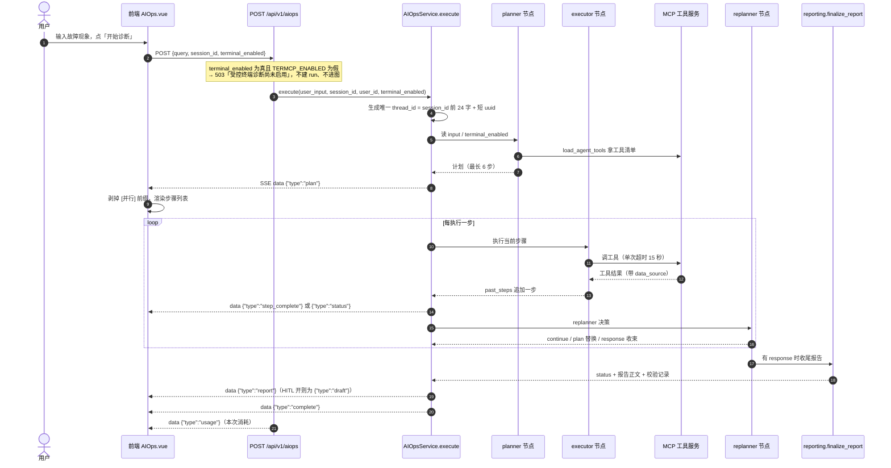
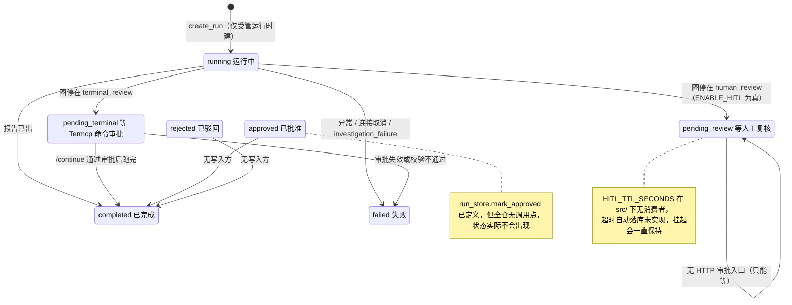
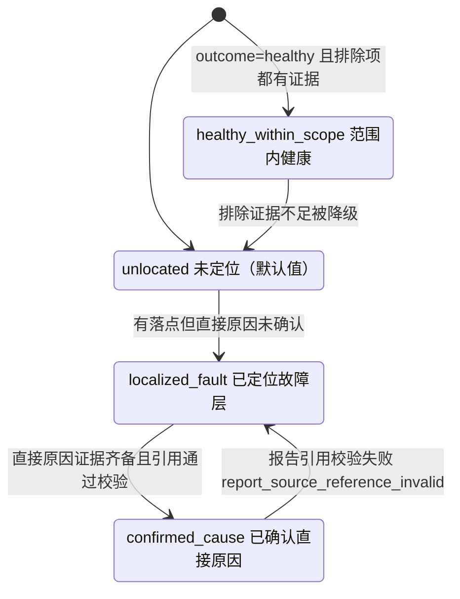

# aiops-diagnosis · AIOps 诊断链路（需求正文）

- 模块：`aiops-diagnosis`（AIOps 诊断链路），需求前缀 `DIAG`
- 基线提交：`bf789d9e4fff51b7a2c0b661046f9e5c72b6e483`（`main`，2026-11-11）
- 上游：`requirements/project-card.md`（D1/D2/D3/D9 决定、对象模型、场景 B）、`requirements/overview.md`（模块职责表、五条链路状态）、`requirements/_conventions.md`
- 本模块**只**负责：用户提交故障现象 → Plan-Execute-Replan 图执行 → SSE 事件推送 → 生成带证据引用的诊断报告，以及图内的策略收束、报告校验、工具加载与降级、受控终端与人工复核这两处挂起。
- **不负责**（见 `requirements/modules/aiops-audit.md`）：运行记录的读接口、证据台账与原始引用权限、步级快照、探针注册状态。
- 三态（已实现 / 已启用 / 已验证）逐条标注。本模块最容易混淆的两处先说清：
  1. **诊断链路已实现且默认可用**，但"运行记录、跨重启恢复、人工复核、受控终端、Windows 探针"五类能力**默认全部关闭**，只有把 `ENABLE_HITL` / `TERMCP_ENABLED` / `PROBE_ENABLED` 任一打开才进入"受管运行"（`src/agent/aiops/graph.py:348`）。默认配置下诊断**不可跨重启恢复**（`src/agent/aiops/graph.py:106`）。
  2. **"已实现"不等于"已验证"**：唯一真实运行证据是 15 轮付费诊断，10 轮通过 / 5 轮未通过，且官方文档明确"修复后可稳定复现**不成立**"（`docs/aiops-goal-handover-20261108.md:159-163`）。

---

## 0. 一句话

用户在 AIOps 页输入"接口报错，下游超时"，点一次「开始诊断」，页面就开始一行行吐进度：先出计划，再逐步显示"步骤完成 (2/5)"，中间可能插一条"继续执行剩余步骤，旁开支线 1 条"，最后给一份带"关键事实及引用"的诊断报告。**全程是一条 SSE 流**；报告里每条处置建议都必须挂着证据引用，引用对不上就降级成一段保守说明，而不是崩掉。

---

## 1. 流程 FLOW-DIAG（诊断提交 → 图执行 → SSE → 报告）

要点（每句都有锚点）：

- 入口只有一个：`POST /api/v1/aiops`，响应是 SSE 流（`src/api/routers/aiops.py:40-44`、`:120`）。
- 帧格式固定 `{"event": "message", "data": "<JSON 字符串>"}`，**真实事件类型在 `data.type` 里**（`src/api/routers/aiops.py:76-79`）。
- 遇到 `type=="complete"` 或 `type=="error"` 就结束本次流（`src/api/routers/aiops.py:80-85`），随后补一帧 `usage`（`src/api/routers/aiops.py:113-116`）。
- 每次诊断的 `thread_id` 都是新的：`f"{session_id[:24]}-{uuid4().hex}"`（`src/agent/aiops/graph.py:345`）。同一个 `session_id` 连续诊断两次不会互相覆盖。
- 报告不一定走 `report`：`ENABLE_HITL=true` 时 replanner 出的是**草稿**事件 `draft`，不是 `report`（`src/agent/aiops/graph.py:588-595`）。

---

## 2. 状态图

### 2.1 run 状态机（7 个状态，写入方只有 5 个）

- 常量共 7 个：`running / pending_review / pending_terminal / approved / rejected / completed / failed`（`src/agent/aiops/run_store.py:25-31`）。
- 真正会写状态的调用点只有：`create_run`、`mark_pending_terminal`、`mark_pending_review`、`mark_completed`、`mark_failed`（`src/agent/aiops/graph.py:353`、`:398`、`:413`、`:422`、`:325/431/438/494/538/544`）。
- `mark_approved` / `mark_rejected` / `add_approval` 在 `src/` 下**没有任何调用点**（定义见 `src/agent/aiops/run_store.py:98-131`）→ 审批表 `aiops_approvals` 永远为空，`approved` / `rejected` 两个状态不可达。
- 表注释只写了 6 个状态，漏 `pending_terminal`（`src/database/models.py:276` 对照 `src/agent/aiops/run_store.py:27`）——已列入 `specs/questions.md` Q-18。

### 2.2 结论层级（conclusion_level，与 outcome 是两个字段）

- 四个取值就是 `Literal['confirmed_cause','localized_fault','healthy_within_scope','unlocated']`，默认 `unlocated`（`src/agent/aiops/strategies/investigation.py:110`）。
- 它与 `outcome`（`investigating / root_cause / healthy`，`src/agent/aiops/strategies/investigation.py:109`）**不是一回事**：`outcome` 是调查意图，`conclusion_level` 是能被报告消费的结论等级。
- 空壳终态会被显式拒绝并回退：`_EMPTY_TERMINAL_CLAIM` 命中时清空 `root_cause` / `root_cause_code`，并把 `outcome` / `conclusion_level` 打回 `investigating` / `unlocated`（`src/agent/aiops/strategies/investigation.py:3844-3851`）。

---

## 3. 需求正文

### REQ-DIAG-001 一个 SSE 端点、三个字段的提交契约

**角色**：core-flow

**用户预期**：我只写一句故障现象就能开始诊断，不用填一堆参数；进度要边跑边出来。

**入口与前提**
- 端点：`POST /api/v1/aiops`（`src/api/routers/aiops.py:40-44`，前缀由 `src/main.py:263` 挂成 `/api/v1/aiops`）。
- 需要登录态：`current_user: User = Depends(get_current_user)`（`src/api/routers/aiops.py:43`）。

**字段校验（三个字段，全部可选除 query）**

| 字段 | 类型 | 默认 | 校验位置与后果 |
|---|---|---|---|
| `query` | `str` | 必填 | **声明层无任何长度/非空校验**（`src/api/routers/aiops.py:35`） |
| `session_id` | `str \| None` | `None` → 取 `"default"` | `src/api/routers/aiops.py:54` |
| `terminal_enabled` | `bool` | `False` | 为真且 `TERMCP_ENABLED=False` → **503「受控终端诊断尚未启用」**（`src/api/routers/aiops.py:55-56`） |

- 空 `query` 的拦截在**图层**，不在路由层：`make_error_event("诊断输入不能为空,请描述当前遇到的故障现象", stage="validation_error")`，两处（`src/agent/aiops/graph.py:341-343`、`:364-369`）。此时**不建 run、不调模型**。
- 因此"空串"这个错误只表现为流里的一条 `error` 事件，HTTP 状态仍是 200。

**正常操作与反馈**：SSE 帧逐条到达，前端按 `data.type` 渲染（`frontend/src/views/AIOps.vue:715-792`）。

**异常与恢复**
- 流内未捕获异常 → `{"type":"error","stage":"exception","message":"诊断异常: …"}`（`src/api/routers/aiops.py:86-94`）。
- 客户端断开（`AbortError`）→ 前端把状态行改成「诊断已取消」（`frontend/src/views/AIOps.vue:816-819`）；后端在 `CancelledError / GeneratorExit` 且 run 仍处于 `running`/`approved` 时把 run 标为 failed，错误文案「诊断连接已取消，已停止选择后续检查」（`src/agent/aiops/graph.py:427-434`）。
- **不做断线续传**：事件流没有 `Last-Event-ID` 游标，也不能从第 k 步重放（`docs/aiops-run-store.md:55`）。

**权限**：任意登录用户都能提交诊断；没有配额、没有并发上限，只打指标 `AIOPS_ACTIVE_DIAGNOSES`（`src/api/routers/aiops.py:58`）。

**数据影响**：默认配置下**不写 `aiops_runs`、不写 checkpoint 文件**（见 REQ-DIAG-010）。受管运行才落库。

**可观察结果**：Network 面板里一条 `text/event-stream` 请求，帧形如 `event: message` + `data: {"type":"plan",…}`。

**版本条件**：无开关即可用。

**三态**：已实现、已启用、已验证（15 轮真实诊断均从该端点进入，`docs/aiops-goal-handover-20261108.md:48-64`）。

**basis**：`observed`　**锚点**：`src/api/routers/aiops.py:32-56,76-94`、`src/agent/aiops/graph.py:341-345,364-369,427-434`、`frontend/src/views/AIOps.vue:816-819`

---

### REQ-DIAG-002 事件契约：实际 11 种，文档只写 5 种（文档缺陷）

**角色**：experience

**用户预期**：页面上该出现的东西都要出现——不是只有"计划/步骤/报告"三种。

**事件全集（11 种）**

| # | `data.type` | 来源 | 何时出现 | 关键字段 |
|---|---|---|---|---|
| 1 | `plan` | `events.py` | planner 出计划 | `plan[]` |
| 2 | `step_complete` | `events.py` | executor 完成一步 | `done`/`total`/`current_step`/`remaining_steps` |
| 3 | `status` | `events.py` | 节点内的中间提示 | `stage`/`role`/`message` |
| 4 | `draft` | `events.py` | `ENABLE_HITL=true` 且 replanner 出稿 | `report` |
| 5 | `report` | `events.py` | 出正式报告 | `report`/`diagnosis`/`investigation` |
| 6 | `pending_review` | `events.py` | HITL 挂起 | `thread_id`/`draft` |
| 7 | `complete` | `events.py` | 正常结束 | `response` + 4 个元数据数组 |
| 8 | `error` | `events.py` | 任意阶段失败 | `stage`/`message` |
| 9 | `evidence` | `events.py` | 每采到一条现场证据 | `evidence_id`/`kind`/`fresh` |
| 10 | `usage` | **路由层直出** | 流结束前 | `llm_calls`/`input_tokens`/`output_tokens`/`cost_cny_estimated`/`elapsed_s` |
| 11 | `pending_terminal_approval` | **graph 层直出** | Termcp 命令待审批 | `thread_id`/`request_id`/`command`/`expires_at`/`termcp_ui_url` |

- 1–9 是 `events.py` 定义的 9 个常量（`src/agent/aiops/events.py:66-74`、`:76-86`）。
- 第 10 种不走 events.py：由路由在 finally 里直接 yield（`src/api/routers/aiops.py:113-116`），字段来自 `as_dict()`（`src/utils/token_meter.py:132-141`）。
- 第 11 种由 `graph.execute` 在终态判定时直接 yield（`src/agent/aiops/graph.py:396-407`）。
- **文档缺陷一**：路由 docstring 只列了 `plan / step_complete / report / complete / error` 5 种（`src/api/routers/aiops.py:45-53`），漏 `status / draft / pending_review / evidence / usage / pending_terminal_approval` 6 种。
- **文档缺陷二**：`docs/aiops-events.md` 的事件目录表只有 8 行，**没有 `evidence` 行**（`docs/aiops-events.md:18-27`）。
- **契约红线**：JSON 字段必须与历史版本逐字段兼容，新增字段必须可选（`docs/aiops-events.md:6`）。改字段要同步 `events.py` + 本文档 + `tests/test_aiops_events.py` + 全量离线测试（`docs/aiops-events.md:80-83`）。
- `complete` 的四个元数据数组缺省为 `[]`（`make_complete_event`，`src/agent/aiops/events.py:282-309`）。

**用户实际看到**：前端 `handleEvent` 只写了 8 个 `case`（plan/step_complete/status/report/complete/evidence/error/pending_terminal_approval），**没有 `draft` 和 `pending_review` 两个分支**，落到 `default: break` 被静默忽略（`frontend/src/views/AIOps.vue:715-792`）。另：`usage` 帧前端也不渲染（`frontend/src/views/AIOps.vue` 全文无 `usage`/`cost_cny` 消费点）。

**异常与恢复**：`error` 事件会清掉挂起卡，但 `resume_conflict` / `terminal_approval_invalid` 两个 stage 例外——保留挂起卡，让用户重试（`frontend/src/views/AIOps.vue:775-778`）。

**版本条件**：`draft` / `pending_review` 只在 `ENABLE_HITL=true` 时出现（且 `state` 里没有 `investigation_failure`，`src/agent/aiops/graph.py:590`）；`pending_terminal_approval` 只在 `TERMCP_ENABLED=true` 且命中终端命令时出现；`evidence` 只在真采到现场证据时出现。

**三态**：11 种事件**已实现**；默认配置下实际会出现的是 7 种（plan / step_complete / status / report / complete / error / usage）；`draft`、`pending_review`、`pending_terminal_approval`、`evidence` 默认不出现。

**basis**：`observed`　**锚点**：`src/agent/aiops/events.py:66-86,282-309,316-320`、`src/api/routers/aiops.py:45-53,113-116`、`src/agent/aiops/graph.py:396-407`、`docs/aiops-events.md:6,18-27,80-83`、`frontend/src/views/AIOps.vue:715-792`

---

### REQ-DIAG-003 图结构：5 个节点、1 条固定边、2 处条件分叉

**角色**：core-flow

**用户预期**：诊断要能"想一步、做一步、再想想"，而不是照脚本走完。

**节点与边**

| 元素 | 事实 | 锚点 |
|---|---|---|
| 节点常量 | `planner` / `executor` / `replanner` / `human_review` / `terminal_review` | `src/agent/aiops/graph.py:55-59` |
| 入口 | `set_entry_point(NODE_PLANNER)` | `src/agent/aiops/graph.py:213` |
| **固定边** | `planner → executor`（不判断、不分叉） | `src/agent/aiops/graph.py:214` |
| 执行后分叉 | 有 `terminal_approval` → `terminal_review`，否则 → `replanner` | `src/agent/aiops/graph.py:216-217` |
| 终端复核出边 | `terminal_rejected` 为真 → END，否则回 `replanner` | `src/agent/aiops/graph.py:224-228` |
| replanner 出边（`ENABLE_HITL=true`） | `investigation_failure`→END；`response`→`human_review`；`plan`→`executor`；否则 END | `src/agent/aiops/graph.py:230-254` |
| replanner 出边（`ENABLE_HITL=false`） | `response`→END；`plan`→`executor`；否则 END（**不经过 human_review**） | `src/agent/aiops/graph.py:255-268` |
| 人工复核出边 | `response` 非空 → END，否则回 `executor` | `src/agent/aiops/graph.py:242-243` |

**执行与分段续跑**：`graph.astream(input, config, stream_mode="updates", interrupt_after=[NODE_REPLANNER])`（`src/agent/aiops/graph.py:285-287`）——**每跑完一个 replanner 就"断"一次**，外层再续跑，这样每个节点都能单独出 SSE 事件；`__interrupt__` 伪节点被跳过（`src/agent/aiops/graph.py:289-290`）。

**状态字段的两个必须知道的坑**
- `past_steps` 与 `raw_evidence` 用 `operator.add` 追加，因此 `src/agent/aiops/state.py` **文件头部明确禁止加 `from __future__ import annotations`**——一加，Annotated 元数据被字符串化，追加就退化成覆盖（`src/agent/aiops/state.py:3-6`）。
- `response` 非空即触发图结束（`src/agent/aiops/state.py:13-78`）。

**用户实际看到**：计划列表 → 逐个步骤打勾 → 报告。若 replanner 决定旁开，会先出现一条 `status`「继续执行剩余步骤，旁开支线 N 条」（`src/agent/aiops/graph.py:596-603`）。

**三态**：已实现、已启用（默认走 `ENABLE_HITL=false` 分支，4 个节点参与）、已验证（15 轮真实诊断即该图）。

**basis**：`observed`　**锚点**：`src/agent/aiops/graph.py:55-59,158-269,285-290`、`src/agent/aiops/state.py:3-6,13-78`

---

### REQ-DIAG-004 计划生成：6 步硬上限、目标未核实不出计划、异常兜底 3 步

**角色**：functional

**用户预期**：计划要短、能执行、别写一堆我系统里根本没有的服务名。

**三条确定性规则（不依赖模型质量）**

1. **上限 6 步**：`_MAX_PLAN_STEPS = 6`（`src/agent/aiops/planner.py:39`），超长直接截断并 warning（`src/agent/aiops/planner.py:392-394`）。注释写明该值与动态分类策略的 `_MAX_STEPS` 匹配，防止计划过长导致"步数上限强制收束"时首选假设还没收敛。
2. **业务目标未唯一核实就不调模型**：`resolve_target` 返回 `ambiguous` / `unmatched` / `invalid_catalog` 时，直接返回空计划 + 一句话「业务目标尚未唯一核实，请明确选择已登记的服务或入口；候选：…」+ `diagnosis(kind='unlocated')`（`src/agent/aiops/planner.py:364-370`）。这条路**不花模型费**。
3. **模型异常兜底 3 步**：`logger.exception("[planner] 生成计划失败,用默认计划")` 后返回固定三步「收集相关指标和日志 / 分析数据定位问题 / 生成诊断报告」（`src/agent/aiops/planner.py:408-418`）。

**其它已核实行为**
- 提示词硬约束：不超过 6 步、禁止写工具名与参数、禁止写死臆造标识符、`[并行]` 前缀表示可并发采集、只读 Probe 无任意配置文件读取能力（`src/agent/aiops/planner.py:229-284`）。
- 计划清洗：命中 `config_file_read_unavailable` 时拦截"读配置文件"计划，若有 `probe_text_log` 工具则改写成"检查已登记服务的应用日志"（`src/agent/aiops/planner.py:41-55`）。
- 计划生成用 `temperature=0`（`src/agent/aiops/planner.py:380-385`）。
- `PROBE_ENABLED=true` 时 planner 会**确定性先行**调 `probe_inventory` / `probe_list_evidence` 各一次（各 15s 超时），把结果当上下文（`src/agent/aiops/planner.py:332-359`）。

**用户实际看到**：`plan` 事件里最多 6 条；前端把 `[并行]` 前缀剥掉转成小标签（`frontend/src/views/AIOps.vue:718-730`）。

**三态**：已实现、已启用、已验证（15 轮均走 planner）。

**basis**：`observed`　**锚点**：`src/agent/aiops/planner.py:39,41-55,229-284,332-359,364-370,380-394,408-418`

---

### REQ-DIAG-005 什么时候停：两套阈值，且"自主调查"模式下步数上限不生效

**角色**：product-details

**用户预期**：别一直查下去；有谱了就出报告。

**默认策略（`DefaultReplanStrategy`）**

| 常量 | 值 | 作用 | 锚点 |
|---|---|---|---|
| `MAX_STEPS` | 8 | 已执行 ≥8 步 → 强制收束出报告 | `src/agent/aiops/strategies/default.py:20,197-199` |
| `NO_REPLAN_AFTER` | 5 | 已执行 ≥5 步 → 禁止 replan，只能 continue/respond | `src/agent/aiops/strategies/default.py:21,225-226` |

提示词里也会把这条禁令写成一行强提示：`⚠️ 已执行 {done} 步 >= {no_replan_after}, 禁止 replan, 只能 continue 或 respond`（`src/agent/aiops/strategies/default.py:120-121`）。策略自身异常时只是「评估失败，继续原计划」返回 `{}`（`src/agent/aiops/strategies/default.py:238-240`），不中断诊断。

**动态分类策略（`ENABLE_DYNAMIC_CLASSIFICATION=true` 时启用）**

| 常量 | 值 | 锚点 |
|---|---|---|
| `_MAX_STEPS` | 12（绝对兜底） | `src/agent/aiops/strategies/dynamic_classification.py:49` |
| `_RESPOND_THRESHOLD` | 0.70 | `src/agent/aiops/strategies/dynamic_classification.py:39` |
| `_MIN_GAP_FOR_RESPOND` | 0.20 | `src/agent/aiops/strategies/dynamic_classification.py:41` |

**关键限制（容易误读）**：两套上限都带 `and not autonomous_investigation` 条件（`src/agent/aiops/strategies/default.py:197`、`src/agent/aiops/strategies/dynamic_classification.py:708`）。而 `autonomous_investigation = terminal_enabled or settings.PROBE_ENABLED`（`src/agent/aiops/graph.py:372-383`）。**也就是说：打开 `PROBE_ENABLED` 或启用终端后，8 步/12 步上限都不再生效**，什么时候收束完全由调查策略自己决定。

**异常与恢复**：调查策略的失败分支会把 `investigation_failure` 写进状态并停止（code ∈ `model_output_truncated` / `invalid_model_decision` / `evaluation_budget_exceeded` / `model_request_failed`，`src/agent/aiops/strategies/investigation.py:3756-3799`）；非可重试异常**直接上抛**，不掩盖编程/配置错误（`src/agent/aiops/strategies/investigation.py:3789-3790`）。

**用户实际看到**：`investigation_failure` 存在时，链路是 `report → error(stage=investigation_failed)`，**没有 `complete`**（`docs/aiops-events.md:78`）。这与"正常跑完但没定位到"（`conclusion_level=unlocated` 但 `status=completed`）是两件事，`state.py` 里专门注释了这点（`src/agent/aiops/state.py:13-78`）。

**三态**：已实现、已启用（默认策略生效）、已验证（真实轮次模型调用 9–17 次，`docs/aiops-goal-handover-20261108.md:48-64`）。

**basis**：`observed`　**锚点**：`src/agent/aiops/strategies/default.py:20-21,120-121,197-226,238-240`、`src/agent/aiops/strategies/dynamic_classification.py:39-49,708`、`src/agent/aiops/graph.py:372-383`、`src/agent/aiops/strategies/investigation.py:3756-3799`

---

### REQ-DIAG-006 报告必须挂证据引用，引用对不上就降级（不崩溃）

**角色**：functional

**用户预期**：报告里"建议你改下游端口"这种话，得能点回原始证据；对不上就别硬编。

**契约版本**：`VERSION = 1`、`MODEL_CONTRACT = 'core-facts-v1'`（`src/agent/aiops/reporting.py:21-22`）；8 个"直接原因码"（`src/agent/aiops/reporting.py:24-26`）。

**强制证据引用校验（三道）**

| 校验 | 规则 | 失败错误码 | 锚点 |
|---|---|---|---|
| 引用存在性 | `findings` / `advice`（`confirmed_cause` 时还包括 `evidence`）每条 `evidence_id` 必须在本次 evidence 记录里，`quote` 非空且**是该证据 payload 的子串** | `report_source_reference_invalid` | `src/agent/aiops/reporting.py:138-145` |
| core ⊆ facts | 核心事实必须来自事实集 | `report_core_reference_invalid` | `src/agent/aiops/reporting.py:265` |
| 布局四组 | `focus_object_ids` / `fact_order` / `explanation_ids` / `action_order` 各自去重、不得含外来 ID，且顺序约束（后续动作不能排在优先级动作之前） | `report_core_order_missing_duplicate_or_foreign_id` / `report_layout_missing_duplicate_or_foreign_id` / `report_followup_before_priority_action` | `src/agent/aiops/reporting.py:276,287,295` |

**失败后的行为——这是本需求最容易被误传的一点**

- 不是抛异常、不是 500、不是空报告。`finalize_report` 捕获 `ValueError` 后：
  - `record['status'] = 'failed'`、`record['fallback_reason'] = 'report_source_reference_invalid'`；
  - 报告正文整段换成「报告证据核验未通过，不能可靠整理处置建议。调查原结果和证据保留在详情，需核对引用后再处理。」；
  - 流照常以 `complete` 结束（`src/agent/aiops/reporting.py:403-405`）。
- 其它两种 `fallback_reason`：`investigation_incomplete_or_not_localized`（`src/agent/aiops/reporting.py:418-419`）；`healthy_within_scope` 则追加"影响范围/处理建议/复测方法"三段固定文案（`src/agent/aiops/reporting.py:414-417`）。

**报告正文的固定分段**：关键事实及引用 / 证据支持的解释 / 人工处理建议（明写"待人工核对，尚未执行；不作为根因证明"）/ 剩余未知 / 校验提示 / 停止原因（`src/agent/aiops/reporting.py:299-365`）。

**数据影响**：`record['report_sha256']` 落到 `aiops_runs.report`（`src/agent/aiops/reporting.py:420-421`、`src/agent/aiops/run_store.py:106-107`）。

**可观察结果**：报告首行是「诊断结论（已确认直接原因）：…」或「已定位故障层：…」（`src/agent/aiops/reporting.py:299-365`）。

**三态**：已实现、已启用、**未在真实轮次中触发过降级**（15 轮均正常出报告，`docs/aiops-goal-handover-20261108.md:48-64`）→ 该降级分支只能靠构造坏引用验证。

**basis**：`observed`　**锚点**：`src/agent/aiops/reporting.py:21-26,133-145,265-296,299-365,384-422`

---

### REQ-DIAG-007 判定枚举：4 个字段的取值集合是硬约束

**角色**：product-details

**用户预期**：报告说"已确认直接原因"就得是确认过的，不能是模型自己觉得。

**四个字段**

| 字段 | 取值 | 锚点 |
|---|---|---|
| `Alternative.status` | `supported` / `excluded` / `unavailable` / `unresolved` | `src/agent/aiops/strategies/investigation.py:45` |
| `root_cause_code` | `''` / `configured_downstream_endpoint_mismatch` / `downstream_stopped_after_request` / `configuration_value_rejected` | `src/agent/aiops/strategies/investigation.py:99-101` |
| `outcome` | `investigating` / `root_cause` / `healthy` | `src/agent/aiops/strategies/investigation.py:109` |
| `conclusion_level` | `confirmed_cause` / `localized_fault` / `healthy_within_scope` / `unlocated` | `src/agent/aiops/strategies/investigation.py:110` |

**配套的可判定条件**（不是自由文本）：`_PREDICTION_CONTRACT` 规定了"有限预期"的合法组合——`dependency_probe`/`tcp` 的期望值只能是 `ok` 或 `failed`（**不是 `success`**）、http 状态码 100–599、服务状态只能是 `running/stopped/paused/start_pending/stop_pending`、`listening`/`process_present` 是布尔（`src/agent/aiops/strategies/investigation.py:60-68`）。

**三个已修的判定缺陷（真实轮次暴露，均已回放验证）**

1. 模型写的"待核实说明"（`contradictions`）曾被当成一票否决 → 改为只让**系统派生**的两类真实冲突参与判定（`docs/aiops-goal-handover-20261108.md:74-83`，修复 `9f1e5e1`）。
2. 结论已完整时策略仍抢排检查 + 末轮空壳提议被接受 → 新增 `_EMPTY_TERMINAL_CLAIM` 先拒绝空壳（`src/agent/aiops/strategies/investigation.py:3409`、`docs/aiops-goal-handover-20261108.md:85-94`，修复 `2f8c24d`）。
3. 同一绑定规则查两遍（一处放行一处否决）+ 模型把收束说明写进 `next_check` 被当成"检查提议缺字段" → 修法见 `docs/aiops-goal-handover-20261108.md:96-107`（修复 `6da5cf8`）。

**还有两次是模型侧失误，故意不修**：候选 id 配错导致 `unlocated`（044）、未核实解释标成 `critical` 导致 `localized_fault`（050）（`docs/aiops-goal-handover-20261108.md:114-155`）。

**改判定逻辑前的强制门禁**：先跑 `python -m pytest -q tests/test_recorded_round_replay.py`，零模型调用、约 2 秒（`docs/aiops-goal-handover-20261108.md:186-200`）；CI 步骤名 `Decision-rule gate (recorded paid rounds must not regress)`（`.github/workflows/tests.yml:46-47`）。

**三态**：枚举**已实现**；判定链路已启用；**"稳定产出正确结论"未验证**——分阶段口径为 全部 15 轮 10/15、修复一后 7/11、修复二后 6/9、修复三后 0/1（`docs/aiops-goal-handover-20261108.md:161-163`）。

**basis**：`observed`　**锚点**：`src/agent/aiops/strategies/investigation.py:43-68,99-110,3409,3756-3799`、`docs/aiops-goal-handover-20261108.md:74-107,114-163,186-200`、`.github/workflows/tests.yml:46-47`

---

### REQ-DIAG-008 工具加载：MCP 两层降级 + 探测工具互斥

**角色**：functional

**用户预期**：某个工具服务没起来，别的还能用；缺了哪一项要让我知道，别装作查过了。

**两层降级**（`src/agent/mcp_client.py:85-134`）
1. 先整体加载（10s 超时，`src/agent/mcp_client.py:36`）。
2. 整体失败 → `logger.warning("整体加载 MCP 工具失败，降级为逐服务加载: …")`（`src/agent/mcp_client.py:108`）→ **逐服务独立加载**（每服务 10s）→ 重置客户端。
3. 部分成功 → 返回成功工具 + 错误串 `部分服务不可用: <名单>`（`src/agent/mcp_client.py:129`）。
4. 全部失败 → 返回空列表 + `全部 MCP 服务不可用: <名单|无配置>`（`src/agent/mcp_client.py:132`），**不抛异常**。

设计动机写在 `src/agent/mcp_client.py:1-12`（超时/错误处理/失败重置只在这一个文件）与 `:91-94`（知识库服务是可选的，它没起来不该把指标/日志工具一起拖下水）。

**执行器层还有一层**：30s 工具清单缓存（`src/agent/aiops/executor.py:88,139`）；单工具 15s 超时（`src/agent/aiops/executor.py:91`），超时文案「工具 '<name>' 调用超时(>15.0s)，请检查该服务是否正常运行」（`src/agent/aiops/executor.py:268`）；**部分工具可用时保留可用工具**、只 warning（`src/agent/aiops/executor.py:146-148`）；工具不存在 → `status='unavailable', reason='tool_not_loaded'`（`src/agent/aiops/executor.py:235`）；异常只暴露 `type(e).__name__`（`src/agent/aiops/executor.py:174-179`）。

**互斥规则（安全边界）**
- `PROBE_ENABLED=true` 时**主动移除**四个原生网络探测工具 `check_website` / `check_ports` / `check_service_health` / `check_api_endpoint`（`src/agent/aiops/tools.py:108-112`）。
- 启用 Termcp 时同样移除这四个（`src/agent/aiops/tools.py:117-119`）。注释写明原因：这些工具接受任意主机，甚至能发业务 POST（`src/agent/aiops/tools.py:114-116`）。

**无工具时的诚实性约束**：`executor` 会注入一段提示，要求声明"基于通用运维经验"、不编造数值（`src/agent/aiops/executor.py:81-86`）；system 提示第 9 条"数据来源诚实性"要求只按工具返回的 `data_source` 判真伪，`mock`/`unavailable` 必须如实说"未取得真实数据"、不得据此下根因（`src/agent/aiops/executor.py:63-68`）。

**三态**：已实现、已启用、已验证（降级路径未在真实轮次中成为主路径）。

**basis**：`observed`　**锚点**：`src/agent/mcp_client.py:1-12,36,85-134`、`src/agent/aiops/tools.py:94-132`、`src/agent/aiops/executor.py:63-91,139-148,174-179,235,268`

---

### REQ-DIAG-009 证据来源可用性：6+1 个来源、7 种状态、缺了就写在报告里

**角色**：experience

**用户预期**：这次诊断到底有没有真实指标和日志？缺哪一项要说出来，别让我以为"查过了没事"。

**动机（模块 docstring 原话）**：某 MCP 服务没起来时诊断照跑，但报告看不出缺了什么，等于"静默失效"；要求"注册状态与实际调用结果分开；未核验不等于正常"（`src/agent/aiops/evidence_sources.py:1-11`）。

**6 个固定来源 + 1 个受限来源**

| key | 展示名 | 代表工具 | 锚点 |
|---|---|---|---|
| `metrics` | 指标(Prometheus) | `query_cpu_metrics` / `query_memory_metrics` | `src/agent/aiops/evidence_sources.py:17-29` |
| `logs` | 日志(Elasticsearch) | `search_log` / `search_topic_by_service_name` / `get_current_timestamp` | 同上 |
| `changes` | 变更/发布事件 | `search_changes` / `get_change_detail` | 同上 |
| `knowledge` | 知识库/经验检索 | `search_knowledge_base` / `list_knowledge_bases` / `get_document_info` | 同上 |
| `probe` | 站点/端口/接口探测 | `check_website` / `check_ports` / `check_service_health` / `check_api_endpoint` | 同上 |
| `host_probe` | Windows 主机 Probe | `probe_inventory` 等 10 个 `probe_*` | 同上 |
| `diagnostic` | 受限现场诊断 | `diagnostic_query` / `diagnostic_exec` 等 5 个 | `src/agent/aiops/evidence_sources.py:31-34` |

- `host_probe` 在 `PROBE_ENABLED=false` 时**直接跳过不展示**（`src/agent/aiops/evidence_sources.py:57-63`，注释：不要让它显示成"降级"）。
- `diagnostic` **只在工具实际加载时才出现**（`src/agent/aiops/evidence_sources.py:73-81`）。

**状态取值共 7 个**：`registered`（默认，未核验）/ `callable` / `unavailable` / `authentication_failed` / `permission_denied` / `stale` / `offline`（`src/agent/aiops/evidence_sources.py:49-97`）。映射规则按错误串关键字：含 `401/403/auth` → `authentication_failed`；含 `permission/access_denied/accessdenied` → `permission_denied`；含 `expired/stale` → `stale`；含 `offline/connection` → `offline`；成功 → `callable`；其它 → `unavailable`（`src/agent/aiops/evidence_sources.py:92-95`）。

**写进报告**：`format_availability_note` 渲染 `## 证据来源` 段落，未验证的显示「已注册（未核验）」（`src/agent/aiops/evidence_sources.py:118-126`）。executor 还会注入一段警告，要求"必须如实说明该项无真实数据，不得用通用经验顶替"（`src/agent/aiops/evidence_sources.py:105-115`）。

**知识库引用单独成段**：输出 `## 参考知识库`，并注明"以上内容仅用于排查方向参考，现场指标、日志和变更证据优先"（`src/agent/aiops/evidence_sources.py:129-176`）；只认 `data_source=='knowledge_base'` 的结果，正文截 1200 字、最多 6 条（`src/agent/aiops/evidence_sources.py:179-229`）。

**用户实际看到**：报告末尾的证据源卡片，每张带状态；`GET /evidence` 也可单独刷新（`frontend/src/views/AIOps.vue:392-397`）。

**三态**：已实现、已启用（默认配置下只有 metrics/logs/changes/knowledge 四个来源参与展示，probe 与 host_probe 都因开关关闭而不出现）。

**basis**：`observed`　**锚点**：`src/agent/aiops/evidence_sources.py:1-11,17-34,49-126,129-229`

---

### REQ-DIAG-010 持久化边界：默认配置下诊断不可跨重启恢复

**角色**：product-details

**用户预期**：刷新页面还能看到上次的诊断；重启服务后也应该还能查。

**实际边界（这是本模块最重要的实现状态说明）**

| 条件 | checkpointer | 是否建 `aiops_runs` | 刷新可读 | 跨重启可读 |
|---|---|---|---|---|
| **默认配置**（三个开关全关） | `MemorySaver()`（进程内） | **否** | 否（thread_id 只在本次流里） | **否** |
| `ENABLE_HITL` / `TERMCP_ENABLED` / `PROBE_ENABLED` 任一为真 | `AsyncSqliteSaver`，库 `data/aiops_checkpoints.sqlite` | 是 | 是 | 是 |

- 默认 saver：`self.checkpointer = MemorySaver()`（`src/agent/aiops/graph.py:106`）。
- 持久 saver：`AsyncSqliteSaver.from_conn_string(settings.AIOPS_CHECKPOINT_DB_PATH)` + `await setup()`，懒建、受锁保护（`src/agent/aiops/graph.py:148-156`）；路径来自 `src/settings.py:217`。
- 判定：`managed_run = settings.ENABLE_HITL or settings.TERMCP_ENABLED or settings.PROBE_ENABLED`（`src/agent/aiops/graph.py:348`）；为真才 `create_run` + 持久图（`src/agent/aiops/graph.py:349-353`），否则重置策略复用内存图（`src/agent/aiops/graph.py:354-359`）。
- 三个开关默认全 `False`：`ENABLE_HITL`（`src/settings.py:187`）、`TERMCP_ENABLED`（`src/settings.py:213`）、`PROBE_ENABLED`（`src/settings.py:220`）。

**由此产生的连带后果**
- 默认配置下 `GET /runs/{thread_id}` 一律 404「诊断不存在」（`src/api/routers/aiops.py:123-129`），因为表里没行。
- 审计端点（`/runs/{id}`、`/steps`、`/evidence`）在默认配置下都会大面积 404 → 这些端点的可用前提写在 `requirements/modules/aiops-audit.md`。

**文档冲突（已单列 `specs/questions.md` Q-15）**：`docs/aiops-run-store.md` 写"仅在 `ENABLE_HITL=true` 时创建（`create_run`）"，与代码 `managed_run` 三条件不一致（`docs/aiops-run-store.md:47` 对照 `src/agent/aiops/graph.py:348`）——文档陈旧，**代码为准**。

**三态**：受管运行路径已实现；默认未启用；已验证（15 轮验收在受管配置下做过"同轮次重启可读且零新增模型调用"，`docs/aiops-goal-handover-20261108.md:9-22`）。

**basis**：`observed`　**锚点**：`src/agent/aiops/graph.py:106,140-156,348-359`、`src/settings.py:187,213,217,220`、`docs/aiops-run-store.md:47`

---

### REQ-DIAG-011 人工复核（HITL）：能挂起，但没有 HTTP 审批入口，也没有超时

**角色**：functional

**用户预期**：报告草稿发给我看一眼，我点"同意"就定稿，点"驳回"并写意见就继续查。

**已实现的部分**
- 节点 `human_review`：`decision = interrupt({"type":"pending_review","draft": draft})`（`src/agent/aiops/human_review.py:32`）。
- `approve` → 返回 `{}`，图随后 END，草稿即报告（`src/agent/aiops/human_review.py:39-41`）。
- 其它动作 + `instruction` → 新计划为「根据人工反馈补充验证: {instruction}」，合并剩余步骤后**再截到 6 步**（`src/agent/aiops/human_review.py:45-50`）。
- 其它动作无 `instruction` → 兜底计划「补充更多诊断信息 / 交叉验证当前假设」（`src/agent/aiops/human_review.py:20,47`）。
- 挂起时 `run.status = pending_review`、`report` 字段存草稿（`src/agent/aiops/graph.py:410-416`）。

**三个硬缺口（必须写清，否则会误导验收）**

1. **没有 HTTP 审批端点**。`src/api/routers/aiops.py` 全文没有任何 `POST .../approve` 或 `POST .../reject`；唯一的 HTTP 恢复入口是 `/runs/{thread_id}/continue`，而它遇到 `pending_review` 直接 409「此诊断等待的不是 Termcp 命令审批」（`src/api/routers/aiops.py:157-158`）。
2. **`AiopsApproval` 表永远没有写入方**：`add_approval` 无调用点（`src/agent/aiops/run_store.py:114-131`），`mark_approved` / `mark_rejected` 也无调用点（`src/agent/aiops/run_store.py:98-103`）。
3. **`HITL_TTL_SECONDS = 600` 在 `src/` 下没有任何消费者**（声明见 `src/settings.py:189`，注释承诺"超时自动落库为'已出草稿、未人工确认'"）→ 挂起不会超时自愈，会一直保持 `pending_review`。

**前端表现**：`handleEvent` 没有 `pending_review` 分支（`frontend/src/views/AIOps.vue:715-792`），也没有审批卡片（`frontend/src/views/AIOps.vue` 里唯一的审批卡 `approval-card` 是给 Termcp 命令用的，绑定 `pendingApproval`，见 `:76-78`）。→ **打开 `ENABLE_HITL` 后，页面会停在"报告草稿已生成"之后什么也不发生**。

**恢复（仅测试脚本可用）**：`AIOpsService.resume(thread_id, decision)` 接受 `{"action":"approve"|"reject","instruction":null|str}`（`src/agent/aiops/graph.py:443-452,454-462`），并有 `_resume_locks` 防重复提交，重复时返回 `error(stage="resume_conflict")`「诊断正在续跑，请勿重复提交」（`src/agent/aiops/graph.py:446-449`）。

**版本条件**：只在 `ENABLE_HITL=true` 时进图（`src/agent/aiops/graph.py:230-254`）。

**三态**：已实现、**默认未启用**、未验证（15 轮验收未覆盖 HITL 分支）。

**basis**：`observed`　**锚点**：`src/agent/aiops/human_review.py:20-52`、`src/agent/aiops/graph.py:230-254,410-416,443-462`、`src/api/routers/aiops.py:146-166`、`src/agent/aiops/run_store.py:98-131`、`src/settings.py:187-189`、`frontend/src/views/AIOps.vue:76-78,715-792`

---

### REQ-DIAG-012 受控终端（Termcp）：前置拒绝、8 条审批校验、续跑只走 approve

**角色**：functional

**用户预期**：能让 Agent 在受控机器上跑一条只读命令，但每条命令都得我批。

**入口与前提**
- 请求体 `terminal_enabled=true`，且服务端 `TERMCP_ENABLED=true`；否则 **503「受控终端诊断尚未启用」**，前置拒绝、**不建 run、不进图**（`src/api/routers/aiops.py:55-56`）。
- 服务端还会再做一次与运算：`terminal_enabled = bool(terminal_enabled and settings.TERMCP_ENABLED)`（`src/agent/aiops/graph.py:347`）。
- 启用后 `autonomous_investigation` 也为真，走调查策略（`src/agent/aiops/graph.py:372-383`）。

**审批对象与工具白名单**
- 只允许 7 个工具：`session_start` / `session_list` / `shell_open` / `shell_list` / `shell_input` / `shell_key` / `shell_output`（`src/agent/aiops/termcp_tools.py:133`）。
- `shell_key` 只允许 `enter` / `return`，文案「Only Enter may submit a reviewed terminal command」（`src/agent/aiops/termcp_tools.py:133-221`）。
- `session_start` / `shell_open` 不允许带初始命令：`initial commands are disabled; use an individually approved shell command`（同上）。
- 写操作结果不确定时**直接停，不重试**：`TerminalProtocolError("Terminal write outcome is unknown; stopping without replay")`（同上）。

**挂起点**：`terminal_review` 节点 `interrupt({"type":"pending_terminal_approval","request_id","session_id","command","expires_at"})`（`src/agent/aiops/graph.py:167-173`）；此时 run 记 `pending_terminal`（`src/agent/aiops/graph.py:396-407`）。

**`verify_terminal_approval` 的 8 条校验**（`src/agent/aiops/termcp_tools.py:43-83`，docstring「Trust Termcp's stored decision, never a browser's claimed approval.」）

| # | 条件 | 失败结果 | 是否连带把 run 标 failed |
|---|---|---|---|
| 1 | `session_id` 形如 `^[A-Za-z0-9_-]{1,80}$` 且有 `request_id` | 409「审批关联信息无效，诊断已停止」 | 是（`terminal=True`） |
| 2 | 能取到 Termcp 审批接口（8s 超时） | 503「无法核验 Termcp 审批状态；请稍后重试」 | **否**（可重试） |
| 3 | 按 `id` 恰好匹配到 1 条 | 409「找不到唯一审批记录，诊断已停止」 | 是 |
| 4 | session/shell/命令文本/`keys==["enter"]`/`source=="mcp"` 全一致 | 409「审批命令与待执行命令不匹配，诊断已停止」 | 是 |
| 5 | `expires_at` 为整数且与本地记录一致 | 410「审批没有有效期限，诊断已停止」 | 是 |
| 6 | 状态仍 `pending` 且未过期 | 409「命令仍待 Termcp UI 审批」 | **否**（可重试） |
| 7 | 状态为 `approved` | 410「审批未通过或已过期，诊断已停止」 | 是 |
| 8 | `0 < resolved_at < expires_at` | 410「审批裁决时间无效，诊断已停止」 | 是 |

**恢复路径**：`POST /runs/{thread_id}/continue` → 仅当 `status == pending_terminal` → 先 `verify_terminal_approval` → decision 固定 `{"action":"approve"}` → SSE 续跑（`src/api/routers/aiops.py:146-166`）。校验抛 `TerminalApprovalStatusError` 且 `exc.terminal` 为真时，先 `mark_failed` 再把同样的状态码/details 抛给调用方（`src/api/routers/aiops.py:150-155`）。

**注意：`/continue` 没有 reject 语义**。它不读请求体，decision 写死为 approve（`src/api/routers/aiops.py:156`）——驳回只能发生在 Termcp UI 侧，之后由校验第 7 条兜住。

**用户实际看到**：审批卡显示待执行命令（`frontend/src/views/AIOps.vue:76-78`），"继续诊断"按钮走 `/continue`（`frontend/src/views/AIOps.vue:829-854`）；刷新后靠 `localStorage.aiops_pending_thread` + `GET /runs/{id}` 恢复审批卡（`frontend/src/views/AIOps.vue:856-890`）。

**审批通过后的证据形态**：执行结果被包装成 `data_source: "termcp_approved_target"`、`target_id = settings.TERMCP_SSH_PROFILE`（`src/agent/aiops/graph.py:183-195`）。

**版本条件**：`TERMCP_ENABLED=true`（`src/settings.py:213`），另需 Termcp UI（`TERMCP_UI_URL`，`src/settings.py:215`）与审批接口（`TERMCP_APPROVAL_API_URL`，`src/settings.py:214`）可用。

**三态**：已实现、**默认未启用**、未验证（15 轮验收未覆盖终端审批）。

**basis**：`observed`　**锚点**：`src/agent/aiops/termcp_tools.py:36-83,133-221`、`src/agent/aiops/graph.py:167-173,183-195,347,396-407`、`src/api/routers/aiops.py:55-56,146-166`、`src/settings.py:212-216`、`frontend/src/views/AIOps.vue:76-78,829-890`

---

### REQ-DIAG-013 本次消耗计量：后端一定会推，前端一定不显示

**角色**：product-details

**用户预期**：这次诊断花了多少钱、调了几次模型？

**实际行为**
- 每次诊断都在 finally 里推一帧 `usage`（`src/api/routers/aiops.py:103-116`），字段为 `llm_calls` / `input_tokens` / `output_tokens` / `total_tokens` / `by_model` / `cost_cny_estimated` / `count_errors` + 补一个 `elapsed_s`（`src/utils/token_meter.py:132-141`、`src/api/routers/aiops.py:107`）。
- 计量失败只 `logger.warning`，**不影响诊断结果**（`src/api/routers/aiops.py:117-118`）。
- **前端不渲染 `usage`**：`frontend/src/views/AIOps.vue` 全文没有 `usage` / `cost_cny` / `llm_calls` / `本次消耗` 的消费点，`handleEvent` 也没有对应 `case`（`frontend/src/views/AIOps.vue:715-792`）。→ 这个能力目前只对脚本/测试可见。
- 费用是**估算**：单价表 + 汇率折算（`src/utils/token_meter.py:23-29`）。真实付款口径不得引用文档里的"新增预留 9.611526 元"当账单（`docs/aiops-goal-handover-20261108.md:166-168`）。

**三态**：已实现、已启用、已验证（15 轮验收的 `product-model/cost.json` 即由该计量产出，`docs/aiops-goal-handover-20261108.md:26-39`）。

**basis**：`observed`　**锚点**：`src/api/routers/aiops.py:103-118`、`src/utils/token_meter.py:23-29,132-141`、`frontend/src/views/AIOps.vue:715-792`

---

## 4. 三态汇总（本模块）

| 能力 | 已实现 | 已启用 | 已验证 |
|---|---|---|---|
| `POST /api/v1/aiops` SSE 诊断主链路 | 是 | 是 | 是（15 轮真实诊断） |
| 11 种 SSE 事件 | 是 | 部分（默认 7 种会出现） | 否（`draft`/`pending_review`/`pending_terminal_approval` 未跑过） |
| 5 节点图 + replanner 分段续跑 | 是 | 是 | 是 |
| planner 6 步上限 / 3 步兜底 | 是 | 是 | 部分 |
| 默认策略 8 步 / 5 步禁 replan | 是 | 是 | 是 |
| 动态分类策略 12 步 / 0.70 / 0.20 | 是 | **否**（`ENABLE_DYNAMIC_CLASSIFICATION=false`） | 否 |
| `autonomous_investigation` 下步数上限失效 | 是（行为如此） | 仅 `PROBE_ENABLED`/Termcp 开时触发 | 部分 |
| 报告强制证据引用校验 + 降级 | 是 | 是 | **否**（15 轮未触发降级） |
| 判定枚举 4 字段硬约束 | 是 | 是 | 结论正确率 10/15 |
| MCP 两层降级 | 是 | 是 | 否 |
| `PROBE_ENABLED` 移除 4 个原生探测工具 | 是 | 随开关 | 否 |
| 证据来源可用性 7 状态 | 是 | 是（默认 4 个来源） | 否 |
| 受管运行（建 run + sqlite checkpoint） | 是 | **否**（三开关全关） | 是（在受管配置下跑过） |
| 默认配置跨重启恢复 | **否**（MemorySaver） | — | — |
| HITL 挂起 | 是 | **否** | 否 |
| HITL 审批（HTTP） | **否**（无端点、无写入方） | — | — |
| HITL 挂起超时（`HITL_TTL_SECONDS`） | **否**（无消费者） | — | — |
| Termcp 命令审批 8 条校验 | 是 | **否** | 否 |
| `/continue` 驳回语义 | **否**（decision 写死 approve） | — | — |
| 断线续传 / 从第 k 步重放 | **否** | — | — |
| `usage` 计量事件 | 是 | 是 | 是 |
| `usage` 前端展示 | **否** | — | — |
| `ENABLE_SUPERVISOR` 统一入口 | **否**（全仓仅 2 行配置） | — | — |

---

## 5. 未决与缺口（汇总到 `specs/questions.md`）

1. **`HITL_TTL_SECONDS` 无消费者**（`src/settings.py:189`）：注释承诺的"超时自动落库为已出草稿、未人工确认"没有实现。用户可观察：打开 `ENABLE_HITL` 后 run 永远停在 `pending_review`。→ Q-13。
2. **HITL 没有 HTTP 审批端点**（`src/api/routers/aiops.py` 全文无审批写入；`/continue` 对 `pending_review` 返回 409，`src/api/routers/aiops.py:157-158`）。→ Q-15 关联。
3. **`AiopsApproval` 表无写入方**（`src/agent/aiops/run_store.py:114-131` 无调用点）：`approved` / `rejected` 状态不可达。→ 新缺口，建议 Q-31。
4. **事件类型文档与实际不符**：路由 docstring 5 种（`src/api/routers/aiops.py:45-53`）vs 实际 11 种；`docs/aiops-events.md:18-27` 表缺 `evidence`。→ Q-16。
5. **`evidence` 事件不带 `raw_hash`**：`make_evidence_event` 收了这个参数但没写进事件体（`src/agent/aiops/events.py:316-320`）。→ Q-17。
6. **`models.py` 状态注释漏 `pending_terminal`**（`src/database/models.py:276` 对照 `src/agent/aiops/run_store.py:27`）。→ Q-18。
7. **`docs/aiops-run-store.md` 与代码冲突**：文档说"仅 `ENABLE_HITL=true` 时建 run"，代码是三开关任一（`docs/aiops-run-store.md:47` 对照 `src/agent/aiops/graph.py:348`）。→ 新缺口，建议 Q-32。
8. **默认配置不可跨重启恢复，且审计端点因此 404**（`src/agent/aiops/graph.py:106,348`）。→ Q-15。
9. **`/continue` 没有 reject 分支**（`src/api/routers/aiops.py:156` 写死 `{"action":"approve"}`）：Termcp 侧驳回后只能由校验第 7 条兜住，无法在平台内表达"我要驳回"。→ 新缺口，建议 Q-33。
10. **前端不渲染 `usage` 与 `draft`/`pending_review`**（`frontend/src/views/AIOps.vue:715-792`）：费用与 HITL 挂起在 UI 不可见。→ 新缺口，建议 Q-34。
11. **判定稳定性不成立**：分阶段 10/15、7/11、6/9、0/1（`docs/aiops-goal-handover-20261108.md:161-163`）。不得写成"稳定复现"。→ Q-25。
12. **费用口径**：9.611526 元是新增预留，不是账单（`docs/aiops-goal-handover-20261108.md:166-168`）。→ Q-26。
13. **原始 SSE 未留证**（`raw_sse_frames_persisted=false`，`docs/aiops-goal-handover-20261108.md:171-172`）：无法用 SSE 原文当验收证据。→ Q-27。
14. **模型可用性、Termcp/Probe 实机状态**：本轮全程只读静态核实，未联网、未调模型（`model_calls: 0`、`network_calls: 0`），一律 `unresolved`。
15. **`ENABLE_SUPERVISOR` 的 `/supervisor/chat` 端点未实现**（全仓仅 `src/settings.py:184-185` 两行；`src/main.py:255-265` 的 11 个 router 无 supervisor）。→ Q-14。

---

## 6. 参考锚点清单

- 端点与请求体：`src/api/routers/aiops.py:1-7,32-56,76-118`
- 恢复端点：`src/api/routers/aiops.py:146-166`
- 路由挂载：`src/main.py:263`
- 图装配与节点：`src/agent/aiops/graph.py:55-59,158-269,271-313`
- 图执行与终态：`src/agent/aiops/graph.py:332-441,443-547,550-603`
- 状态定义：`src/agent/aiops/state.py:3-6,13-78`
- 事件契约：`src/agent/aiops/events.py:20-86,217-320`、`docs/aiops-events.md:6,10-31,71-91`
- planner：`src/agent/aiops/planner.py:35,39-55,145-214,229-300,303-418`
- executor：`src/agent/aiops/executor.py:63-91,135-153,211-302,345-381,384-479,482-690,693-783`
- replanner 与策略：`src/agent/aiops/replanner.py:23-56`、`src/agent/aiops/strategies/base.py:12-40`、`src/agent/aiops/strategies/default.py:20-22,110-134,189-240`、`src/agent/aiops/strategies/dynamic_classification.py:38-55,613-790`
- 调查策略：`src/agent/aiops/strategies/investigation.py:27-126,3409,3424-3800,3803-3851`
- 人工复核：`src/agent/aiops/human_review.py:3-52`
- 报告：`src/agent/aiops/reporting.py:21-41,133-296,299-365,384-422,425-492`
- 工具与 MCP：`src/agent/aiops/tools.py:21-132`、`src/agent/mcp_client.py:1-134`
- 证据来源：`src/agent/aiops/evidence_sources.py:1-229`、`src/agent/aiops/evidence_reader.py:13-87`
- 终端审批：`src/agent/aiops/termcp_tools.py:36-95,133-221`
- 配置项：`src/settings.py:132,137,141-142,146,150,154,162,174-181,185-191,203-225,305-329`
- 运行记录（写入侧）：`src/agent/aiops/run_store.py:3,25-31,75-111,151-169,223-242`、`src/database/models.py:267-282,299-311,346-363`
- 前端：`frontend/src/views/AIOps.vue:13-78,392-415,454,512-516,622-686,715-890`
- 验收现状与门禁：`docs/aiops-goal-handover-20261108.md:9-22,48-107,114-180,186-200,202-257`、`.github/workflows/tests.yml:46-47`、`tests/test_recorded_round_replay.py:1`
