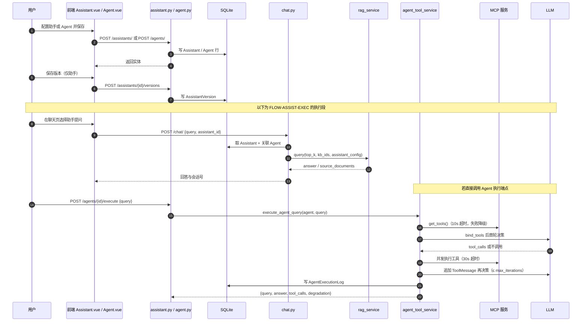

# 模块需求：assistant-agent（助手与 Agent 的配置、版本与执行）

- 模块 ID：`assistant-agent`（前缀 `AGENT`）
- 基线提交：`bf789d9e4fff51b7a2c0b661046f9e5c72b6e483`
- 资料状态：本文按源码事实撰写，除注明 confirmed 外均为 observed
- 首次生成：2026-11-11
- 关联来源：`requirements/sources/index.json`、`requirements/project-card.md`、`requirements/overview.md`

## 0. 一句话

用户在这里定义"助手"（预配置的问答人格 + 知识库 + 记忆 + 检索参数 + 可挂载 Agent）与"Agent"（MCP 工具 + LLM 多轮决策），并可对 Agent 发起一次工具型查询；助手通过聊天入口使用，Agent 的配置从聊天链路间接生效。

## 1. 主链路图

链路名：`FLOW-ASSIST-EXEC`（配置 → 版本 → 执行）。该链路的前半段（配置/版本）在前端有界面；后半段（`POST /agents/{id}/execute`）**前端没有任何调用方**，见 §4-U2。

## 2. 需求条目

### REQ-AGENT-001 创建与维护助手配置

- **用户预期**：能新建一个助手，设定名称、模型、温度、系统提示、开场白、绑定知识库、记忆配置、检索配置、可调用 Agent 列表；能改、能删、能查。
- **入口与前提**：前端 `/assistants` 页面（`frontend/src/router/index.js:12`）；接口 `POST /api/v1/assistants/`（`src/api/routers/assistant.py:59`）。前提是已登录并持有 JWT，路由守卫只校验 `localStorage` 里 token 是否存在（`frontend/src/router/index.js:24-31`）。
- **字段与校验**：
  - `name` 必填；`description` / `system_prompt` / `greeting_message` 可空。
  - `llm_model` 默认取 `settings.LLM_MODEL`，不硬编码（`src/api/routers/assistant.py:18`）；当前可选值只有一项（`src/settings.py:77-79`）。
  - `temperature` 创建时限定 0.0–2.0（`src/api/routers/assistant.py:19`），但**更新时无此约束**（`src/api/routers/assistant.py:32`）。
  - `memory_config` 默认 `{"enable": True, "window_size": 10}`（`src/api/routers/assistant.py:22`）；`rag_config` 默认 `{"top_k": 5, "enable_rerank": True}`（`src/api/routers/assistant.py:24`）；`tool_config` 默认 `[]`；`agent_ids` 默认 `[]`。
  - `kb_ids` 非空时逐个校验归属当前用户，数量对不上即 400，detail 为 `'Invalid KB IDs: some knowledge bases do not exist or do not belong to you'`（`src/api/routers/assistant.py:66-75`）。PUT 走同一套校验（`src/api/routers/assistant.py:131-141`）。
  - 所有 config 字段类型都是 `Optional[dict]` / `Optional[List[...]]`，**内部键名不做 schema 校验**，任意字典都能存。
- **正常操作与反馈**：保存成功返回助手实体；列表按 `user_id` 过滤（`src/api/routers/assistant.py:96-101`）；前端保存后刷新列表并提示成功。
- **异常与恢复**：`kb_ids` 越权 → 400；`GET /{id}` 不存在 → 404 `'Assistant not found'`（`src/api/routers/assistant.py:103-114`）；他人助手 → 403 `'Not authorized'`。删除不存在的助手返回 404（`src/api/routers/assistant.py:156-170`）。
- **权限**：全部 7 个端点都挂 `Depends(get_current_user)`；读/改/删前比对 `user_id`。
- **数据影响**：写 `assistants` 表；删除时级联删除该助手的全部 `assistant_versions`（`src/database/models.py:199-201` 的 `cascade="all, delete-orphan"`）。
- **可观察结果**：`assistants` 表行数、`GET /assistants/` 返回项的字段值（含 `rag_config` / `memory_config` 原样回读）。
- **三态**：已实现·已启用·未验证（无运行记录）。
- **basis**：observed。
- **锚点**：`src/api/routers/assistant.py:14-26`、`src/api/routers/assistant.py:59-147`、`src/database/models.py:169-201`。

### REQ-AGENT-002 助手版本快照

- **用户预期**：改配置前先存一版，改坏了能回滚。
- **入口与前提**：前端 `/assistants` 详情里"保存版本/恢复版本"（`frontend/src/views/Assistant.vue:481-527`、`:550-560`）；接口 `POST /api/v1/assistants/{id}/versions`（`src/api/routers/assistant.py:172`）与 `GET .../versions`（`src/api/routers/assistant.py:195`）。
- **字段与校验**：请求体是裸 `dict` 取 `version` 与 `config`（`src/api/routers/assistant.py:185-189`），**无 Pydantic schema**：`version` 可缺失、`config` 缺失时存 `{}`、`version` 不要求唯一、不复核是否是合法配置。
- **正常操作与反馈**：写一行 `AssistantVersion` 后返回 `{"message": "Version saved"}`；列表按 `created_at` 倒序。前端"保存版本"实际是两次请求：先 `PUT /assistants/{id}` 落当前配置，再 `POST .../versions` 存快照（`frontend/src/views/Assistant.vue:502-517`）。
- **异常与恢复**：助手不存在 → 404；他人助手 → 403。版本号由前端按十进制进位自增（patch≥10→minor，minor≥10→major，`frontend/src/views/Assistant.vue:529-548`），后端不校验，因此并发或手工调用可能产生重复版本号。
- **权限**：同 REQ-AGENT-001。
- **数据影响**：写 `assistant_versions` 表（`config` 列非空，`src/database/models.py:203-212`）；删助手时一并删除。
- **可观察结果**：`assistant_versions` 行数、`GET /assistants/{id}/versions` 的 `version` 与 `config`。
- **三态**：已实现·已启用·未验证。
- **basis**：observed。
- **锚点**：`src/api/routers/assistant.py:172-212`、`frontend/src/views/Assistant.vue:481-560`。

### REQ-AGENT-003 助手的检索参数在问答中生效

- **用户预期**：在助手配置里设 `top_k`、`enable_rerank`、`rerank_top_n`，问答时按这些值检索与重排。
- **入口与前提**：前端助手表单的 `rag_config` 区块（`frontend/src/views/Assistant.vue:80-94`，top_k 1–20、`hybrid_weight` 0–1、`enable_rerank` 开关、`rerank_top_n` 1–20）；保存走 `PUT /assistants/{id}`；使用入口是聊天页（`POST /chat/`）。
- **字段与校验**：后端不校验 `rag_config` 内部结构。前端默认 `{top_k:5, hybrid_weight:0.5, enable_rerank:false, rerank_top_n:5}`（`frontend/src/views/Assistant.vue:302-311`），后端默认 `{"top_k": 5, "enable_rerank": True}`（`src/api/routers/assistant.py:24`），两处 `enable_rerank` 默认值相反。
- **正常操作与反馈**：目标行为是按助手配置生效。**实现事实：`rag_config` 被组装进 `assistant_config` 传给 RAG 服务（`src/api/routers/chat.py:138`），但 `RAGService.query()` 从不读该键**，检索与重排分别用入参 `top_k` 和全局开关 `settings.ENABLE_RERANK`（`src/services/rag_service.py:84-103`、`src/services/rag_service.py:241`、`src/services/rag_service.py:250-253`）。`hybrid_weight`、`rerank_top_n` 在 `src/` 内无任何读取点。
- **异常与恢复**：无报错、无提示——配置保存成功但行为不变，属"静默不生效"。
- **权限**：同 REQ-AGENT-001。
- **数据影响**：`assistants.rag_config` 有值且能被回读，但下游无消费者。
- **可观察结果**：把 `rag_config.top_k` 设成 1 与 20 各问一次，`source_documents` 条数与检索行为**不变**；改 `settings.ENABLE_RERANK` 才会变。
- **三态**：已实现（写入）·已启用（透传）·**未生效**（下游不读）。
- **basis**：observed。
- **锚点**：`src/api/routers/chat.py:133-150`、`src/services/rag_service.py:75-103`、`src/api/routers/assistant.py:22-24`、`frontend/src/views/Assistant.vue:80-94`。
- **未决**：见 §4-U1（口径冲突已在 `specs/questions.md` Q-07 登记）。

### REQ-AGENT-004 助手的记忆配置在问答中生效

- **用户预期**：开关短期记忆、设定保留窗口，模型能"记住"前面几轮。
- **入口与前提**：前端 `memory_config` 区块（`frontend/src/views/Assistant.vue:55-61`，`enable_short_term` 开关、`window_size` 1–20、`enable_long_term` 开关）；使用入口 `POST /chat/`。
- **字段与校验**：后端默认键是 `{"enable": True, "window_size": 10}`（`src/api/routers/assistant.py:22`），RAG 服务读的键是 `enable_short_term` 与 `window_size`（`src/services/rag_service.py:90-92`）——**键名不一致**：后端默认的 `enable` 无人读，`enable_short_term` 缺失时按 `True` 兜底，所以默认行为恰好等价。前端写的正是 `enable_short_term`，故前端存的配置能生效。
- **正常操作与反馈**：`enable_short_term` 默认 True、`window_size` 默认 10（`src/services/rag_service.py:90-92`），`history = memory.get_short_term_memory(session_id, limit=window_size)`（`src/services/rag_service.py:95-96`），短期历史存 Redis（`src/services/memory_service.py:30-64`，`lpush` + `ltrim` + `expire`）。`enable_long_term` 只写一行 `logger.info`，`long_term_context` 恒为空串；`add_long_term_memory` 是 `pass`（`src/services/memory_service.py:71-73`）。
- **异常与恢复**：Redis 不可用时 `get_short_term_memory` 捕获异常记 `logger.error` 并返回 `[]`（`src/services/memory_service.py:51-53`），问答照常但无上下文，用户无明显提示。
- **权限**：同 REQ-AGENT-001；记忆数据按 `session_id` 隔离，会话归属校验在 chat 层（`src/api/routers/chat.py:122-123`）。
- **数据影响**：写 Redis 键 `session:{session_id}:history`（`src/services/memory_service.py:57`）；长期记忆无落库。
- **可观察结果**：同会话连续两问，第二次请求的 prompt 中含第一轮内容；把 `window_size` 设 1 后历史只剩 1 条；`enable_long_term` 开关对回答无影响。
- **三态**：短期记忆已实现·已启用·未验证；长期记忆**已实现接口·未启用**（空函数）。
- **basis**：observed。
- **锚点**：`src/services/rag_service.py:84-103`、`src/services/memory_service.py:18-76`、`src/api/routers/assistant.py:22`。

### REQ-AGENT-005 创建与维护 Agent 配置

- **用户预期**：新建 Agent，设定名称、类型（function_call / react / plan_execute）、系统提示、MCP 工具、知识、记忆、推理、安全、交互、LLM、执行超时等参数；能改、能删、能查。
- **入口与前提**：前端 `/agents` 页面（`frontend/src/router/index.js:13`）；接口 `POST /api/v1/agents/`（`src/api/routers/agent.py:176`）。
- **字段与校验**：
  - `name` 必填；`type` 默认 `"function_call"`，**类型是裸 `str`，没有 Literal 约束**，任意字符串可入库（`src/api/routers/agent.py:135-139`），而模型注释只列了三种（`src/database/models.py:220`）。
  - `tools_config` 是 `dict[str, MCPServerConfig]`，子模型 `extra="forbid"`，`transport` 只接受 `streamable_http` / `sse`（`src/api/routers/agent.py:16-38`）。
  - MCP `url` 走 `_validate_url_safe`：只允许 http/https，拦截私网、回环、链路本地、`169.254.169.254`、`fc00::/7`；**开发环境（`APP_ENV != "production"`）放行 loopback 与 `localhost`**（`src/api/routers/agent.py:73-74`、`:83-84`）；否则做 DNS 解析后复查防重绑定（`src/api/routers/agent.py:86-93`），`socket.gaierror` 放行（`src/api/routers/agent.py:94-96`）。
  - `llm_config`：`model` / `temperature` 0–2 / `max_tokens > 0` / `top_p` 0–1，`extra="forbid"`（`src/api/routers/agent.py:99-107`）。
  - `execution_config`：`max_iterations` 要求 `> 0` 且 `≤ 20`，三个 timeout 要求 `> 0.0`（`src/api/routers/agent.py:110-118`）。
  - 落库时子模型二次 `model_dump(exclude_none=True)` 转成 JSON（`src/api/routers/agent.py:189`、`:243-248`）。
- **正常操作与反馈**：保存成功返回 Agent 实体；列表按 `user_id` 过滤（`src/api/routers/agent.py:206-211`）。
- **异常与恢复**：越界参数 → 422（Pydantic）；`GET /{id}` 不存在 → 404 `'Agent not found'`（`src/api/routers/agent.py:214-225`）；他人 Agent → 403 `'Not authorized'`；删除返回 `{"message": "Agent deleted"}`（`src/api/routers/agent.py:258-272`）。
- **权限**：6 个端点全部 `Depends(get_current_user)`，读改删前比对 `user_id`。
- **数据影响**：写 `agents` 表 11 个配置列 + legacy `config` 列（`src/database/models.py:214-249`）。
- **可观察结果**：`agents` 表行数、`GET /agents/{id}` 的配置回读；前端保存后是否 422（前端 `tools_config` 明确不发送，见 §4-U3）。
- **三态**：已实现·已启用·未验证。
- **basis**：observed。
- **锚点**：`src/api/routers/agent.py:16-203`、`src/database/models.py:214-249`。

### REQ-AGENT-006 执行一次 Agent 查询（工具型问答）

- **用户预期**：给定一个问题，Agent 自动挑选并调用配置的 MCP 工具，再基于工具结果作答；工具不可用时至少给纯 LLM 回答。
- **入口与前提**：接口 `POST /api/v1/agents/{agent_id}/execute`，请求体 `{"query": "..."}`（`src/api/routers/agent.py:275-290`）。**前端没有任何页面调用该端点**（`frontend/src/views/Agent.vue` 全文无 `execute` 调用，仅出现 `'plan_execute'` 选项与 `execute_code` 权限复选框）。因此当前只有脚本/接口层可达。
- **字段与校验**：`query` 必填字符串，无长度限制；无 `response_model`，返回裸 dict（`src/api/routers/agent.py:290`）。
- **正常操作与反馈**：执行链路（`src/services/agent_tool_service.py:118-256`）依次为——取 LLM（模型不在白名单则回落 `settings.AGENT_MODEL`，`src/services/agent_tool_service.py:55-76`）→ 加载 MCP 工具（10s 超时，失败不抛，`src/services/agent_tool_service.py:42-52`）→ `bind_tools` 首轮决策 → 有 `tool_calls` 则**并发**执行（30s 超时，`src/services/agent_tool_service.py:85-115`）→ 追加 `ToolMessage` 再决策，最多 `max_iterations` 轮 → 写执行日志。返回 `{"query", "answer", "tool_calls", "degradation"}`。
- **异常与恢复**：降级是显式的，共四种取值——
  - LLM 不可用 → `degradation="llm_fallback"`，answer 为 `'LLM 服务暂不可用，请稍后重试。'`（`src/services/agent_tool_service.py:125-132`）；
  - 工具加载失败或无工具 → `degradation="tools_unavailable"`，走纯 LLM 回答（`src/services/agent_tool_service.py:157-181`）；
  - 首轮/后续决策异常 → `degradation="llm_fallback"`，answer 为 `'模型决策时出错，请稍后重试。'` / `'模型再决策时出错，请稍后重试。'`（`src/services/agent_tool_service.py:189-204`、`:239-246`）；
  - 部分工具失败 → `degradation="tools_partial"`（`src/services/agent_tool_service.py:249`）；
  - 全部正常 → `degradation=None`。
  - 单工具异常不冒泡，转成字符串 `'Error executing {tool_name}: {e}'` 作为工具返回内容（`src/services/agent_tool_service.py:85-115`）。
- **权限**：登录态 + `agent.user_id == current_user.id`，否则 403 `'Not authorized'`（`src/api/routers/agent.py:286-287`）。
- **数据影响**：写 `agent_execution_logs` 一行（`src/services/execution_log_service.py:28-36`）：`query` 截断 5000 字、`answer` 截断 10000 字、`tool_calls` JSON、`tool_count`、`degradation`。**`trace_id` 从不写入，`latency_ms` 形参存在但调用方不传，落库恒为 NULL。**
- **可观察结果**：响应体的 `degradation` 与 `tool_calls`；`agent_execution_logs` 的 `tool_count`、`degradation`、`latency_ms`（恒空）。
- **三态**：已实现·已启用（接口层）·**前端未接线**。
- **basis**：observed。
- **锚点**：`src/api/routers/agent.py:275-290`、`src/services/agent_tool_service.py:118-267`、`src/services/execution_log_service.py:18-44`。
- **未决**：见 §4-U2、§4-U5。

### REQ-AGENT-007 助手挂载 Agent 后的问答走向

- **用户预期**：助手绑定了 Agent 时，问答应由 Agent 完成（含工具调用）。
- **入口与前提**：助手配置里 `agent_ids` 非空，用户在聊天页选用该助手（`POST /chat/`）。
- **字段与校验**：`agent_ids` 是 `Optional[List[int]]`，**创建/更新时不校验这些 Agent 是否属于当前用户**（只有 `kb_ids` 有校验，`src/api/routers/assistant.py:66-75`）。
- **正常操作与反馈**：chat 层预加载 Agent 列表塞进 `assistant_config["agents"]`（`src/api/routers/chat.py:125-128`、`:141`）；RAG 服务在 `_agent_path` 里**只取 `agents[0]`**（`src/services/rag_service.py:201`），即多绑的 Agent 只有第一个生效；若有 `kb_ids` 先检索 + 按全局开关 rerank 拼成 `【知识库参考资料】` 再交给 `execute_agent_query`（`src/services/rag_service.py:204-220`）。
- **异常与恢复**：Agent 执行内的降级同上；工具失败不阻断回答。
- **权限**：Agent 归属未校验 → 可能挂上他人 Agent 的 id 并触发其工具配置（见 §4-U4）。
- **数据影响**：每次走 Agent 分支都会写一行 `agent_execution_logs`。
- **可观察结果**：聊天响应里出现 `tool_calls` 字段（`src/services/rag_service.py:223-228`）；日志表新增行。
- **三态**：已实现·已启用·未验证。
- **basis**：observed。
- **锚点**：`src/services/rag_service.py:196-228`、`src/api/routers/chat.py:125-142`。

## 3. 三态汇总

| 需求 | 已实现 | 已启用 | 已验证 | basis |
| --- | --- | --- | --- | --- |
| REQ-AGENT-001 助手 CRUD | 是 | 是 | 否 | observed |
| REQ-AGENT-002 助手版本 | 是 | 是 | 否 | observed |
| REQ-AGENT-003 rag_config 生效 | 写入是 | 透传是 | 否（下游不读，实际不生效） | observed |
| REQ-AGENT-004 记忆配置 | 短期是 / 长期空实现 | 短期是 / 长期否 | 否 | observed |
| REQ-AGENT-005 Agent CRUD | 是 | 是 | 否 | observed |
| REQ-AGENT-006 Agent 执行端点 | 是 | 接口层是 | 否（前端无调用方） | observed |
| REQ-AGENT-007 助手挂 Agent | 是 | 是 | 否 | observed |

## 4. 未决与缺口

- **U1（口径冲突，高）**：README / 项目卡把 `rag_config` 描述为助手的检索参数，但 `RAGService` 从不读取它，`hybrid_weight` 与 `rerank_top_n` 全仓无消费者。需求口径应是"配置生效"还是"下线该配置项"，需产品决定。证据：`src/api/routers/chat.py:138` 写入 vs `src/services/rag_service.py:84-103` 只读 `system_prompt/agent_ids/agents/llm_model/temperature/memory_config`。已登记 `specs/questions.md` Q-07。
- **U2（端点无界面，中）**：`POST /agents/{id}/execute` 无任何前端调用方，用户无法从界面执行 Agent；同样情况还有 Legacy `/upload`（属其他模块）。`specs/questions.md` Q-29 已登记。
- **U3（前后端契约不一致，中）**：前端 `Agent.vue` 保存时**不发送 `tools_config`**（注释自陈为避免 422，`frontend/src/views/Agent.vue:383-385`），并把 `llm_config.model_name` 映射成 `model`（`:392`）、`execution_config.timeout` 同时写入 `llm_timeout` 与 `tool_timeout`（`:397-398`）、`retry_times` 映射成 `max_iterations`（`:399`）；前端还有后端 schema 里不存在的 `fallback_response`（被丢弃）。后果：从界面无法配置 MCP 工具，Agent 只能走 `degradation="tools_unavailable"` 的纯 LLM 分支。
- **U4（越权面，中）**：`agent_ids` 不校验归属（`src/api/routers/assistant.py:66-75` 只校验 `kb_ids`），且 `_agent_path` 只取 `agents[0]`（`src/services/rag_service.py:201`）。多绑无效 + 可挂他人 Agent 两项都需要定性。
- **U5（日志字段不可用，中）**：`trace_id` 从不写入、`latency_ms` 恒 NULL（`src/services/execution_log_service.py:28-36`），`degradation` 有值。所以"按 trace 追踪一次执行"和"看耗时"这两个用法目前都做不到；`AgentExecutionLog` 也没有任何读端点。
- **U6（Agent.type 无约束，低）**：字段是裸 `str`（`src/api/routers/agent.py:135-139`），与模型注释的三值（`src/database/models.py:220`）不一致；代码里也不见按 `type` 分派的逻辑，即 `react` / `plan_execute` 与 `function_call` 行为相同——需产品确认三种类型是否应实际生效。
- **U7（默认值前后不一致，低）**：`rag_config.enable_rerank` 后端默认 True（`src/api/routers/assistant.py:24`）而前端默认 false（`frontend/src/views/Assistant.vue:302-311`）；`memory_config` 后端默认键 `enable` 与读取方 `enable_short_term` 不同名（`src/api/routers/assistant.py:22` vs `src/services/rag_service.py:91`）。
- **U8（未核实）**：MCP 工具的可用性与实际行为未核实——需要外部 MCP 服务在线，本次只读源码，`network_calls=0`。`src/agent/mcp_client.py:149-200` 的 per-config 客户端缓存行为（同一 `tools_config` 复用连接）未实测。

## 5. 参考锚点清单

- `src/api/routers/assistant.py:14-26`（创作 schema 与默认值）
- `src/api/routers/assistant.py:59-147`（CRUD 与 kb_ids 校验）
- `src/api/routers/assistant.py:156-212`（删除与版本端点）
- `src/api/routers/agent.py:16-118`（MCP / LLM / 执行参数 schema 与 SSRF 防护）
- `src/api/routers/agent.py:176-290`（Agent CRUD 与 execute 端点）
- `src/services/agent_tool_service.py:28-256`（工具加载、多轮决策、四态降级）
- `src/services/execution_log_service.py:18-44`（执行日志落库）
- `src/services/rag_service.py:84-103`（assistant_config 消费面）
- `src/services/rag_service.py:196-228`（Agent 分支）
- `src/services/memory_service.py:18-76`（短期记忆 Redis / 长期记忆空实现）
- `src/agent/mcp_client.py:149-200`（per-config MCP 客户端）
- `src/database/models.py:169-264`（Assistant / AssistantVersion / Agent / AgentExecutionLog）
- `frontend/src/views/Assistant.vue:55-94`、`:302-311`、`:481-560`（配置表单与版本操作）
- `frontend/src/views/Agent.vue:375-428`（保存映射与删除）
