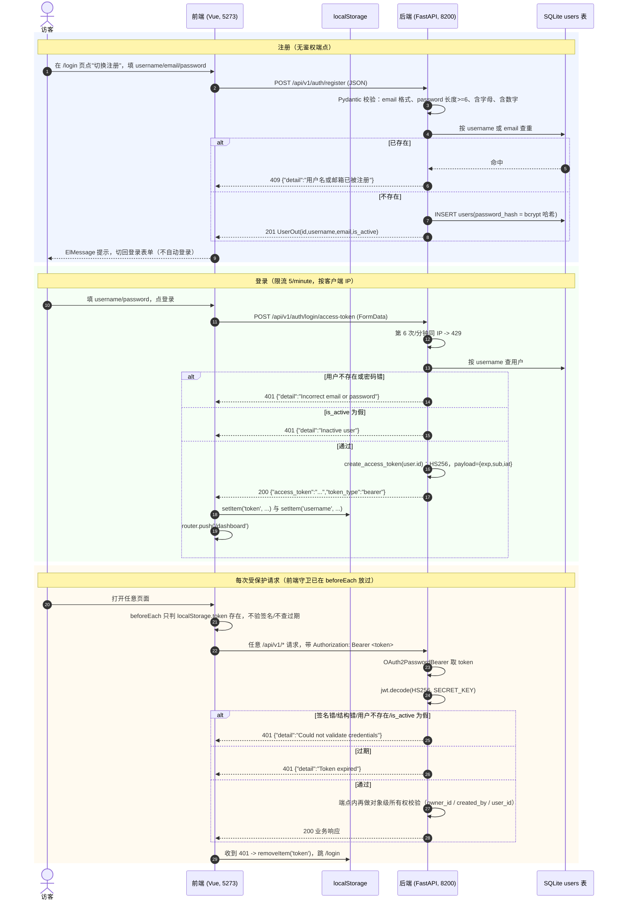

# auth-console · 鉴权与前端控制台（需求正文）

- 模块：`auth-console`，需求前缀 `REQ-AUTH-`，流程 `FLOW-AUTH`
- 基线提交：`bf789d9e4fff51b7a2c0b661046f9e5c72b6e483`
- 上游：`requirements/project-card.md`（角色与权威存储）、`requirements/_conventions.md`（ID 与 basis 规则）
- 本模块只负责：**身份怎么建立（注册/登录）、凭据怎么带（Bearer token 与 localStorage）、越权边界在哪（对象级所有权）、前端守卫管到哪一步（只判 token 是否存在）**。业务对象的增删改查语义归各业务模块；平台级中间件与 CORS 归 `platform`。
- 三态口径：本文件对每项能力分别标注**已实现 / 已启用 / 已验证**。`observed` 只证明"代码是这样写的"，不证明设计正确。

---

## 0. 一句话

系统里只有一种身份凭据：登录后拿到的一个 JWT，存前端 `localStorage`，每次请求以 `Authorization: Bearer` 带上；**后端每个受保护端点都重新验签并查库**，前端守卫只负责"没 token 就跳登录页"，不做有效性校验——所以**前端的"登录态"不等于授权**。

---

## 1. 流程 FLOW-AUTH

> 关键落差：**FLOW-AUTH 的最后一段有两次判定，第一次在中间层（验签），第二次在端点内（所有权）**。前端的"能进页面"只代表有 token 字符串，与这两次判定都无因果关系。

---

## 2. 需求正文

### REQ-AUTH-001 注册：不需要登录，四种校验，冲突统一 409

**用户预期**：任何人都能自助创建账号；失败时知道是"格式不对"还是"已被占用"，但**不该知道是用户名还是邮箱被占**。

**入口与前提**：前端 `frontend/src/views/Login.vue:21` 的切换按钮把同一页切成注册表单，注册成功后 `isRegister` 置回 false（`frontend/src/views/Login.vue:44-47`），**不自动登录**。后端入口 `POST /api/v1/auth/register`，无鉴权（`src/api/routers/auth.py:40-41`）。

**字段与校验**：
- `username`：字符串，必填，无长度/字符集约束（模型层 `unique=True`，`src/database/models.py:7-22`）。
- `email`：`EmailStr`，格式非法由 Pydantic 拦下（422）。
- `password`：`min_length=6`（`src/api/routers/auth.py:18`）；另有 `validate_password_complexity`：缺字母报"密码必须包含至少一个字母"、缺数字报"密码必须包含至少一个数字"（`src/api/routers/auth.py:20-28`）。
- 查重按 `username == ? OR email == ?` 一次查（`src/api/routers/auth.py:42-44`）。

**正常操作与反馈**：201，返回 `UserOut`＝`id/username/email/is_active`（`src/api/routers/auth.py:34-38,40`）——**响应不含 password、不含 password_hash**。`tests/test_auth_functional.py:14-29` 对"响应中不出现密码字段"有断言。

**异常与恢复**：命中已存在 → 409，detail 固定"用户名或邮箱已被注册"（`src/api/routers/auth.py:46-50`），注释明确写"不区分用户名/邮箱已存在，防止用户枚举"。重复用户名与重复邮箱的结果**逐字相同**（`tests/test_auth_functional.py:31-43,45-56` 分别覆盖两条路径）。密码不合规 → 422，detail 是校验错误数组。

**权限**：无鉴权。任何人可调用，包括未登录访客。

**数据影响**：向 `users` 表 INSERT 一行，`password_hash` 存 **bcrypt** 哈希（`src/utils/security.py:14-18`），不存明文；`role` 默认 `"user"`，`is_active` 默认 True（`src/database/models.py:7-22`）。

**三态**：已实现 ✅；已启用 ✅；已验证 ✅（`tests/test_auth_functional.py`，非 integration 用例）。

**basis：observed**；锚点：`src/api/routers/auth.py:15-59`、`src/utils/security.py:14-18`、`frontend/src/views/Login.vue:44-47`、`tests/test_auth_functional.py:14-56`、`src/database/models.py:7-22`。

---

### REQ-AUTH-002 登录：表单换 token，唯一被限流的端点

**用户预期**：用 username + 密码换到一个凭据，之后所有请求带上它。

**入口与前提**：前端提交 `FormData`（不是 JSON）到 `POST /api/v1/auth/login/access-token`（`frontend/src/views/Login.vue:49-55`）。后端用 `OAuth2PasswordRequestForm` 解析，**字段名是 `username` 而不是 email**——但错误文案里写的是 email（`src/api/routers/auth.py:69`），属文案与实现不一致。

**字段与校验**：仅 username / password 两个表单字段。无格式前置校验（前端也不做，`frontend/src/views/Login.vue:42-63` 直接提交）。

**正常操作与反馈**：200，返回 `{"access_token": <JWT>, "token_type": "bearer"}`（`src/api/routers/auth.py:61-76`）。JWT 由 `create_access_token(user.id)` 签发：`ALGORITHM="HS256"`，payload 恰为 `{"exp", "sub": str(user.id), "iat"}`，`exp = now + ACCESS_TOKEN_EXPIRE_MINUTES`（默认 480 分钟＝8 小时，`src/settings.py:20`）（`src/utils/security.py:20-31`）。`tests/test_auth_functional.py:58-70` 断言 `token_type == "bearer"` 且解出的 `sub == str(user.id)`。

**异常与恢复**：
- 用户不存在或密码错 → 401 "Incorrect email or password"（`src/api/routers/auth.py:69`）。
- `is_active` 为假 → 401 "Inactive user"（`src/api/routers/auth.py:71`）。`tests/test_auth_functional.py:80-98` 覆盖。
- 同 IP 每分钟第 6 次 → **429**（`src/api/routers/auth.py:62` 唯一一处 `@limiter.limit("5/minute")`，`src/utils/rate_limit.py:8-9` 按 `get_remote_address` 计数）。全仓只此一个端点被限流。
- 前端失败时取 `err.response.data.detail` 或 `err.message` 弹 ElMessage（`frontend/src/views/Login.vue:59-61`）。

**权限**：无鉴权（不需要已有 token 才能登录）。

**数据影响**：只读 users 表，无写入。**不写 Cookie、不写 HttpOnly 会话**——后端全程无 `Set-Cookie`。

**三态**：已实现 ✅；已启用 ✅；已验证 ✅（登录成功/失败/停用三态有测试；429 限流本轮未跑实证，只核实了装饰器与唯一性）。

**basis：observed**；锚点：`src/api/routers/auth.py:61-76`、`src/utils/security.py:20-31`、`src/utils/rate_limit.py:8-9`、`src/settings.py:20`、`frontend/src/views/Login.vue:49-61`、`tests/test_auth_functional.py:58-98`。

---

### REQ-AUTH-003 凭据携带：只存 localStorage，只走 Authorization 头

**用户预期**：刷新页面不用重新登录。

**入口与前提**：登录成功后前端写两个键：`token`（JWT 原文）与 `username`（明文，仅用于顶栏展示）（`frontend/src/views/Login.vue:53-54`；顶栏读取 `frontend/src/App.vue:103`）。

**字段与校验**：
- axios 侧：请求拦截器给每个请求加 `config.headers.Authorization = "Bearer " + token`（`frontend/src/api/index.js:7-13`）。
- 非 axios 侧（SSE、上传、下载、预览）：`getAuthHeaders()` 返回 `{'Content-Type':'application/json'}` 并按需加 Authorization（`frontend/src/utils/auth.js:4-11`），被 `streamSSE` 使用（`frontend/src/utils/sse.js:15`）；el-upload 场景自己算 header（`frontend/src/views/KnowledgeBaseDetail.vue:268-270`）。

**正常操作与反馈**：所有经 axios 的请求自带凭据，用户无感。

**异常与恢复**：收到 401 时 axios 拦截器删 `token` 并 `window.location.href = '/login'`（`frontend/src/api/index.js:15-24`）；native fetch 路径由 `handleAuthError` 做同样动作，默认提示"登录已过期，请重新登录"（`frontend/src/utils/auth.js:13-24`）。两者行为一致，`frontend/src/utils/auth.test.js:39-67` 对 401 与 500 两态都有断言（500 不删 token 不跳转）。

**权限**：token 一旦泄露等价于账号被盗用直到过期。`ACCESS_TOKEN_EXPIRE_MINUTES` 默认 480 分钟，期间无法吊销。

**数据影响**：`localStorage` 有两个键；**这是 XSS 可知的持久凭据**（同源脚本可读）。后端无 cookie、无 CSRF token——安全模型完全依赖"不出现 XSS"。

**三态**：已实现 ✅；已启用 ✅；已验证 ✅（`frontend/src/utils/auth.test.js`、`frontend/src/views/Login.test.js:31-52`）。

**basis：observed**；锚点：`frontend/src/views/Login.vue:53-54`、`frontend/src/api/index.js:3-24`、`frontend/src/utils/auth.js:4-24`、`frontend/src/utils/sse.js:15`、`frontend/src/views/KnowledgeBaseDetail.vue:268-270`、`src/settings.py:20`。

---

### REQ-AUTH-004 后端每次请求重验：验签 + 查库 + is_active

**用户预期**：token 过期或账号被停用后，旧 token 立刻失效。

**入口与前提**：`oauth2_scheme = OAuth2PasswordBearer(tokenUrl="/api/v1/auth/login/access-token")`（`src/api/dependencies.py:10`），`get_current_user` 作为受保护端点的依赖（`src/api/dependencies.py:12`）。

**字段与校验**：`jwt.decode(token, settings.SECRET_KEY, algorithms=["HS256"])`（`src/api/dependencies.py:19`）→ 取 `payload["sub"]` → 转 int 查 users 表 → 校验 `is_active`。

**正常操作与反馈**：返回 ORM `User` 对象，端点继续用它做所有权判定。

**异常与恢复**：**三类失败都走 401，detail 不同**：
- 过期 → "Token expired"（`src/api/dependencies.py:24-28`）。
- 签名错/结构错/sub 无法转 int/用户不存在 → "Could not validate credentials"（`src/api/dependencies.py:15-20,33-36`）。
- `is_active` 为假 → 同一句 "Could not validate credentials"（`src/api/dependencies.py:35-36`）——**停用与伪造在响应上不可区分**，这是有意的收敛。

**权限**：这是唯一的身份判定入口。**无 token 时 OAuth2PasswordBearer 直接 401**，不进业务代码（`tests/test_health.py:16-19`、`tests/test_aiops_auth.py:12` 覆盖）。

**数据影响**：每次受保护请求一次 users 查询（无缓存）。

**三态**：已实现 ✅；已启用 ✅；已验证 ✅（`tests/test_security.py:13-58` 六条 JWT 用例：未来时间、窗口内、sub 为字符串、过期被拒、被篡改被拒、错密钥被拒）。

**basis：observed**；锚点：`src/api/dependencies.py:10-36`、`tests/test_security.py:13-58`、`tests/test_health.py:16-26`、`tests/test_aiops_auth.py:12`。

---

### REQ-AUTH-005 前端守卫只判"有没有"，不判"好不好"

**用户预期**：没登录时访问内部页面会被送去登录页。

**入口与前提**：`router.beforeEach`（`frontend/src/router/index.js:24-31`）：取 `localStorage.getItem('token')`，若目标路由 `meta.requiresAuth` 为真且 token 不存在 → `next('/login')`，否则 `next()`。

**字段与校验**：**只做 `!token` 的存在性判断**。不解析 JWT、不查 `exp`、不发请求校验。所以一个随便写的字符串也能"进页面"，进入后所有数据请求会 401 再被拦截器弹回登录页。

**正常操作与反馈**：12 条路由中除 `/login` 与重定向 `/` 外，10 条页面都带 `meta: { requiresAuth: true }`（`frontend/src/router/index.js:4-17`）。

**异常与恢复**：真正的"踢回登录"由 401 响应拦截完成（REQ-AUTH-003），不是由守卫完成。

**权限**：**守卫是体验层的，不是安全层的**。绕过它（手工往 localStorage 写任意非空值）只会看到一堆空数据/401 提示，拿不到任何越权数据——因为授权在后端（REQ-AUTH-006）。

**数据影响**：无。

**三态**：已实现 ✅；已启用 ✅；已验证（部分）：`frontend/src/App.test.js` 只验证导航文案，**守卫本身没有前端单测**。

**basis：observed**；锚点：`frontend/src/router/index.js:24-31`、`frontend/src/router/index.js:4-17`、`frontend/src/api/index.js:15-24`。

---

### REQ-AUTH-006 对象级越权边界：四个域，四条不同策略

**用户预期**：看不到、改不了、删不了别人的东西。

**入口与前提**：四类资源各有独立的判定实现，**没有统一抽象**：

1. **知识库 / 文档**：按 `owner_id`。文档删除走 `DELETE /api/v1/monitor/tasks/{task_id}`，`kb.owner_id != current_user.id` → 403 "Not authorized"（`src/api/routers/monitor.py:116-127`）。
2. **评测任务**：`_check_task_ownership(task, current_user, db)`——任务关联了 kb 就用 `kb.owner_id`，没关联 kb 就用 `task.created_by`（`src/api/routers/evaluation.py:27-41`），在 8 个写操作点上调用（`src/api/routers/evaluation.py:347,397,414,429,449,471,511,524`）；列表查询直接按所有者过滤（`src/api/routers/evaluation.py:495-496`）。
3. **对象存储**：命名空间隔离。`_user_prefix(user)` 固定返回 `user_{id}`（`src/api/routers/storage.py:18-20`），`_safe_object_name` 把 `..` 删掉、前导 `/` 剥掉、**他人 `user_` 前缀剥掉后重建自己的前缀**（`src/api/routers/storage.py:23-40`），`GET /files` 忽略前端传入的 prefix（`src/api/routers/storage.py:53-55`）。
4. **AIOps 诊断**：`_owned_run(thread_id, user)`——thread_id 先过正则 `[A-Za-z0-9_.-]{1,64}`，不符 400；run 不存在**或不属于自己**统一 404 "诊断不存在"（`src/api/routers/aiops.py:123-129`），用 404 而非 403 避免暴露存在性。

**字段与校验**：原始证据多一层角色门。`/evidence` 返回 `can_read_raw = role in {"admin","auditor"}`（`src/api/routers/aiops.py:184-190`）；单条证据对非审计员 `row.pop("raw_ref")`（`src/api/routers/aiops.py:193-205`）。注意 `role` 默认 `"user"`，**没有代码路径自动授予 admin/auditor**（`src/database/models.py:7-22`）。

**正常操作与反馈**：所有者操作全部成功；非所有者得到 403（monitor/evaluation）或 404（aiops）或"被改写到自己命名空间"（storage）。

**异常与恢复**：storage 的"改写"策略意味着越权访问不会报错，而是**访问到自己的同名对象或 404**——`tests/test_storage_security.py:32-100` 有九条针对 `_safe_object_name` 的用例（路径穿越、他人前缀、多重 payload）。

**权限**：这是本系统真正的授权层。**注意三种失败码不一致（403/404/静默改写）**，属于实现现状而非设计文档化的决定。

**数据影响**：越权尝试不产生写入。

**三态**：已实现 ✅；已启用 ✅；已验证（部分）：storage 与 aiops 有单测（`tests/test_storage_security.py`、`tests/test_aiops_auth.py`），monitor 与 evaluation 的对象级判定本轮**未见专门单测**。

**basis：observed**；锚点：`src/api/routers/monitor.py:108-130`、`src/api/routers/evaluation.py:27-41,495-496`、`src/api/routers/storage.py:18-55`、`src/api/routers/aiops.py:123-129,184-205`、`tests/test_storage_security.py:32-100`、`src/database/models.py:7-22`。

---

### REQ-AUTH-007 没有登出、续期、改密、找回

**用户预期**（现实）：点"退出登录"能登出；token 快到期时能续；忘了密码能找回。

**入口与前提**：
- 退出登录：`frontend/src/App.vue:126-130` 的 `logout()` **只做三件事**——删 `token`、删 `username`、`router.push('/login')`。**不发任何后端请求**，所以 token 在服务端仍然有效直到 `exp`。
- 续期 / 改密 / 找回：后端**没有** `/logout`、`/refresh`、`/me`、`/change-password`、`/reset-password` 任何端点，`src/api/routers/auth.py` 全文只有 register 与 login 两个路由（`src/api/routers/auth.py:40,61`）。
- 校验：`src/api/dependencies.py:10-36` 无 refresh 分支，`src/utils/security.py:20-31` 只签一种 token。

**正常操作与反馈**：退出登录在体验上成功（界面回到登录页），在安全上**不撤销凭据**。

**异常与恢复**：用户忘记密码时**没有任何自助恢复路径**；只能由持有数据库的人改库。

**权限**：无。

**数据影响**：无。

**三态**：已实现（退出登录的 UI 行为）✅；**未实现**（后端撤销、refresh、改密、找回）❌；已验证 ✅（`frontend/src/App.test.js` 断言"退出登录"文案存在，但无登出行为测试）。

**basis：observed**；锚点：`frontend/src/App.vue:126-130`、`src/api/routers/auth.py:40,61`、`src/utils/security.py:20-31`、`src/api/dependencies.py:10-36`。

---

### REQ-AUTH-008 控制台骨架：12 条路由、9 个导航项、两处已核实的口径裂缝

**用户预期**：登录后是一个统一左侧导航 + 顶栏的控制台；只有登录页隐藏外壳。

**入口与前提**：`frontend/src/App.vue:3` 与 `frontend/src/App.vue:56` 用 `v-if="!isLoginPage"` 控制侧栏与顶栏；`isLoginPage` 判定 `route.path === '/login' || route.path === '/register'`（`frontend/src/App.vue:105`）。导航共 9 项：仪表盘、会话、知识库、助手、AIOps 诊断、监控、队列监控、评测（`frontend/src/App.vue:11-43`）。

**字段与校验**：

**裂缝 1（已核实）**：`App.vue` 判定了 `/register` 路径，但 `frontend/src/router/index.js:4-17` **没有 `/register` 路由**——注册只是 `Login.vue` 内部 `isRegister` 状态切换。该分支永远不成立（死判定）。

**裂缝 2（已核实）**：`frontend/src/views/Monitor.vue:306-310` 的下载用 `window.open(`${API_PREFIX}/storage/download/...`)`、`frontend/src/views/Monitor.vue:321-329` 的预览把 iframe src 设为 `/storage/preview/...`，**两者都不带 Authorization 头**；而后端这两个端点是 `Depends(get_current_user)`（`src/api/routers/storage.py:63,99`）。结论：**从监控页点下载/预览必然 401**，文件拿不到。对照正例：el-upload 场景显式带了 header（`frontend/src/views/KnowledgeBaseDetail.vue:268-270`）。

**裂缝 3（已核实）**：监控页删除队列任务传的是 `row.task_id`（`frontend/src/views/Monitor.vue:213,225-226`），后端把该值 `int()` 强制转换（`src/api/routers/monitor.py:116-119`）——若 `task_id` 是 Celery 的 UUID 字符串则直接 400 "Invalid ID format"。

**正常操作与反馈**：仪表盘聚合四个来源（知识库列表、前 10 个知识库的文档、monitor 统计、评测任务），任一失败该指标显示 '—'（`frontend/src/views/Dashboard.vue:120-151`）；依赖面板取 `/health/dependencies` 的 7 项，映射成"正常/降级/不可用"（`frontend/src/views/Dashboard.vue:105-113,153-173`）。

**异常与恢复**：裂缝 1、2、3 都不会有前端提示——用户看到的是"点了没反应"或"空白 iframe"。

**权限**：控制台本体不做权限分级——所有 role 看到同一套 9 个导航项，没有任何按角色隐藏的逻辑。

**数据影响**：无。

**三态**：控制台骨架已实现 ✅ / 已启用 ✅；三条裂缝**均为已实现但行为与预期不符**（登记为缺口，不判是否缺陷）；已验证（部分）：`frontend/src/App.test.js` 断言 9 个中文导航文案且不含英文，`frontend/src/views/Dashboard.test.js`、`frontend/src/views/Monitor.test.js` 存在但未覆盖上述三条裂缝。

**basis：observed**；锚点：`frontend/src/App.vue:3,11-43,56,103-105,126-130`、`frontend/src/router/index.js:4-17`、`frontend/src/views/Monitor.vue:213,225-226,306-329`、`src/api/routers/storage.py:62-63,98-99`、`src/api/routers/monitor.py:116-119`、`frontend/src/views/KnowledgeBaseDetail.vue:268-270`、`frontend/src/views/Dashboard.vue:105-173`、`frontend/src/views/Login.vue:35`。

---

## 3. 三态汇总（本模块）

| 能力 | 已实现 | 已启用 | 已验证 |
|---|---|---|---|
| 自助注册（201，统一 409） | 是 | 是 | 是（`tests/test_auth_functional.py:14-56`） |
| 密码复杂度（≥6、含字母、含数字） | 是 | 是 | 是（`tests/test_auth_functional.py:14-29`、`tests/test_security.py:102-140`） |
| bcrypt 哈希存储（无明文） | 是 | 是 | 是（`tests/test_auth_functional.py:100-103`） |
| 登录签发 HS256 JWT（exp/sub/iat） | 是 | 是 | 是（`tests/test_auth_functional.py:58-70`、`tests/test_security.py:13-58`） |
| 登录限流 5/minute（全仓唯一） | 是 | 是 | 否（仅核实装饰器与唯一性） |
| 停用账号拒登（401 Inactive user） | 是 | 是 | 是（`tests/test_auth_functional.py:80-98`） |
| 每请求重验 token（验签+查库+is_active） | 是 | 是 | 是（`tests/test_security.py`、`tests/test_health.py:16-26`） |
| token 存 localStorage、走 Authorization 头 | 是 | 是 | 是（`frontend/src/utils/auth.test.js`、`frontend/src/views/Login.test.js:31-52`） |
| 前端路由守卫（只判存在） | 是 | 是 | 否（`frontend/src/App.test.js` 不覆盖守卫逻辑） |
| 401 全局回登录（axios + fetch 两条路） | 是 | 是 | 是（`frontend/src/utils/auth.test.js:39-67`） |
| 知识库/文档 owner_id 校验 | 是 | 是 | 否（未见专门单测） |
| 评测任务双重所有权（kb.owner_id 或 created_by） | 是 | 是 | 否（未见专门单测） |
| 对象存储前缀隔离 | 是 | 是 | 是（`tests/test_storage_security.py:32-100`） |
| AIOps 诊断 user_id 隔离（404 不泄露存在性） | 是 | 是 | 是（`tests/test_aiops_auth.py`） |
| 原始证据 role 门（admin/auditor） | 是 | 是 | 否（无 role 赋值路径，无从验证） |
| 后端登出 / refresh / 改密 / 找回 | **否** | — | — |
| 前端"退出登录"（仅清本地） | 是 | 是 | 否 |
| 按角色隐藏导航 | **否** | — | — |
| `/register` 独立路由 | **否**（`App.vue:105` 有死判定） | — | — |
| 监控页下载/预览带凭据 | **否**（必然 401） | — | — |

---

## 4. 未决与缺口（汇总到 `specs/questions.md`）

1. **登出只清本地，服务端 token 仍有效**：`frontend/src/App.vue:126-130` 不发请求；无 `/logout` 端点。要不要引入黑名单/短 token？属设计决定。
2. **无 refresh**：480 分钟到期即需重新登录，前端无任何续期或临期提醒。
3. **无改密与找回**：忘记密码无自助路径，运维需直接改库。
4. **token 存 localStorage 的 XSS 面**：无 HttpOnly cookie 方案，无 CSP 头（安全头里没有 CSP，见 `src/main.py:223-230`）。
5. **三种越权失败码不一致**：monitor/evaluation 用 403、aiops 用 404、storage 静默改写到自己命名空间。是否统一未定。
6. **`role` 无授予路径**：`admin/auditor` 无接口可设，证据原文读取能力实际不可达（除非直接改库）。
7. **登录错误文案写 email、字段其实是 username**：`src/api/routers/auth.py:69`。
8. **`App.vue:105` 的 `/register` 死判定**：应删除或补路由，二者取一。
9. **监控页下载/预览不带 Authorization → 必然 401**：`frontend/src/views/Monitor.vue:306-329` vs `src/api/routers/storage.py:63,99`。需要改成 fetch + blob 或后端支持短期票据。
10. **监控页删除任务传 `task_id`、后端强制 int**：`frontend/src/views/Monitor.vue:213` vs `src/api/routers/monitor.py:116-119`。字段语义未对齐（注释自称"把 task_id 宽松映射成 doc_id"）。
11. **前端守卫无单测**：`frontend/src/router/index.js:24-31` 的三条分支（有 token / 无 token / 无需鉴权）没有测试覆盖。
12. **`ACCESS_TOKEN_EXPIRE_MINUTES` 默认 480 是否合适**：注释写"8 小时，平衡可用性与安全"，但配合"无 refresh、无法吊销"，实际是长窗口。

---

## 5. 参考锚点清单

**后端鉴权核心**
- `src/api/routers/auth.py:15-28`（UserCreate 与密码复杂度）
- `src/api/routers/auth.py:40-59`（register，统一 409）
- `src/api/routers/auth.py:61-76`（login，唯一限流配额）
- `src/api/dependencies.py:10-36`（OAuth2PasswordBearer + jwt.decode + is_active）
- `src/utils/security.py:7-31`（HS256、bcrypt、payload exp/sub/iat）
- `src/utils/rate_limit.py:8-9`（唯一 Limiter）
- `src/settings.py:19-20`（SECRET_KEY 与 token 有效期）
- `src/database/models.py:7-22`（users 表列与 role/is_active 默认值）

**对象级授权**
- `src/api/routers/monitor.py:108-130`（文档删除 owner_id 403）
- `src/api/routers/evaluation.py:27-41`（`_check_task_ownership` 双分支）
- `src/api/routers/evaluation.py:495-496`（列表按所有者过滤）
- `src/api/routers/storage.py:18-55`（前缀隔离与前缀忽略）
- `src/api/routers/storage.py:62-63,98-99`（下载/预览需鉴权——与前端冲突点）
- `src/api/routers/aiops.py:123-129`（thread_id 正则 + 404 不泄露）
- `src/api/routers/aiops.py:184-205`（can_read_raw 与 raw_ref 剥离）

**前端控制台**
- `frontend/src/router/index.js:4-31`（12 条路由 + beforeEach 只判存在）
- `frontend/src/api/index.js:3-24`（baseURL、请求加头、401 处理）
- `frontend/src/utils/auth.js:4-36`（fetch 侧头与错误处理三函数）
- `frontend/src/utils/sse.js:12-24`（SSE 也走 getAuthHeaders）
- `frontend/src/views/Login.vue:35-63`（登录/注册切换与两个提交分支）
- `frontend/src/App.vue:3-56,103-105,126-130`（外壳、导航 9 项、死判定、纯前端登出）
- `frontend/src/views/Monitor.vue:213,225-226,306-329`（三处裂缝）
- `frontend/src/views/KnowledgeBaseDetail.vue:268-270`（带 header 的正例）
- `frontend/src/views/Dashboard.vue:105-173`（控制台首屏聚合与依赖面板）
- `frontend/src/utils/constants.js:5-7`（axios 之外场景的前缀来源）

**测试**
- `tests/test_auth_functional.py`（注册/登录/停用/哈希）
- `tests/test_security.py:13-58,102-140,171-192`（JWT、密码、CORS）
- `tests/test_storage_security.py:32-100`（`_safe_object_name` 九例）
- `tests/test_aiops_auth.py`（无 token 401 / 有 token 200）
- `frontend/src/utils/auth.test.js`（getAuthHeaders / handleAuthError / parseFetchError）
- `frontend/src/views/Login.test.js`（两个端点与 FormData、写 localStorage、跳转）
- `frontend/src/App.test.js`（9 个中文导航文案）
