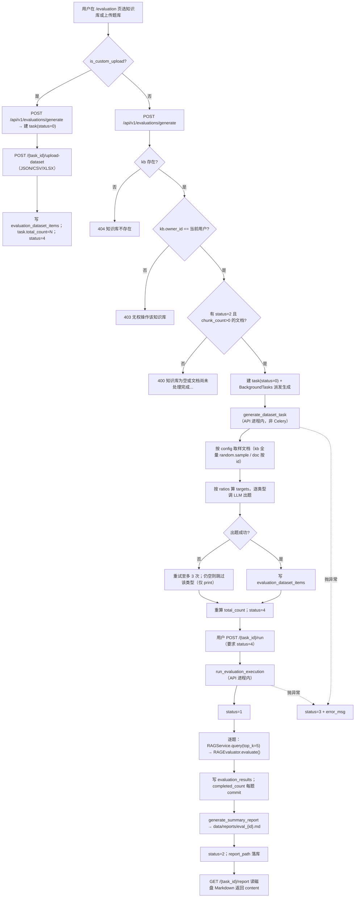

# evaluation · 评测（需求正文）

- 模块：`evaluation`（评测：数据集生成/上传 → 执行 → 打分 → 报告），需求前缀 `EVAL`
- 基线提交：`bf789d9e4fff51b7a2c0b661046f9e5c72b6e483`（`main`，2026-11-11）
- 上游：`requirements/project-card.md`（对象模型、§7.2 降级表）、`requirements/_conventions.md`、`requirements/overview.md`（§5.1 `FLOW-EVAL` 一句话状态）
- 本模块**只**负责：评测任务、评测数据集、评测执行、打分、报告。检索与生成本身见 `requirements/modules/rag-qa.md`；文档摄取见 `requirements/modules/kb-ingest.md`。
- 三态（已实现 / 已启用 / 已验证）逐条标注。本模块最易被 README 误导的两点先说清：**① 打分是自研 LLM-as-Judge，不是 RAGAS；② 四个维度里没有 Recall**（REQ-EVAL-007）。

---

## 0. 一句话

用户选一个知识库（或自己传一份题库），让系统生成/接收 N 道带参考答案的题，然后逐题走一遍真实 RAG 问答并让模型给答案打分，最后出一份 Markdown 汇总报告。**一次评测会消耗 `N × 2` 次左右的模型调用，不是免费操作。**

---

## 1. 流程 FLOW-EVAL



---

## 2. 需求正文

### REQ-EVAL-001 新建评测任务

**用户预期**：在评测页选一个知识库、填题目数，点一下就创建出一个"待生成"的评测任务，能立刻在历史列表里看到它。

**入口与前提**：已登录（JWT）。页面 `/evaluation`（`frontend/src/router/index.js:11`）→「新建评测」Tab（`frontend/src/views/Evaluation.vue:238-250`）。接口 `POST /api/v1/evaluations/generate`（`src/api/routers/evaluation.py:283`），前缀 `/api/v1/evaluations` 挂载于 `src/main.py:264`。

**字段与校验**（`EvalConfig`，`src/api/routers/evaluation.py:44-52`）

| 字段 | 默认 | 校验 |
|---|---|---|
| `kb_id` | 无（Optional） | 非 custom 时必查库存在且归属 |
| `num_questions` | `10` | **后端无上下界**（无 `Field(ge/le)`）；前端限 5–2000（`frontend/src/views/Evaluation.vue:70`） |
| `doc_ids` | 无（Optional） | `mode="doc"` 且有值时按 id 取 |
| `mode` | `"kb"` | 只用于"是否按 doc_ids 取文档"，无枚举约束 |
| `ratios` | `{single_hop:0.7, multi_hop:0.2, error:0.1}` | **后端不校验和是否为 1** |
| `num_docs` | `5` | 后端无上下界；前端 1–50（`frontend/src/views/Evaluation.vue:65`） |
| `is_custom_upload` | `False` | 为真时不派发生成任务 |

- 非 custom 的三道前置门（严格按顺序）：库不存在 → **404** `知识库不存在`（`src/api/routers/evaluation.py:292-293`）；库不属于当前用户 → **403** `无权操作该知识库`（`src/api/routers/evaluation.py:294`）；没有 `status==2 且 chunk_count>0` 的文档 → **400** `知识库为空或文档尚未处理完成，请先上传文档并等待处理完成`（`src/api/routers/evaluation.py:297-306`）。
- 任务名自动生成：`Eval-{kb.name}-{num_questions}-{时间戳}`（`src/api/routers/evaluation.py:310`）；custom 为 `Eval-Custom-{num_questions}-{时间戳}`（`src/api/routers/evaluation.py:314`）。

**正常操作与反馈**：返回 `EvalTaskOut`（`id/name/status/created_at/completed_count/total_count/dataset_path/is_custom_dataset`，`src/api/routers/evaluation.py:54-64`）。前端提示 `数据集生成已开始，请稍候...` 并自动切到「历史与报告」Tab（`frontend/src/views/Evaluation.vue:286-289`）。

**异常与恢复**：403/404/400 前端一律显示 `e.response?.data?.detail || '启动生成失败'`（`frontend/src/views/Evaluation.vue:291`）——**因此这 3 条中文 detail 是用户唯一能看到的失败原因**，改文案会直接影响可用性。

**权限**：`created_by` 固定写当前用户（`src/api/routers/evaluation.py:322`）。

**数据影响**：新增 1 行 `evaluation_tasks`，`status=0`、`config` 存 `config.model_dump()`、`is_custom_dataset=is_custom_upload`（`src/api/routers/evaluation.py:316-323`）。**非 custom 还会在后台新增 N 行 `evaluation_dataset_items`。**

**三态**：已实现；已启用（无开关）；**未验证**（本次未运行服务）。

**basis**：`observed`　**锚点**：`src/api/routers/evaluation.py:44-52,283-335`、`frontend/src/views/Evaluation.vue:238-295`、`src/main.py:264`

---

### REQ-EVAL-002 题目数量的分配：ratios 如何变成实际条数

**用户预期**：我写"10 题、单跳 0.7 / 多跳 0.2 / 错题 0.1"，就该拿到 7/2/1 这 10 道题，不多不少。

**入口与前提**：REQ-EVAL-001 的非 custom 分支派发后。

**实际算法**（`src/api/routers/evaluation.py:111-114`）
- `targets = {qa_type: math.ceil(num_questions * ratio)}` —— **每类各自向上取整**。
- 若 `sum(targets) > num_questions`，从 `single_hop` 里扣掉超出部分（`targets["single_hop"] -= overflow`）。
- 默认值下：`ceil(7)=7`、`ceil(2)=2`、`ceil(1)=1`，和正好 10。
- 但 `num_questions=10` 配 `ratios={"single_hop":0.5,"multi_hop":0.5,"error":0.5}` → `5+5+5=15`，超出 5，`single_hop` 变 0 → 实际 0/5/5、总数 10。
- **`sum(targets) < num_questions` 时没有任何补足逻辑**（例如三类比例都是 0.1，ceil 各为 1，总数 3 < 10），最终 `total_count` 会比用户填的小。

**正常操作与反馈**：`task.total_count` 最终由**实际落库条数**重算（`src/api/routers/evaluation.py:148-154`），而不是直接等于 `num_questions`；`status=4`。

**异常与恢复**：某类出题 LLM 连续 3 次返回空（`retries<3`，`src/api/routers/evaluation.py:123-146`），该类题目为 0 条，**任务仍然成功（status=4）**，用户只从"题目数少于自己填的数"察觉。

**权限**：同 REQ-EVAL-001。

**数据影响**：`evaluation_dataset_items` 行数 = 各类实际成功条数之和；`evaluation_tasks.total_count` 同值。

**三态**：已实现；已启用；**未验证**。前端比例滑块只给"和为 1"的黄色警告、不阻止提交（`frontend/src/views/Evaluation.vue:85-92`、`:256-261`）→ 用户可提交任意比例，行为按上述算法生效。

**basis**：`observed`　**锚点**：`src/api/routers/evaluation.py:111-114,123-154`、`frontend/src/views/Evaluation.vue:76-92,252-261`

---

### REQ-EVAL-003 题目由模型真实生成，不是模板拼装

**用户预期**：题目要贴合我知识库里的内容，而不是"请根据以下内容回答第 1 题"这样的空壳。

**入口与前提**：非 custom 生成路径。

**实现**（`src/services/qa_generator.py:10-57`）
- 文档 → 文本：取该文档前 5 条 `DocumentChunk` 的 `content` 拼接；**没有 chunk 时回退成字符串 `Document content for {doc.filename}`**（`src/api/routers/evaluation.py:116-119`）——此时题目与文档内容无关。
- prompt 里把文本截断到 **3000 字符**（`src/services/qa_generator.py:28`）。
- 五类题型的说明文案在 `type_desc`（`single_hop/multi_hop/summary/error/general`，`src/services/qa_generator.py:11-17`）；`qa_type=="error"` 时 system prompt 换成"陷阱题考官"（`src/services/qa_generator.py:36-38`）。
- 调用 `self.llm_client.generate_custom_response(prompt, system_prompt=...)`（`src/services/qa_generator.py:40`），返回先 `replace("```json","").replace("```","").strip()`（`src/services/qa_generator.py:43`）再 `json.loads`。
- 每批请求条数 `min(pairs_needed, 5)`（`src/api/routers/evaluation.py:123-146`），即**最多每批 5 题**。

**正常操作与反馈**：返回 list 时逐条注入 `qa["qa_type"] = qa_type`（`src/services/qa_generator.py:46-51`）；写入 `evaluation_dataset_items(question, ground_truth, qa_type, doc_id)`。

**异常与恢复**
- LLM 返回合法 JSON 但不是 list → `logger.error("LLM returned valid JSON but not a list")`，返回 `[]`（`src/services/qa_generator.py:52-54`）。
- JSON 解析失败 → `logger.error(f"Failed to parse QA pairs from LLM response: {response}")`，返回 `[]`（`src/services/qa_generator.py:55-57`）。
- 调用异常 → 只 `print(f"QA Gen Error: {e}")`（`src/api/routers/evaluation.py:143-144`）→ **失败原因不落库、不进 error_msg、界面不可见**。
- 整体异常 → `status=3` + `error_msg`（`src/api/routers/evaluation.py:156-161`）。

**权限**：无额外权限点，取决于 REQ-EVAL-001 的库归属校验。

**数据影响**：每次生成消耗 LLM 调用；生成失败不产生垃圾行（返回 `[]` 时循环跳过）。

**三态**：已实现；已启用（无开关）；**未验证**。默认 `ratios` 里 `multi_hop`/`error` 也是走同一函数换 `qa_type` 文案，**不是独立的多跳推理构造**——见 §4 第 3 条。

**basis**：`observed`　**锚点**：`src/services/qa_generator.py:10-57`、`src/api/routers/evaluation.py:116-146`

---

### REQ-EVAL-004 自定义评测集上传（JSON / CSV / XLSX）

**用户预期**：我手上已有题库，不想让系统花钱生成，直接传上去就能跑。

**入口与前提**：勾选"自定义数据集"（前端 `is_custom_upload`，`frontend/src/views/Evaluation.vue:238-250`），先调 REQ-EVAL-001 建 task，再 `POST /api/v1/evaluations/{task_id}/upload-dataset`（`src/api/routers/evaluation.py:337`）。前端上传组件 `accept=".json,.csv,.xlsx"`、`limit=1`、不自动上传（`frontend/src/views/Evaluation.vue:22-29`）。

**字段与校验**（`src/api/routers/evaluation.py:357-368`）

| 格式 | 解析 | 列映射 |
|---|---|---|
| `.json` | `json.loads(content)`，直接迭代顶层 list | 每项取 `question`、`answer` 或 `ground_truth`、`type`（默认 `single_hop`） |
| `.csv` | `pd.read_csv` | 同上（行字典） |
| `.xlsx` | `pd.read_excel(io.BytesIO(content))` | 同上 |
| 其它扩展名 | **无兜底分支** → `items` 为空 | — |

- 前端提示格式：`支持 JSON/CSV/Excel。格式：question、answer（或 ground_truth）、type（可选）`（`frontend/src/views/Evaluation.vue:34-36`）。
- **没有任何扩展名白名单报错**：传 `.txt` 不会被拒，会走完流程返回 `Uploaded 0 items` 且把 `task.status` 置为 **4（数据集就绪）**（`src/api/routers/evaluation.py:379-383`）——用户看到"就绪"但点运行会 0 题。

**正常操作与反馈**：写 N 行 `evaluation_dataset_items`，`task.total_count = len(items)`、`task.status = 4`；返回 `{"message": "Uploaded N items"}`（`src/api/routers/evaluation.py:379-383`）。前端提示 `自定义数据集已上传，可预览并运行评测`（`frontend/src/views/Evaluation.vue:282`）。

**异常与恢复**：解析异常（JSON 语法错、pandas 报错）→ **400** `Invalid file: {e}`（`src/api/routers/evaluation.py:385`）；非本人任务 → 403（`src/api/routers/evaluation.py:347` 调 `_check_task_ownership`）。**重复上传会叠加而不是覆盖**（代码只 `db.add`，无删除旧项）。

**权限**：`_check_task_ownership`（`src/api/routers/evaluation.py:27-42`）：`kb_id` 非空时比 `kb.owner_id`，为空（custom）时比 `task.created_by`；不符 → 403 `无权操作该评估任务`。

**数据影响**：新增 `evaluation_dataset_items`；`evaluation_tasks.total_count` 被改写为本次条数（**不是累加**，与上一句"行叠加"矛盾，属于实现瑕疵，见 §4 第 4 条）。

**三态**：已实现；已启用；**未验证**。

**basis**：`observed`　**锚点**：`src/api/routers/evaluation.py:337-385,27-42`、`frontend/src/views/Evaluation.vue:22-36,271-295`

---

### REQ-EVAL-005 查看、编辑、删除评测集条目

**用户预期**：生成出来的题我得先看一眼，个别不好的题改一改或删掉，再开始跑。

**入口与前提**：历史列表里 `status==4` 的任务 →「查看数据集」按钮（前端 `:disabled="currentTaskStatus !== 4"`，`frontend/src/views/Evaluation.vue:183-184`）。

**接口**
- `GET /api/v1/evaluations/{task_id}/dataset` → `DatasetItemOut` 列表（`id/question/ground_truth/qa_type`，`src/api/routers/evaluation.py:405-415`）。
- `PUT /api/v1/evaluations/dataset-items/{item_id}`：body 三字段**全部必填**（`DatasetItemUpdate`，`src/api/routers/evaluation.py:74-77`），全量覆盖（`src/api/routers/evaluation.py:417-436`）。
- `DELETE /api/v1/evaluations/dataset-items/{item_id}`：删除后 `task.total_count = max(0, total_count - 1)`（`src/api/routers/evaluation.py:438-458`）。

**字段与校验**：`question` 非空由 DB 约束保证（`evaluation_dataset_items.question` not null，`src/database/models.py:161`）；`qa_type` 默认 `single_hop`（`src/database/models.py:163`）。**接口层无长度/内容校验。**

**正常操作与反馈**：编辑成功无独立提示（前端 `ElMessage.success` 后刷新列表，`frontend/src/views/Evaluation.vue:322-342`）；删除返回 `{"message": "Deleted"}`（`src/api/routers/evaluation.py:458`）。

**异常与恢复**：item 不存在 → **404**（`raise HTTPException(status_code=404)`，无 detail 文案，`src/api/routers/evaluation.py:425`）；无权 → 403。前端删除失败提示 `删除失败`。

**权限**：**`PUT`/`DELETE` 单条目端点直接按 item 查，未显式调用 `_check_task_ownership`** —— 只校验登录态。是否为越权缺口见 §4 第 1 条（**本轮判为 `unresolved`，按代码看存在横向越权可能**）。

**数据影响**：改/删 `evaluation_dataset_items`；删条目会改 `evaluation_tasks.total_count`，**但不重算 `status`**。

**三态**：已实现；已启用；**未验证**。

**basis**：`observed`（端点行为）；单条目越权 `unresolved`　**锚点**：`src/api/routers/evaluation.py:74-77,405-458`、`src/database/models.py:158-167`、`frontend/src/views/Evaluation.vue:297-342`

---

### REQ-EVAL-006 执行评测：逐题跑真实 RAG 再打分

**用户预期**：点"确认并运行"后，系统拿每道题去我的知识库里真跑一遍问答，再用模型的答案打分。

**入口与前提**：任务 `status==4`。前端数据集弹窗底部「确认并运行评测」仅在该状态显示（`frontend/src/views/Evaluation.vue:191`）→ `POST /api/v1/evaluations/{task_id}/run`（`src/api/routers/evaluation.py:387`）。

**校验**：`status != 4` → **400** `Dataset not ready`（`src/api/routers/evaluation.py:399-400`）；任务不存在 → 404 `Task not found`；无权 → 403。

**执行路径**（`run_evaluation_execution`，`src/api/routers/evaluation.py:165-279`）
1. `task.status = 1` 并 commit（`src/api/routers/evaluation.py:171-172`）。
2. 逐条 dataset item：`asyncio.run(rag_service.query(item.question, top_k=5, kb_ids=[kb_id] if kb_id else None))`（`src/api/routers/evaluation.py:199`）——**`top_k` 硬编码 5**，不受任何配置影响；custom 任务 `kb_id` 为空 → `kb_ids=None` → 检索会走全库/无库路径（**具体后果见 §4 第 2 条，`unresolved`**）。
3. `evaluator.evaluate(query, answer, source_documents, ground_truth)`（`src/api/routers/evaluation.py:202-207`）。
4. 从 `rag_result["metrics"]` 取 `first_token_latency` / `total_latency`，>0 才计入（`src/api/routers/evaluation.py:209-214`）。
5. 写 `EvaluationResult`，`metrics` 合并 scores + 两个延迟 + `qa_type`（`src/api/routers/evaluation.py:221-234`）。
6. 每题 `task.completed_count += 1` 并 commit（`src/api/routers/evaluation.py:246-248`）——**这是前端进度条的唯一数据源**。

**派发方式**：`background_tasks.add_task(run_evaluation_execution, task.id, SessionLocal)`（`src/api/routers/evaluation.py:402`）——**FastAPI BackgroundTasks，跑在 API 进程内，不是 Celery**。含义：请求返回后仍在跑；进程重启则任务永远停在 `status=1`。

**异常与恢复**
- 单题异常：`error_msg = str(e)` 写入 `EvaluationResult.error_msg`，同时 `print(f"Error processing QA {item.id}: {e}")`（`src/api/routers/evaluation.py:216-218`）；**该题不进 results，因此不进报告**（`src/api/routers/evaluation.py:237-244`）。
- 整体异常：`status=3` + `error_msg`，`print(f"Evaluation failed: {e}")`（`src/api/routers/evaluation.py:272-277`）。
- **没有取消机制、没有超时上限**；`completed_count` 每项 commit 意味着崩溃后已完成的题留在库里，但 `status` 会停在 1。

**权限**：`_check_task_ownership`（`src/api/routers/evaluation.py:397`）。

**数据影响**：N 行 `evaluation_results`；`evaluation_tasks.completed_count` 递增；**消耗 N 次 RAG 问答 + N 次打分 = 每题的模型调用 2 次以上**（RAG 侧还可能含意图分类与 rerank）。

**三态**：已实现；已启用；**未验证**。默认部署下会真实产生 `model_calls > 0`——**这是本项目里唯一由用户点击直接触发批量模型调用的功能**。

**basis**：`observed`　**锚点**：`src/api/routers/evaluation.py:165-279,387-403`、`frontend/src/views/Evaluation.vue:183-191,344-358`

---

### REQ-EVAL-007 打分：自研 LLM-as-Judge 的四维与它的边界

**用户预期**：每题给出"忠实度 / 相关性 / 上下文精度 / 准确率"四类分数和一段理由，好知道该往哪优化。

**实现**（`src/services/evaluator.py:11-61`）
- `context = "\n".join([doc.get("text","") for doc in source_documents])`（`src/services/evaluator.py:15`）。
- prompt（`src/services/evaluator.py:17-47`）要求模型按 **0–10** 打分，四个维度：`faithfulness`（忠实度）、`relevancy`（相关性）、`context_precision`（上下文精度）、`accuracy`（准确性，"仅当提供参考答案时评分"）；要求返回 JSON `{scores:{...}, reasons:{...}, overall_score, summary}`。
- 解析：`re.search(r'\{.*\}', response, re.DOTALL)` + `json.loads`（`src/services/evaluator.py:50-56`）；成功补 `timestamp`、`query`。

**必须写清的四条事实（防止误判）**
1. **不是 RAGAS**：`src/` 内零 `ragas` 引用；`ragas` 只出现在 `requirements.txt` 与离线脚本 `scripts/run_ragas_eval.py`。README 的"基于 RAGAS"与代码不符。
2. **没有 Recall 维度**：四个维度里没有 `context_recall`，`accuracy` 也不是 RAGAS 的 `answer_correctness`/`context_recall` 的等价物。README 的"召回率"无对应实现。
3. **`accuracy` 不进汇总**：`generate_summary_report` 只对 `faithfulness`/`relevancy`/`context_precision`/`overall_score` 求均值（`src/services/evaluator.py:70-73`），报告里没有 Accuracy 列。
4. **解析失败是静默降级**：无匹配 → `return {"error": "Failed to parse evaluation JSON"}`（`src/services/evaluator.py:58`）；异常 → `{"error": str(e)}`（`src/services/evaluator.py:59-61`）。**调用方（`src/api/routers/evaluation.py:202-244`）不检查 `error` 键** → 该题的 `metrics.scores` 缺失，但结果行照写、`completed_count` 照加，报告里该题被当作无分数处理。

**异常与恢复**：模型输出含多个 JSON 对象时贪婪正则 `\{.*\}` 会从第一个 `{` 抓到最后一个 `}`，`json.loads` 失败 → 落到第 4 条。

**权限**：无独立权限，跟随 REQ-EVAL-006。

**数据影响**：每道题 1 次 LLM 调用；失败也占 1 次。

**三态**：已实现；已启用；**未验证**（未联网，未实际验证打分质量）。"与业界 RAGAS 指标是否可比"记为 `unresolved`（见 `specs/questions.md` Q-11）。

**basis**：`observed`　**锚点**：`src/services/evaluator.py:11-61,63-141`、`src/api/routers/evaluation.py:202-244`

---

### REQ-EVAL-008 报告：写成 Markdown 文件，接口读磁盘

**用户预期**：跑完能看一份汇总报告，能下载存下来。

**生成**（`src/services/evaluator.py:63-141`）
- 空列表 → 返回字符串 `无评测数据。`（`src/services/evaluator.py:67-68`）。
- 5 个章节：`# RAG 系统评测分析汇总报告`（含生成时间、样本数）→ `## 1. 核心指标概览` → `## 2. 场景维度分析`（按 `qa_type` 聚合：样本数/平均得分/首字延迟/完整延迟）→ `## 3. 指标详情分析` → `## 4. 典型案例分析`（取前 3 条）→ `## 5. 优化建议`（固定 3 条）。
- 报告尾部追加延迟分位数表：`np.percentile` 的 `[50,60,70,80,90,95]`（`src/api/routers/evaluation.py:254-261`）。
- 写盘路径固定为相对路径 `data/reports/eval_{task.id}.md`，写前 `os.makedirs(os.path.dirname(...), exist_ok=True)`（`src/api/routers/evaluation.py:263-266`），路径存 `task.report_path`，`task.status=2`（`src/api/routers/evaluation.py:268-269`）。

**读取**：`GET /api/v1/evaluations/{task_id}/report` → **`if not task.report_path or not os.path.exists(task.report_path): 404 "Report not found"`**（`src/api/routers/evaluation.py:526-527`），否则读文件返回 `{"content": "..."}`（`src/api/routers/evaluation.py:529-532`）。

**正常操作与反馈**：前端把 `res.data.content` 塞进 `<pre>`（`frontend/src/views/Evaluation.vue:196-204,407-416`）；「下载报告」是**前端用 Blob 自己拼 `report_{id}.md`**，不走任何后端下载端点（`frontend/src/views/Evaluation.vue:418-426`）。

**异常与恢复**：报告文件被删/换了工作目录（`report_path` 是相对路径）→ **404**，前端提示 `加载报告失败`。`data/` 目录按项目决定不得删除（`requirements/project-card.md` D8）→ 报告属于"删了不可恢复"的数据。

**权限**：同 REQ-EVAL-009 的列表权限（报告端点本身只查登录态 + 任务存在性）。

**数据影响**：`data/reports/eval_{id}.md` 一份；`evaluation_tasks.report_path` 与 `status`。

**三态**：已实现；已启用；**未验证**。

**basis**：`observed`　**锚点**：`src/services/evaluator.py:63-141`、`src/api/routers/evaluation.py:251-269,514-532`、`frontend/src/views/Evaluation.vue:196-204,407-426`

---

### REQ-EVAL-009 任务列表与批量删除

**用户预期**：历史里只看到我自己的评测任务；不想要的一次清掉。

**列表**：`GET /api/v1/evaluations/tasks`（`src/api/routers/evaluation.py:484`），`outerjoin KnowledgeBase` 后按 `or_(KnowledgeBase.owner_id == 当前用户, EvaluationTask.created_by == 当前用户)` 过滤，`created_at desc`（`src/api/routers/evaluation.py:494-497`）。前端每 5000ms 轮询一次且**仅在「历史与报告」Tab 激活时**（`frontend/src/views/Evaluation.vue:441-445`，`POLL_SLOW=5000` 见 `frontend/src/composables/usePolling.js:9`）。

**批量删除**：`DELETE /api/v1/evaluations/tasks/batch-delete`，body 是**裸 `List[int]`**（`task_ids: List[int] = Body(...)`，`src/api/routers/evaluation.py:462`）；逐 id `_check_task_ownership`，无权则 `continue` **跳过而不报错**（`src/api/routers/evaluation.py:472-473`）；对有权任务删 `EvaluationResult` → `EvaluationDatasetItem` → task（`src/api/routers/evaluation.py:476-478`）；返回 `f"Deleted {count} tasks"`（`src/api/routers/evaluation.py:482`）。

**字段与校验**：前端发的是 `api.delete('/evaluations/tasks/batch-delete', { data: ids })`（`frontend/src/views/Evaluation.vue:364`）。**`ids` 的元素类型是数字还是字符串决定成败**：后端声明 `List[int]`，Pydantic 会把数字字符串强转为 int，但非数字字符串 → 422。

**异常与恢复**：`count` 只统计真正删掉的；被跳过的 id 静默忽略 → **用户看到 `Deleted 2 tasks` 时无法知道另外 3 个为什么没删**。前端失败提示 `删除任务失败：{detail}`（`frontend/src/views/Evaluation.vue:369`）。

**权限**：列表按 `or_` 双条件（kb 归属或创建者）；删除逐个校验。

**数据影响**：级联删 3 张表的行；**报告文件 `data/reports/eval_{id}.md` 不会被删**（代码无 `os.remove`）→ 磁盘残留。

**三态**：已实现；已启用；**未验证**。前端源码残留过期注释"the current router in evaluation.py doesn't seem to have a list endpoint!"（`frontend/src/views/Evaluation.vue:396-398`），**实际有**。

**basis**：`observed`　**锚点**：`src/api/routers/evaluation.py:460-499`、`frontend/src/views/Evaluation.vue:360-405,441-445`

---

### REQ-EVAL-010 状态机与"用户能看到的进度"

**用户预期**：点了生成/运行后能看出"在跑、跑到第几题、跑完了"，别让我猜。

**`evaluation_tasks.status` 五态**（`src/database/models.py:130`）

| 值 | 含义 | 进入点 |
|---|---|---|
| 0 | Pending（待跑） | 建任务（`src/api/routers/evaluation.py:316-323`） |
| 4 | DatasetGenerated（数据集就绪） | 生成完成（`:151-154`）或上传完成（`:379-380`） |
| 1 | Running | 执行入口（`:171`） |
| 2 | Completed | 报告写完（`:269`） |
| 3 | Failed + `error_msg` | 生成/执行外层异常（`:156-161`、`:272-277`） |

**顺序是 0 → 4 → 1 → 2**，不是 0→1→2——`4` 在语义上插在 `1` 之前。前端用 `EVAL_STATUS.DATASET_READY=4`（`frontend/src/utils/status.js:13`），但 `EVAL_TEXT_MAP` **只有 0/1/2/3 的文案，没有 4**（`frontend/src/utils/status.js:36`），`getEvalStatusText` 对 4 会落到 `'未知'`（`frontend/src/utils/status.js:38-40`）。

**进度**：`el-progress` 的百分比 = `completed_count / total_count`（`frontend/src/views/Evaluation.vue:122-129,428-431`，`total_count` 为 0 时返回 0）。`status===4` 时单独显示"数据集就绪 + total_count"（`frontend/src/views/Evaluation.vue:122-129`）。

**用户看不到什么**：无 WebSocket/SSE，无推送；错误原因只有 `error_msg` 字段（`EvalTaskOut` 不含它，`src/api/routers/evaluation.py:54-64`）→ **失败任务在界面上只有一个红色状态，看不到原因**。

**三态**：状态机已实现、已启用；进度展示已实现；"失败原因可见"**未实现**。

**basis**：`observed`　**锚点**：`src/database/models.py:123-141`、`frontend/src/utils/status.js:13-40`、`frontend/src/views/Evaluation.vue:122-129,428-431`

---

## 3. 三态汇总（本模块）

| 能力 | 已实现 | 已启用 | 已验证 |
|---|---|---|---|
| 建评测任务 + 三道前置门 | 是 | 是 | 否（本轮只读） |
| 比例分配（ceil + 从 single_hop 扣） | 是 | 是 | 否 |
| LLM 真实出题（非模板） | 是 | 是 | 否；失败仅 print |
| 自定义集上传 JSON/CSV/XLSX | 是 | 是 | 否；无扩展名白名单 |
| 数据集查看/编辑/删除 | 是 | 是 | 否；单条目未见所有权校验 |
| 执行（BackgroundTasks 进程内） | 是 | 是 | 否；非 Celery |
| 自研 LLM-as-Judge 四维打分 | 是 | 是 | 否 |
| RAGAS 兼容打分 | **否** | — | — |
| Recall 维度 | **否** | — | — |
| accuracy 进汇总报告 | **否** | — | — |
| 打分 JSON 解析鲁棒性 | **否**（贪婪正则 + 静默 error） | — | — |
| Markdown 报告写盘 + 接口读盘 | 是 | 是 | 否 |
| 报告文件随任务删除而清理 | **否**（残留） | — | — |
| 列表/批量删除（逐 id 校验） | 是 | 是 | 否 |
| 进度推送（WS/SSE） | **否** | — | — |
| 失败原因对用户可见 | **否**（`error_msg` 不进 `EvalTaskOut`） | — | — |
| 取消 / 超时上限 | **否** | — | — |

---

## 4. 未决与缺口（汇总到 `specs/questions.md`）

1. **单条目编辑/删除疑似横向越权**：`PUT/DELETE /dataset-items/{item_id}` 只查 item 存在，未调 `_check_task_ownership`（`src/api/routers/evaluation.py:417-458`）。任何登录用户知道 `item_id` 就能改删他人评测集。→ `unresolved`（是否为有意设计待产品确认；用例按 `static_review` 记录）。
2. **custom 任务执行时会不会检索到别的东西**：custom 任务 `kb_id=NULL`，执行时 `kb_ids=None`（`src/api/routers/evaluation.py:199`），`RAGService` 收到 `kb_ids=None` 时的检索范围未核实（`src/services/rag_service.py:230-263`）。→ `unresolved`（这是"自定义题库评测结果是否可信"的前提）。
3. **`multi_hop` / `error` 不是真的多跳与错题构造**：三种类型只换 prompt 文案（`src/services/qa_generator.py:11-17,36-38`），文档文本同样是"前 5 个 chunk 拼接 + 3000 字符截断"（`src/api/routers/evaluation.py:116-119`）。所谓"场景维度分析"的差异只来自模型对文案的响应。→ `unresolved`（是否可接受）。
4. **`total_count` 与数据集行数可能不一致**：重复上传时行**叠加**但 `total_count` **被覆盖**（`src/api/routers/evaluation.py:370-380`）；删除条目时 `total_count` 递减但 `status` 不重算（`:455`）。→ `risk`。
5. **报告与 `report_path` 用相对路径**：`data/reports/eval_{task.id}.md`（`src/api/routers/evaluation.py:263`），换个工作目录启动就读不到 → 404。→ `risk`。
6. **`num_questions` / `num_docs` / `ratios` 后端零校验**（`src/api/routers/evaluation.py:44-52`），只有前端有上下界（`frontend/src/views/Evaluation.vue:65-92`）且比例和不等于 1 只是警告。→ `gap`。
7. **打分与业界 RAGAS 是否可比**：已在 Q-11 登记，本模块正文按"不可比/无 Recall"写。→ `open`。
8. **`re.search(r'\{.*\}')` 的失败语义**（Q-12）：本模块进一步写明"调用方不检查 error 键 → 结果行照写"。→ `open`。

---

## 5. 参考锚点清单

- 路由与校验：`src/api/routers/evaluation.py:22-77,79-163,165-279,283-335,337-385,387-403,405-458,460-499,501-532`
- 打分与报告：`src/services/evaluator.py:11-61,63-141`
- 出题：`src/services/qa_generator.py:10-57`
- 同类脆弱解析旁证：`src/services/question_analyzer.py:45-57`
- 依赖服务：`src/services/rag_service.py:75-114,174-263`、`src/api/routers/chat.py:133-150`
- 模型与状态：`src/database/models.py:123-167`
- 前端：`frontend/src/views/Evaluation.vue:22-36,65-92,122-129,183-204,238-295,297-371,382-451`、`frontend/src/utils/status.js:13-40`、`frontend/src/composables/usePolling.js:8-9`、`frontend/src/router/index.js:11`
- 挂载与前缀：`src/main.py:264`、`src/settings.py:12`
