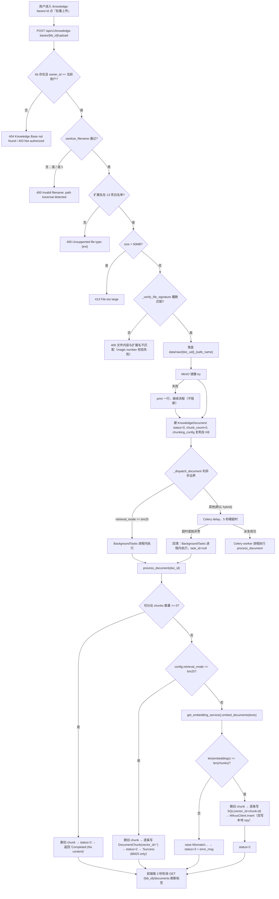

# kb-ingest · 知识库与文档摄取（需求正文）

- 模块：`kb-ingest`（知识库与文档摄取），需求前缀 `KB`
- 基线提交：`bf789d9e4fff51b7a2c0b661046f9e5c72b6e483`（`main`，2026-11-11）
- 上游：`requirements/project-card.md`（对象模型、场景 A）、`requirements/_conventions.md`（ID/basis/三态口径）
- 本模块**只**负责：建库 → 传文件 → 解析 → 切分 → 向量化/本地索引 → 就绪 → 分片/QA/预览/重处理。提问与检索生成见 `requirements/modules/rag-qa.md`。
- 说明：正文写"用户动作 → 系统处理 → 状态变化 → 用户结果"。每条事实后紧跟锚点。三态（已实现 / 已启用 / 已验证）逐条标注，**不得互相替代**。

---

## 0. 一句话

用户建一个知识库，把手册/规范/表格类文件丢进去，系统把文件变成"可定位到页的片段"；只有这些片段落库完成（`status=2`），后面的问答才能检索到它们。用户能看到的进度只有文档列表里的状态标签，**没有推送、没有取消、没有任务详情页**。

---

## 1. 流程 FLOW-KB-INGEST（上传 → 解析 → 切分 → 向量化 → 就绪）

---

## 2. 需求正文

### REQ-KB-001 创建知识库并选择检索方式

**用户预期**：建一个知识库时就能定"这个库用向量+关键词，还是只用本地关键词"，后面上传的文档按这个方式摄取；选错可以改。

**入口与前提**：已登录（JWT）。页面 `/knowledge-bases` 顶部"创建知识库"按钮（`frontend/src/views/KnowledgeBase.vue:5`）→ 对话框（`frontend/src/views/KnowledgeBase.vue:61`）。接口 `POST /api/v1/knowledge-bases/`（`src/api/routers/knowledge_base.py:219`），挂载前缀见 `src/main.py:257`。

**字段与校验**
- `name` 必填（`src/api/routers/knowledge_base.py:46`）；`description`、`is_public` 可选。
- `chunking_config` 为自由 JSON（`src/api/routers/knowledge_base.py:49`），唯一被强校验的键是 `retrieval_mode`：只允许 `hybrid` / `bm25`，否则校验器抛 `retrieval_mode must be hybrid or bm25`（`src/api/routers/knowledge_base.py:51-56`）。
- 同一校验器被 `KBUpdate` 复用（`src/api/routers/knowledge_base.py:64`），因此改库时也要守这条规则。
- 前端给的默认值：`retrieval_mode='hybrid'`、`method='recursive'`、`chunk_size=500`、`chunk_overlap=50`（`frontend/src/views/KnowledgeBase.vue:166-176`）。注意：这与后端未配置时的兜底值 1000/200 **不同**（`src/worker/tasks.py:95-107`）。

**正常操作与反馈**：成功后返回 `KBOut`（`id/kb_uid/name/description/is_public/chunking_config/created_at/owner_id`，`src/api/routers/knowledge_base.py:66-76`），前端弹"知识库创建成功"并关闭对话框（`frontend/src/views/KnowledgeBase.vue:199-208`）。

**异常与恢复**：`retrieval_mode` 非法 → 422（Pydantic 校验失败），前端只弹"创建知识库失败"（`frontend/src/views/KnowledgeBase.vue:207`），**不显示具体原因**。

**权限**：`owner_id` 固定取当前用户（`src/api/routers/knowledge_base.py:232`），不可代建。

**数据影响**：新增 1 行 `knowledge_bases`（`src/database/models.py:24-41`）。`vector_store_collection` 字段存在但建库时**未写入**（`src/api/routers/knowledge_base.py:226-233` 未传该参数），检索只按 `kb_id` 过滤，不按 collection 名。

**三态**：已实现；已启用（无开关）；**未验证**（本次未运行服务）。

**basis**：`observed`　**锚点**：`src/api/routers/knowledge_base.py:45-56,219-237`、`frontend/src/views/KnowledgeBase.vue:61-101,166-176`

---

### REQ-KB-002 上传前的四道门：文件名、扩展名、大小、魔数

**用户预期**：选错文件/超大文件/伪装扩展名的文件应当在"上传"这一步就被明确拒绝，而不是进了队列才失败，也不应该让服务端崩掉。

**入口与前提**：知识库详情页"批量上传"（`frontend/src/views/KnowledgeBaseDetail.vue:23-36`，可多选）。请求 `POST /api/v1/knowledge-bases/{kb_id}/upload`，`multipart/form-data`，字段 `file`（必填）+ `source_url`（可选，`src/api/routers/knowledge_base.py:315-316`）。

**四道门的顺序与文案**（严格按代码顺序）

| # | 检查 | 位置 | 失败结果 |
|---|---|---|---|
| 1 | `sanitize_filename`：空 → 400 `Filename cannot be empty`；含 `..` / `/` / `\` → 400 `Invalid filename: path traversal detected`；仅取 basename 并删 `\ / * ? : " < > \|` | `src/api/routers/knowledge_base.py:197-215` | 400 |
| 2 | 扩展名白名单 13 项：`.pdf .docx .doc .xlsx .xls .csv .pptx .ppt .md .html .htm .txt` | `src/api/routers/knowledge_base.py:145-148,331-336` | 400 `Unsupported file type: {ext}. Allowed: …` |
| 3 | 大小 `MAX_UPLOAD_SIZE = 50*1024*1024`；**先 `file.file.read()` 全量读进内存再判** | `src/api/routers/knowledge_base.py:339-345` | **413** `File too large: {n} bytes exceeds limit of 52428800 bytes` |
| 4 | 魔数 `_verify_file_signature`：`.txt/.md/.csv/.html/.htm` 直接跳过；`.pdf` 要 `%PDF`；`.docx/.xlsx/.pptx` 要 `PK\x03\x04`；`.doc/.xls/.ppt` 要 `\xd0\xcf\x11\xe0`；`len<4` → 400 `文件内容过短，无法验证类型` | `src/api/routers/knowledge_base.py:159-194` | 400 `文件内容与扩展名 '{ext}' 不匹配（magic number 校验失败）` |

**正常操作与反馈**：返回 `{"message":"File uploaded successfully","doc_id":N,"task_id":"…"}`（`src/api/routers/knowledge_base.py:404`）；回落同步时为 `{"message":"File uploaded (sync mode)","doc_id":N,"task_id":null}`（`src/api/routers/knowledge_base.py:411`）。前端对每个文件进"上传队列"折叠面板，成功弹 `文件 {name} 上传成功` 并 3 秒后出队（`frontend/src/views/KnowledgeBaseDetail.vue:44-56,330-357`）。

**异常与恢复**
- 大小超限返回 **413 而不是 400** —— 用例断言必须按 413 写，否则会把正确实现判成缺陷。
- 读文件进内存发生在 size 判断之前（`src/api/routers/knowledge_base.py:339`），50MB 上限只是接口门槛，**不是内存保护**。
- 落盘失败 → 500 `Failed to save file: {e}`（`src/api/routers/knowledge_base.py:382-383`）；落盘后立刻 `os.path.exists` 再确认一次（`src/api/routers/knowledge_base.py:363-364`）。
- 魔数校验只覆盖二进制 7 类；纯文本 5 类**完全不校验**，因此 `.txt` 里塞二进制不会在这一步被拦（`src/api/routers/knowledge_base.py:165-167`）。

**权限**：仅 `kb.owner_id == 当前用户`（`src/api/routers/knowledge_base.py:320-324`）。`is_public` 的知识库**不放开上传** —— 与"能读"不是一回事（对比 `src/api/routers/knowledge_base.py:281` 的读权限）。

**数据影响**：`data/raw/{doc_uid}_{safe_name}`（`settings.UPLOAD_DIR`，`src/settings.py:15`）；MinIO 对象名同文件名（`src/api/routers/knowledge_base.py:368`）。落盘成功后才建库行；被校验拦下的请求**不留任何文件、不留库行**。

**三态**：全部四道门已实现且默认启用；MinIO 镜像失败只 `print`（`src/api/routers/knowledge_base.py:374-380`）→ 「已实现、可降级」；**未验证**。

**basis**：`observed`　**锚点**：`src/api/routers/knowledge_base.py:143-215,311-411`

---

### REQ-KB-003 上传后的异步边界：三种情形，用户只看到一种

**用户预期**：点了上传就立刻返回"已收到"，解析在后台跑，界面能看到进度，别把页面卡住。

**系统实际处理**（`_dispatch_document`，`src/api/routers/knowledge_base.py:131-141`）

1. **bm25 库**：不进 Celery。`doc.celery_task_id=None` → 提交 → `background_tasks.add_task(process_document, doc.id)`（`src/api/routers/knowledge_base.py:132-137`）。代码注释的理由是"不派给可能尚未加载本地模式代码的在线 worker"（`src/api/routers/knowledge_base.py:133`）。执行发生在 **API 进程内**，请求返回后仍在跑。
2. **hybrid 库 + broker 可用**：`process_document_task.delay(doc_id)`，写入 `doc.celery_task_id`（`src/api/routers/knowledge_base.py:138-141`）。
3. **broker 不可用**：`_try_celery_delay` 在 `ThreadPoolExecutor` 里跑 `delay()`，`future.result(timeout=5)`（`src/api/routers/knowledge_base.py:29-41`）；超时/异常被外层 `except` 捕获，回落进程内（`src/api/routers/knowledge_base.py:405-411`）。Celery 侧另有 `broker_connection_retry=False`、`broker_connection_timeout=4` 让 producer 快速失败（`src/worker/celery_app.py:23-24`）。

**用户看到什么**：三种情形**返回文案不同，但前端只用了成功提示**。前端不读 `message`，也不读 `task_id`，只按 HTTP 成功推进（`frontend/src/views/KnowledgeBaseDetail.vue:345-357`）。因此用户无法从界面区分"进了队列"和"在本进程里同步跑"。

**进度与取消**
- 进度只能靠轮询：`usePolling(pollDocuments, POLL_FAST)`，`POLL_FAST=3000`（`frontend/src/composables/usePolling.js:8`），且仅当列表里存在 `status 0/1` 的文档或上传队列非空时才发请求（`frontend/src/views/KnowledgeBaseDetail.vue:316-328`）。
- 服务端 `process_document` 通过 `progress` 回调上报 `PROCESSING 10/30/50/70`、`SUCCESS 100`、`FAILED 100`（`src/worker/tasks.py:65,91,142,152,204,225`），但这条进度**只写进 Celery result backend**，没有对应 HTTP 端点；`src/api/routers/tasks.py` 未挂载（`src/main.py:255-265` 无该 include）。→ **用户侧不可见**。
- **没有取消机制**，也没有超时上限暴露给用户。

**三态**：三种分支均已实现；Celery 路径**是否其实在跑**取决于 broker/worker 是否在线，本轮未联网核实 → `unresolved`。前端轮询已实现且默认启用。

**basis**：`observed`（分支与超时数值）；是否真实异步执行 `unresolved`　**锚点**：`src/api/routers/knowledge_base.py:29-41,131-141,402-411`、`src/worker/celery_app.py:15-24`、`frontend/src/views/KnowledgeBaseDetail.vue:316-328`、`frontend/src/composables/usePolling.js:8`

---

### REQ-KB-004 解析与页号感知切分

**用户预期**：PDF/Word/Excel/PPT 都能进来；检索命中后能告诉我是"第几页"，不是"某处"。

**解析**：`MultiDocParser().parse(file_path)` 按后缀分派（`src/processors/multi_doc_parser.py:17-36`）：`.pdf` → `PDFParser`；`.docx/.doc` → 自写 docx 解析；`.xlsx/.xls/.csv` → Excel；`.pptx/.ppt` → PPT；`.md/.html/.htm/.txt` 各自；其他后缀 → `ValueError(f"Unsupported file type: {suffix}")`。
- PDF：PyMuPDF 逐页 `get_text()`，非空页写 `[Page {n}] {text}`（`src/processors/pdf_parser.py:58-59`）；空页回退 pdfplumber 的 `_extract_complex_page`（`src/processors/pdf_parser.py:61-63`）；默认 `use_ocr=False`（`src/processors/multi_doc_parser.py:14`）→ **扫描件不 OCR，大概率变成空页**。
- Excel 每 sheet 加 `[Page {i+1}] Sheet: {sheet}`（`src/processors/multi_doc_parser.py:80`）；PPT 每页加 `[Slide {i+1}]`（`src/processors/multi_doc_parser.py:93`）。
- 解析失败统一返回 `status="failed"` + `error_message`（`src/processors/multi_doc_parser.py:157-162`；`src/processors/pdf_parser.py:80-86`），由 worker 转成异常（`src/worker/tasks.py:88-89`）。

**切分**：`TextChunker`，`RecursiveCharacterTextSplitter`，分隔符 `["\n\n","\n","。","！","？","."," ",""]`（`src/processors/text_chunker.py:12-16`）。
- **PDF 走 `split_text_with_pages`**：先 `re.split(r"\[Page (\d+)\]", content)` 还原页边界，再逐页切，`page` 为真实页号（`src/worker/tasks.py:112-115`、`src/processors/text_chunker.py:69-95`）。
- **非 PDF 走 `split_document`**：整篇切，页号靠正文里残留的 `[Page N]` / `[Slide N]` 正则启发式（`src/processors/text_chunker.py:18-67`），跨页 chunk 的页码会失真。
- 配置优先级 **doc > kb > 硬编码 1000/200**（`src/worker/tasks.py:95-107`）。
- `chunk_id` 形如 `doc_{doc_id}_chunk_{i}`（`src/processors/text_chunker.py:51`、`:94`），全局递增。

**正常反馈**：`doc.chunk_count` 在切分后立即回写（`src/worker/tasks.py:119`），列表"分片数"列随之更新（`frontend/src/views/KnowledgeBaseDetail.vue:79`）。

**异常**：切出 0 个 chunk **不算失败**——删旧 chunk、`status=2`、返回 `"Completed (No content)"`（`src/worker/tasks.py:122-128`）。空文档在界面上显示"已完成 / 分片数 0"，用户看不出这是异常。

**三态**：已实现、已启用。**OCR 未启用**（`use_ocr=False`）→ 扫描件路径属"已实现未启用"。`method`（recursive/fixed/separator）这个前端下拉项**后端不消费**：`tasks.py` 只读 `chunk_size` / `chunk_overlap` / `retrieval_mode`（`src/worker/tasks.py:106-107,130`）→ **选"固定长度"和选"递归切分"结果一样**（`SPEC_GAP`）。

**basis**：`observed`　**锚点**：`src/processors/multi_doc_parser.py:14-36`、`src/processors/pdf_parser.py:58-63`、`src/processors/text_chunker.py:12-95`、`src/worker/tasks.py:84-128`、`frontend/src/views/KnowledgeBase.vue:77-84`

---

### REQ-KB-005 就绪：向量化、双写、以及 bm25 的短路

**用户预期**：文件状态变成"已完成"后，问答里就应该能检索到它的内容。

**hybrid 路径**（`src/worker/tasks.py:144-206`）
1. `embed_documents(texts)`，批大小 `min(EMBEDDING_BATCH_SIZE, EMBEDDING_MAX_BATCH_SIZE)` = `min(20,25)=20`（`src/embedding/dashscope_embedding.py:21`、`src/settings.py:50-51`）。非 200 直接 `raise`（`src/embedding/dashscope_embedding.py:37-38`）。
2. `len(embeddings) != len(chunks)` → `raise Mismatch between chunks ({n}) and embeddings ({m}) count`（`src/worker/tasks.py:149-150`）。
3. **先删本 doc 的旧 chunk**（`src/worker/tasks.py:159`），再逐条写 `DocumentChunk`，`vector_id = chunk.id`（`src/worker/tasks.py:169-178`）—— 同名 SQL 与向量 ID 一致。
4. `metadata` 补 `doc_id / kb_id / filename / text`（`src/worker/tasks.py:182-193`）。
5. `milvus_client.insert(vector_records)`（`src/worker/tasks.py:198`）→ 内部**先写本地 `LocalVectorStore`** 再写 Milvus（`src/database/vector_db.py:128`），Milvus 不可用或插入异常时返回 `False` 且**不抛**（`src/database/vector_db.py:130-131`、`:146-151`）。
6. `status=2`（`src/worker/tasks.py:201`）。

**bm25 路径**（`src/worker/tasks.py:130-140`）：删旧 chunk → 逐条写 `DocumentChunk` 且 `vector_id=""` → `status=2` → `"Success (BM25 only)"`。**不调 embedding、不写 Milvus、不写本地向量库。**

**矢量库降级**：Milvus 连接失败只 warning 并置 `_available=False`（`src/database/vector_db.py:35-41`）；此后 `search` 直接走 `_local_store.search`（`src/database/vector_db.py:172-174`），本地库落 `data/vectors/vectors.npy` + `vectors_meta.json`，tmp + `os.replace` 原子替换（`src/database/local_vector_store.py:64-87`）。

**数据影响**：`document_chunks` 行数 = `chunk_count`；`vector_id` 非空（`src/database/models.py:74` 声明 `nullable=False`，bm25 路径用空串满足非空约束）。删除知识库会按 `kb_id` 删向量（`src/database/vector_db.py:206-218`）并级联删文档/chunk/QA（`src/database/models.py:39-40`），但**不删 `data/raw` 里的物理文件**（`src/api/routers/knowledge_base.py:260-269` 只有 4 步，无 `os.remove`）。

**三态**：hybrid 与 bm25 两条路径均已实现；Milvus 降级路径已实现、是否真实生效取决于 Milvus 在线状态（`unresolved`，未联网核实）。

**basis**：`observed`　**锚点**：`src/worker/tasks.py:130-206`、`src/embedding/dashscope_embedding.py:17-43`、`src/database/vector_db.py:108-151,166-218`、`src/database/local_vector_store.py:64-87`

---

### REQ-KB-006 失败、重试与重新切分

**用户预期**：文件处理失败要能看见原因、能一键重来；改了切分参数要能对同一个文件重切。

**失败的统一形态**：`except` 里 `db.rollback()` → 重查 → `status=3`、`error_msg=str(e)` → commit，**不 re-raise**（`src/worker/tasks.py:208-229`）。代码注释写明理由：`update_state('FAILURE')` 会让 Celery 回读 meta 时抛 `ValueError: Exception information must include the exception type`（`src/worker/tasks.py:220-224`）。因此：
- 前端能看到"失败"标签（`frontend/src/utils/status.js:30`），
- 但 **`error_msg` 在界面上没有任何展示位置**（`frontend/src/views/KnowledgeBaseDetail.vue:59-106` 的表格列不含 error_msg，`DocumentOut` 也**不包含**该字段：`src/api/routers/knowledge_base.py:78-89`）→ 用户拿不到失败原因，这是可感知的可用性缺口。

**三个恢复入口**

| 入口 | 前提 | 行为 | 返回 |
|---|---|---|---|
| 单条"重试"（仅 `status===3` 时出现，`frontend/src/views/KnowledgeBaseDetail.vue:103`） | 原文件仍在磁盘 | `status=0`、`error_msg=None`、重新派发（`src/api/routers/knowledge_base.py:474-490`） | 文件丢失 → 400 `Original file not found on server` |
| "批量重试"（`frontend/src/views/KnowledgeBaseDetail.vue:38`） | 至少选 1 条 | 逐条校验 `kb.owner_id`，命中才重置 + 派发（`src/api/routers/knowledge_base.py:413-434`） | `{"message":"Restarted N documents"}`；**不返回哪些被跳过** |
| "重新切分"（`frontend/src/views/KnowledgeBaseDetail.vue:102,119-143`） | 可改策略/块大小/重叠/分隔符 | 有 `config` 时可改 `doc.chunking_config`；`retrieval_mode` 非法 → **422** `Invalid retrieval_mode`；随后 `status=0` 重派（`src/api/routers/knowledge_base.py:698-733`） | `{"message":"Reprocessing started",…}` |

**重新切分的实际语义**：前端表单字段名是 `strategy / chunk_size / chunk_overlap / separator`（`frontend/src/views/KnowledgeBaseDetail.vue:543-560`），后端读的是 `chunk_size` / `chunk_overlap` / `retrieval_mode`（`src/worker/tasks.py:106-107,130`）。**`strategy` 与 `separator` 落进 JSON 但没有任何消费者**（`SPEC_GAP`）。

**批量删除的副作用**：删物理文件用 `try/except: pass`（`src/api/routers/knowledge_base.py:448-452`），**文件删不掉也返回成功**；不调 `vector_db_client` 删该 doc 的向量 → **残留向量**（只在删整个库时才按 kb_id 清）。

**三态**：三个入口均已实现、已启用。失败原因对用户**不可见**属已核实的实现缺口（`observed`，非设计决定）。

**basis**：`observed`　**锚点**：`src/worker/tasks.py:208-229`、`src/api/routers/knowledge_base.py:78-89,413-490,698-733`

---

### REQ-KB-007 本地关键词检索入口（仅 bm25 库）

**用户预期**：选了"本地关键词（无需模型服务）"的库，应该有个不烧 token 的方式直接翻手册，命中后能跳到原文那一页。

**入口与前提**：仅当 `kb.chunking_config.retrieval_mode === 'bm25'` 时页面才显示检索区（`frontend/src/views/KnowledgeBaseDetail.vue:9-20,272`）。接口 `POST /api/v1/knowledge-bases/{kb_id}/search`（`src/api/routers/knowledge_base.py:507-519`）。

**字段校验**：`query` 长度 1–1000，`top_k` 默认 5、范围 1–20（`KeywordSearch`，`src/api/routers/knowledge_base.py:120-122`）。前端固定传 `top_k:5`（`frontend/src/views/KnowledgeBaseDetail.vue:283`）。前端空输入**静默不发请求**（`frontend/src/views/KnowledgeBaseDetail.vue:278`）。

**正常反馈**：返回 `{"data_source":"knowledge_base","retrieval_mode":"bm25","results":[{chunk_id,content,score,**metadata}]}`（`src/api/routers/knowledge_base.py:516-519`），metadata 展开后带 `filename/page/doc_id`，前端据此显示"`文件 · 第 N 页`"与"查看引用原文"（`frontend/src/views/KnowledgeBaseDetail.vue:14-19`）。

**异常**：非 bm25 库调此入口 → 400 `此入口仅用于本地关键词知识库`（`src/api/routers/knowledge_base.py:512-513`）。无命中时前端文案是"没有匹配片段，请调整关键词；不能据此判断现场故障原因。"（`frontend/src/views/KnowledgeBaseDetail.vue:13`）——**这句话本身就是产品口径**：检索无结果 ≠ 现场无此故障。

**实现特征（重要）**：这个入口**每次请求现场从 SQLite 重建索引**（`src/retrieval/knowledge_bm25.py:7-19`），不使用 `HybridRetriever` 里那份进程内缓存索引。所以它**能看到刚上传的新文档**，而 rag-qa 的混合检索**不能**（见 `requirements/modules/rag-qa.md` REQ-RAG-003）。

**三态**：已实现、已启用（仅 bm25 库）。**未验证**。

**basis**：`observed`　**锚点**：`src/api/routers/knowledge_base.py:120-122,507-519`、`src/retrieval/knowledge_bm25.py:7-19`、`frontend/src/views/KnowledgeBaseDetail.vue:9-20,272-291`

---

### REQ-KB-008 QA 对：生成、手建、编辑、删除、导出

**用户预期**：能从文档批量抽一批"问题+答案"，人工改一改，导成文件交给别人。

**生成**：`POST /api/v1/knowledge-bases/documents/{doc_id}/generate-qa?num_pairs=N`（`src/api/routers/knowledge_base.py:521-570`）。
- `num_pairs` 默认 5，被夹紧到 `[1,20]`（`src/api/routers/knowledge_base.py:524,533`）。
- 取该文档**前 10 条** chunk 拼文本（`src/api/routers/knowledge_base.py:541,548`）。
- **无 chunk 时不报错**，用占位串 `Document content for {filename}` 直接喂给 LLM（`src/api/routers/knowledge_base.py:546`）→ 会生成与文档内容无关的 QA 对。
- 生成器 prompt 截断 `text[:3000]`（`src/services/qa_generator.py:28`）；`json.loads` 失败返回 `[]`（`src/services/qa_generator.py:55-57`）→ 接口返回空数组，前端仍弹"QA 生成完成"（`frontend/src/views/KnowledgeBaseDetail.vue:429`）。
- **落库 `qa_type` 硬编码 `"single_hop"`**（`src/api/routers/knowledge_base.py:560`），尽管调用时未传类型、生成器内部默认是 `general`（`src/services/qa_generator.py:10`）→ 六种类型的能力**存在但走不到**（`SPEC_GAP`）。
- 新生成的行 `status=0`（待确认）（`src/api/routers/knowledge_base.py:561`）。

**手建**：`POST /documents/{doc_id}/qa-pairs`，`status=1`、`created_by=当前用户名`（`src/api/routers/knowledge_base.py:575-602`）。**改**：`PUT /qa-pairs/{qa_id}`，字段非 None 才覆盖，含 `status`（`src/api/routers/knowledge_base.py:604-630`）。**删**：`DELETE /qa-pairs/{qa_id}`（`src/api/routers/knowledge_base.py:632-648`）。**查**：`GET /documents/{doc_id}/qa-pairs`（`src/api/routers/knowledge_base.py:755-769`）。

**导出**：`GET /documents/{doc_id}/qa-pairs/download` → `text/markdown`，`Content-Disposition: attachment; filename=qa_pairs_{doc.filename}.md`，正文是 `# QA Pairs for …` + 每对 `## Question i (type)` / `**Q:**` / `**A:**`（`src/api/routers/knowledge_base.py:650-679`）。前端用 blob 下载、本地文件名退化为 `qa_pairs_{docId}.md`（`frontend/src/views/KnowledgeBaseDetail.vue:499-516`）——**与服务端给的文件名不一致**。

**权限**：全部要求 `kb.owner_id == 当前用户`，`is_public` 不放开（`src/api/routers/knowledge_base.py:537-538,587-588,616-617,643-644,661-662`）。

**三态**：功能全已实现、已启用。生成质量与类型多样化**未验证**（需真实模型，本轮 model_calls=0）。

**basis**：`observed`　**锚点**：`src/api/routers/knowledge_base.py:521-679`、`src/services/qa_generator.py:10-57`

---

### REQ-KB-009 分片查看与原文预览

**用户预期**：怀疑切得不好时，能看这个文件被切成了什么；想核对答案时，能打开原文那一页。

**分片**：`GET /api/v1/knowledge-bases/documents/{doc_id}/chunks`，`limit` 默认 100、**无上限**（`src/api/routers/knowledge_base.py:681-696`）。返回 `id/chunk_uid/content/page_num`（`src/api/routers/knowledge_base.py:111-117`）。前端以对话框表格展示 ID/内容/页码（`frontend/src/views/KnowledgeBaseDetail.vue:199-205,518-526`）。→ 超过 100 片的大文档，界面上**看不全**，且没有翻页。

**预览**：`GET /api/v1/knowledge-bases/documents/{doc_id}/preview`（`src/api/routers/knowledge_base.py:735-753`）。按 `file_type` 分流（`src/utils/preview_utils.py:56-183`）：
- `pdf` → `FileResponse(media_type="application/pdf", content_disposition_type="inline")`；
- `md` → markdown → bleach 白名单净化 → `text/html`；bleach 不可用时退化为正则删 `<script>/<iframe>/<object>/<embed>/on*`；
- `txt` → `html.escape` + `pre-wrap`；
- `docx/doc` → 逐段落/表格转 HTML（转义）；
- `xlsx/xls` → `pd.read_excel` + `to_html(escape=True)`；
- **其他类型** → `application/octet-stream` + `attachment`，强制下载。

文件不在磁盘 → 404 `File not found on server`（`src/api/routers/knowledge_base.py:750-751`）。前端 PDF 且带页码时拼 `#page=N` 实现跳页（`frontend/src/views/KnowledgeBaseDetail.vue:534`）。

**副作用（重要）**：`docx` 预览的样式串里有**未转义的花括号**（`src/utils/preview_utils.py:113`），f-string 之外的 `.format` 冲突风险存在 —— 该分支被 `try/except` 包住，异常时返回 `text/plain` 的 `Error previewing DOCX: …`（`src/utils/preview_utils.py:145-146`）。**本轮不运行，无法确认是否真的会走到该分支** → 记为 `unresolved`。

**三态**：已实现、已启用；docx 分支是否稳定 `unresolved`。

**basis**：`observed`　**锚点**：`src/api/routers/knowledge_base.py:681-696,735-753`、`src/utils/preview_utils.py:56-183`

---

### REQ-KB-010 权限边界与删除的真实影响

**用户预期**：我的知识库别人不能动；我删了就该彻底没了。

**读权限**：`owner_id == 当前用户 or is_public`（`src/api/routers/knowledge_base.py:281-282` 单库、`:501-502` 文档列表）。
**写权限**：仅 `owner_id == 当前用户`（建 `:232`、改 `:295-296`、删 `:257-258`、上传 `:323-324`、重试 `:471-472`、重处理 `:711-712`、QA 全链 `:537,587,616,643,661`）。

**列表页的已知偏差**：`GET /api/v1/knowledge-bases/` **只返回自己的库**（`src/api/routers/knowledge_base.py:244-246`，源码注释直白写着 `For now just user's`）。但单库 `GET /{kb_id}` 允许读 `is_public` 库 → **别人可以知道 id 就能读，却无法在列表里发现它**。

**删除知识库的四步**（`src/api/routers/knowledge_base.py:260-269`）：按 `kb_id` 删 Milvus/本地向量 → SQLAlchemy 级联删文档与 chunk → 级联删 QA → 删 KB 行。**不做**：不删 `data/raw` 物理文件、不清 BM25 进程内索引（那份索引本来也不刷新，见 rag-qa）。
**删除文档**：`os.remove` 失败被吞（`src/api/routers/knowledge_base.py:448-452`）、**不删该 doc 的向量**。

**可观察结果**：删除后 `GET /{kb_id}` 返回 404；`GET /{kb_id}/documents` 返回 404；但磁盘文件仍在、向量可能仍在 → 若重建同名库并复用 id，可能出现"检索到已删文档文本"的情况（**推断，未验证**，记 `unresolved`）。

**basis**：`observed`（权限与删除步骤）；"残留向量导致串数据"为推断，`unresolved`　**锚点**：`src/api/routers/knowledge_base.py:239-309,436-457`、`src/database/models.py:39-40`、`src/database/vector_db.py:206-218`

---

## 3. 三态汇总（本模块）

| 能力 | 已实现 | 已启用 | 已验证 |
|---|---|---|---|
| 建库 + retrieval_mode 校验 | 是 | 是 | 否（本轮只读） |
| 四道上传门（名/扩展名/50MB/魔数） | 是 | 是 | 否 |
| MinIO 镜像 | 是 | 是 | 否；失败仅 print，不阻断 |
| bm25 进程内 / hybrid Celery / 回落同步 | 是 | 是 | 否；Celery 是否在线 `unresolved` |
| 页号感知切分（PDF） | 是 | 是 | 否 |
| OCR（扫描件） | 是 | **否**（`use_ocr=False`） | 否 |
| `method`(recursive/fixed/separator/semantic) 生效 | **否**（后端不消费） | — | — |
| hybrid 向量化 + SQL/Milvus 双写 | 是 | 是 | 否 |
| bm25 短路（不调 embedding） | 是 | 是 | 否 |
| Milvus 不可用降级本地 npy | 是 | 是 | 否（未联网核实） |
| 失败置 status=3 且不 re-raise | 是 | 是 | 否 |
| 失败原因对用户可见 | **否**（`error_msg` 不进 `DocumentOut`、界面无位置） | — | — |
| 单条重试 / 批量重试 / 重新切分 | 是 | 是 | 否 |
| 本地关键词检索入口 | 是 | 是（仅 bm25 库） | 否 |
| QA 生成/手建/编辑/删除/导出 | 是 | 是 | 否；`qa_type` 恒 single_hop |
| 分片查看（上限 100，无翻页） | 是 | 是 | 否 |
| 原文预览（5 类分流 + 未知类型强制下载） | 是 | 是 | 否；docx 分支 `unresolved` |
| 任务进度推送 / 取消 | **否** | — | — |

---

## 4. 未决与缺口（汇总到 `specs/questions.md`）

1. **`method` / `separator` 无消费者**：前端可选 4 种切分方式（`frontend/src/views/KnowledgeBase.vue:77-84`），后端只读 `chunk_size`/`chunk_overlap`/`retrieval_mode`（`src/worker/tasks.py:106-107,130`）。用户以为换了策略，实际没变。
2. **失败原因不可见**：`DocumentOut` 不含 `error_msg`（`src/api/routers/knowledge_base.py:78-89`），界面无展示位 → 状态 3 只有一个红标签。
3. **前端默认 chunk_size=500/50 与后端兜底 1000/200 不一致**（`frontend/src/views/KnowledgeBase.vue:166-176` vs `src/worker/tasks.py:95-107`）→ 不经过前端建的库与经过前端建的库切分结果不同。
4. **删除文档不清向量**（`src/api/routers/knowledge_base.py:436-457`），只在删库时按 kb_id 清（`src/database/vector_db.py:206-218`）。
5. **`vector_store_collection` 字段建库时不写**（`src/api/routers/knowledge_base.py:226-233`），检索也不按它过滤 —— 该字段是否废弃 `unresolved`。
6. **Celery / broker / Milvus / MinIO 在线状态**：本轮未联网，一律 `unresolved`（见 `specs/questions.md` Q-21）。
7. **`GET /knowledge-bases/` 不含 public 库**（`src/api/routers/knowledge_base.py:244-246`），与单库读权限不对称 —— 是有意还是待办 `unresolved`。

---

## 5. 参考锚点清单

- 端点与校验：`src/api/routers/knowledge_base.py:29-41,125-215,219-309,311-411,413-490,492-519,521-570,575-679,681-696,698-733,735-769`
- 处理纯函数：`src/worker/tasks.py:34-232`；Celery 配置 `src/worker/celery_app.py:6-24`
- 解析/切分：`src/processors/multi_doc_parser.py:14-162`、`src/processors/pdf_parser.py:32-86`、`src/processors/text_chunker.py:9-95`
- 向量：`src/database/vector_db.py:26-218`、`src/database/local_vector_store.py:64-262`、`src/embedding/dashscope_embedding.py:9-52`
- 本地关键词：`src/retrieval/knowledge_bm25.py:7-19`
- 预览：`src/utils/preview_utils.py:19-183`
- 前端：`frontend/src/views/KnowledgeBase.vue:5-244`、`frontend/src/views/KnowledgeBaseDetail.vue:9-618`、`frontend/src/composables/usePolling.js:8`、`frontend/src/utils/status.js:30-33`
- 模型：`src/database/models.py:24-93`
