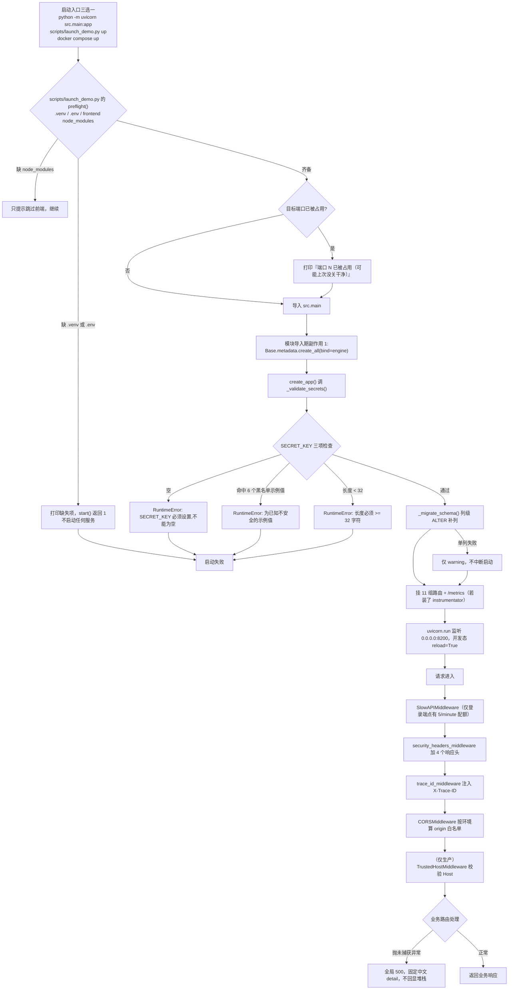

# platform · 平台启动、配置、安全与 CI（需求正文）

- 模块：`platform`（平台启动/配置/安全/CI），需求前缀 `PLAT`
- 基线提交：`bf789d9e4fff51b7a2c0b661046f9e5c72b6e483`（`main`，2026-11-11）
- 上游：`requirements/project-card.md`（已确认决定 D4 端口 8200、D5 NO_PROXY、D6 SECRET_KEY 校验、D10 CI 假密钥）、`requirements/_conventions.md`（ID/basis/三态口径）
- 本模块**只**负责：进程能不能起来 → 起来后建什么表 → 读哪份配置 → 请求进来先过哪几道中间件 → 出错对外说什么 → 部署形态 → CI 用什么门禁拦住回归。业务端点内部逻辑见各功能模块。
- 说明：三态（已实现 / 已启用 / 已验证）逐条标注，**不得互相替代**。本轮只读源码与配置，**未运行**任何服务、测试、容器，因此"已验证"列一律为否。

---

## 0. 一句话

这个模块不产生业务价值，它决定"服务能不能起来、起来后对外露出什么面、哪类改动会被 CI 拦住"。它的失败模式是**启动即死**或**静默降级**，两者都不给业务层留补救时间。

---

## 1. 流程 FLOW-PLAT（启动与请求进入）

补充：`src/main.py:281` 的 `app = create_app()` 是**模块级**执行，所以任何 `import src.main` 的进程（含测试、脚本）都会先跑一遍密钥校验与列迁移，不存在"只导入不启动"的旁路。

---

## 2. 需求正文

### REQ-PLAT-001 启动前置条件与四类启动失败的落点

**用户预期**：我按文档敲一条命令就能起来；起不来时必须**立刻**告诉我缺什么，而不是跑起来后在第一个登录请求上才炸。

**入口与前提**：三个真实入口——`python -m uvicorn src.main:app --port 8200`（`scripts/demo.sh:35`）、`python scripts/launch_demo.py up`（`start_demo.bat:2` 菜单项 1）、`docker compose -f docker/docker-compose.yml up`（`docker/docker-compose.yml:4-9`）。`src/main.py:283-288` 的 `__main__` 分支只服务"直接 `python -m src.main`"这一种走法。

**字段与校验**
- `.venv/Scripts/python.exe` 缺失 → `launch_demo.py` 的 `preflight()` 打印"缺虚拟环境"并返回 False，`start()` 直接 `return 1`（`scripts/launch_demo.py:258-277`）。
- `.env` 缺失 → 同一处打印"缺 .env 文件"，同样 `return 1`（`scripts/launch_demo.py:263-269`）。
- `frontend/node_modules` 缺失 → 只打印"将跳过前端"，**不阻断**（`scripts/launch_demo.py:266-269`）。
- `SECRET_KEY` 三项检查（`src/main.py:47-61`）：空值、命中 6 个示例值黑名单（`unsafe-secret-key` / `your-super-secret-key-change-it` / `your-secret-key` / `change-me` / `secret` / `changeit`，`src/main.py:36-43`）、长度不足 32（`src/main.py:44`）。三条都先 `logger.critical` 再 `raise RuntimeError`。

**正常操作与反馈**：全部通过则 `create_app()` 顺序执行"密钥校验 → 列迁移 → 建 app → 挂中间件 → 挂 11 组路由 → 挂 /metrics"（`src/main.py:177-279`）。成功标志是 UVicorn 打出监听行，且 `GET /health` 返回 `{"status":"ok","version":"1.0.0"}`（`src/api/routers/health.py:14-16`）。

**异常与恢复**
- **密钥不合格 = 进程起不来**，且异常发生在 `create_app()` 内、`uvicorn.run` 之前 → 没有半启动状态（`src/main.py:178`）。
- **端口冲突**：`launch_demo.py` 自带占用检测（`scripts/launch_demo.py:299-309`）并打印提示，但它**只打印不退出**，随后仍会拉起其余服务；裸 uvicorn 走法下冲突由操作系统报 `winerror 10013`。这正是选 8200 的原因——避开 Windows 保留段 7911-8010（`src/main.py:285` 注释原文）。
- **依赖缺失降级**：`prometheus-fastapi-instrumentator` 未装 → `_HAS_PROMETHEUS` 为假，只 warning 并跳过 `/metrics`，其余功能不受影响（`src/main.py:23-28,155-157`）；`bleach` 未装 → 预览净化降级为正则删除（`src/utils/preview_utils.py:13-16,44-46`）。
- **数据库不可写**：`Base.metadata.create_all` 在导入期执行（`src/main.py:31`），失败即导入失败，无法绕过。

**权限**：启动动作只对"能改本机 .env 与能起进程的人"开放，没有鉴权层。

**数据影响**：`src/settings.py:381-383` 在**导入 settings 时**就 `os.makedirs` 创建 `UPLOAD_DIR`/`PROCESSED_DIR`/`VECTOR_DIR`，即"只读配置"也会留下目录副作用。`scripts/create_tables.py:10` 是独立建表入口，功能与导入期 `create_all` 重复。

**三态**：已实现=是；已启用=是（无开关）；已验证=否（本轮未运行）。

**basis**：`observed`（四类失败分支均为源码直读）。**锚点**：`src/main.py:31,36-61,177-179,283-288`、`scripts/launch_demo.py:258-277,299-309`、`scripts/demo.sh:35`、`scripts/create_tables.py:6-11`、`src/settings.py:381-383`

---

### REQ-PLAT-002 数据库引导：create_all 加列级 ALTER，没有迁移框架

**用户预期**：我 pull 到新代码直接启动，旧库里应该自动补齐新字段，不用手动执行建表脚本。

**入口与前提**：任何进程导入 `src.main`。数据库是 **SQLite**，`sqlite:///./rag_system.db`（`src/settings.py:103`），不是 PostgreSQL。

**字段与校验**
- 第 1 步：`Base.metadata.create_all(bind=engine)`（`src/main.py:31`）——只建**缺失的表**，不改已存在的表。
- 第 2 步：`_migrate_schema()`（`src/main.py:89-144`）用 `inspect(engine)` 取真实列，与 `Base.metadata.sorted_tables` 逐表逐列 diff，缺列则拼 `ALTER TABLE "{table}" ADD COLUMN "{col}" {sql_type} DEFAULT {default}`（`src/main.py:138`）。
- 类型映射由 `_TYPE_MAP` 决定（`src/main.py:98-108`）；DEFAULT 生成规则：布尔→1/0、数值→字符串、字符串→单引号包裹（`src/main.py:128-137`）。
- 逐列 `conn.commit()`，单列失败只 `logger.warning` 并继续（`src/main.py:139-144`）——**迁移失败不会让启动失败**。

**正常操作与反馈**：补齐成功的列会打 `[schema-migrate] {表}.{列} ({类型}) 已补齐`（`src/main.py:141`）。

**异常与恢复**：见 `src/main.py:92-94` docstring 原文——`create_all` 只建新表、不改旧表；模型新增列后 SQLite 不会自动迁移，导致 INSERT 500。故 `_migrate_schema()` 是补丁：**它能补列，不能删列、改类型、加约束、回滚**。删除模型里的列或改可空性，SQLite 侧会留下陈旧结构。

**权限**：无。迁移在生产环境同样自动执行。

**数据影响**：只做 `ADD COLUMN`，带 DEFAULT 时不改写已有行。`src/database/sql_session.py:13-21` 另在连接事件里设 `PRAGMA journal_mode=WAL` 与 `PRAGMA busy_timeout=10000`，注释说明这是为"Celery worker + API 多进程并发写同一 SQLite"（`src/database/sql_session.py:14-15`）。

**三态**：已实现=是；已启用=是；已验证=否（未实际执行迁移）。表数量口径：`src/database/models.py` 实有 **20** 个 `__tablename__`，与 `requirements/project-card.md` 写的 24 张不一致（见 §4）。

**basis**：`observed`。**锚点**：`src/main.py:31,89-144`、`src/database/sql_session.py:5-25`、`src/settings.py:103`、`src/database/models.py:7-22`

---

### REQ-PLAT-003 配置分层、单例与死配置

**用户预期**：所有可调项集中在一个 `.env` 里；改了要生效；没被任何代码读的那几项别让我白调。

**入口与前提**：`Settings(BaseSettings)`，`env_file=".env"`、`extra="ignore"`（`src/settings.py:360-364`），模块级 `settings = Settings()`（`src/settings.py:367`）。因此**全仓只有一个配置对象实例**，导入即定值，运行中无法热改。

**字段与校验**：实测 **136 个字段**（`src/settings.py` 行号 9–302），`.env.example` 顶层键同为 **136 个且完全一致**；`tests/test_configuration_audit.py:92-99` 正是校验"示例文件无缺失/未知/重复字段"。关键默认值：`APP_ENV=development`（`src/settings.py:10`）、`DEBUG=True`（`:11`）、`API_PREFIX=/api/v1`（`:12`）、`SECRET_KEY` 空串（`:19`）、`ACCESS_TOKEN_EXPIRE_MINUTES=480`（`:20`）、`ALLOWED_ORIGINS` 空（`:25`）、`ALLOWED_HOSTS=*`（`:26`）。

**正常操作与反馈**：`settings` 的派生属性把零散字段收敛成可直接用的结构——`MCP_SERVERS`（`src/settings.py:304-323`）、`MCP_TERMCP_SERVER`（`:325-330`）、`RESOLVED_CHANGE_ES_URL`（`:332-335`）、`RESOLVED_LLM_API_BASE`（`:337-348`）、`RESOLVED_LLM_API_KEY`（`:350-353`）、`RESOLVED_LLM_FALLBACK_API_KEY`（`:355-358`）。

**异常与恢复**：配置项**没有取值校验**（除启动期单独的 SECRET_KEY 检查）。把 `ALLOWED_ORIGINS` 写成不存在的域名不会报错，只会让跨域静默失败。

**权限**：`.env` 不进镜像（`.dockerignore:3-6` 排除 `.env` 与 `.env.*`），容器靠 compose environment 注入（`docker/docker-compose.yml:17-25`）。

**数据影响（死配置，逐条已 grep 核实）**：`CHUNK_SIZE`（`src/settings.py:106`）、`CHUNK_OVERLAP`（`:107`）、`TOP_K`（`:108`）、`RAG_MIN_SCORE`（`:110`）、`LONG_TERM_MEMORY_COLLECTION`（`:195`）在 `src/` 内**除定义处外无任何引用**——调它们没有任何效果。另有一批默认关闭的能力开关（`ENABLE_SUPERVISOR` `:185`、`ENABLE_HITL` `:187`、`ENABLE_STEP_SNAPSHOTS` `:154` 等）属于"已实现但未启用"，与"死配置"不是同一件事。

**三态**：已实现=是；已启用=是（读取 `.env`）；已验证=否。死配置口径=已 grep 断言"无引用"。

**basis**：`observed`。**锚点**：`src/settings.py:8-26,103-110,185-196,304-367,369-383`、`.dockerignore:3-6`、`docker/docker-compose.yml:17-25`、`tests/test_configuration_audit.py:92-99`

---

### REQ-PLAT-004 路由挂载清单与两条未挂载的死路由

**用户预期**：文档和 OpenAPI 里出现的每个接口都应该真能调；调不通的要明确告诉我它不存在。

**入口与前提**：`create_app()` 尾部连续 11 次 `include_router`（`src/main.py:255-265`）。

**字段与校验**：11 组前缀均以 `settings.API_PREFIX`（`/api/v1`）为基：`/health`、`/auth`、`/knowledge-bases`、`/assistants`、`/agents`、`/monitor`、`/storage`、`/chat`、`/aiops`、`/evaluations`、`/upload`（最后一组带 `# Legacy` 注释，`src/main.py:265`）。

**正常操作与反馈**：未挂载路由返回 404，符合 FastAPI 默认行为。

**异常与恢复**：`src/api/routers/` 下实有 13 个模块文件，其中 **`query.py` 被 import 但从未 `include_router`**（`src/main.py:16` vs `:255-265`），**`tasks.py` 连 import 都没有**。两者是死代码：既不暴露，也不参与任何链路。`src/main.py:267-276` 另有一段被整块注释掉的 RAG MCP 同进程挂载代码，明确写着改走独立进程 `python mcp_servers/rag_server.py`（端口 8105）。

**权限**：挂载本身不做鉴权；每组内部的 `Depends(get_current_user)` 各自负责（见 auth-console 模块）。

**数据影响**：无。

**三态**：已实现=是（11 组）；死路由=已确认未启用；已验证=否。

**basis**：`observed`。**锚点**：`src/main.py:16,255-276`、`src/api/routers/`

---

### REQ-PLAT-005 请求进入链：限流、CORS、主机白名单、安全头、trace

**用户预期**：任何请求都带着可追踪的 id 出去；跨域只放该放的源；登录接口不能无限试；响应头别把服务指纹和点击劫持风险送出去。

**入口与前提**：无业务前置，所有请求必经。注册顺序见 `src/main.py:200-243`。

**字段与校验**
- **限流**：全仓唯一限流器 `Limiter(key_func=get_remote_address)`（`src/utils/rate_limit.py:9`），`app.state.limiter` + `RateLimitExceeded` 处理器 + `SlowAPIMiddleware`（`src/main.py:200-202`）。**全仓只有一处配额**：`@limiter.limit("5/minute")` 落在登录端点（`src/api/routers/auth.py:62`）。其余所有端点无限流。
- **CORS**：`_build_cors_origins()`（`src/main.py:64-87`）。生产读 `ALLOWED_ORIGINS` 逗号切分，**为空则返回 `[]` 并 warning**（`:77-78`），即拒绝一切跨域；开发态硬编码 6 个源：`localhost/127.0.0.1` 各配 `5273`、`3000`、`8080`（`:80-87`）——**没有 5173**。`allow_credentials=True`、方法/头全放开（`src/main.py:214-220`）。
- **主机白名单**：`TrustedHostMiddleware` **仅生产**挂载，`ALLOWED_HOSTS` 逗号切分、空则 `['*']`（`src/main.py:205-211`）。
- **安全头**：`X-Content-Type-Options=nosniff`、`X-Frame-Options=SAMEORIGIN`、`Referrer-Policy=strict-origin-when-cross-origin`、`X-XSS-Protection=1; mode=block`（`src/main.py:223-230`）。
- **trace**：`set_trace_id()` 默认取 `uuid4().hex[:12]`（`src/utils/tracing.py:27-30`），写入 `request.state.trace_id` 与响应头 `X-Trace-ID`，`finally` 里 `reset_trace_id()`（`src/main.py:233-243`）。

**正常操作与反馈**：任意响应都能看到 4 个安全头与 `X-Trace-ID`；`tests/test_security.py:171-192` 已有 CORS 两态断言（开发态 evil origin 的 OPTIONS 断言放宽到 `200/400`，生产态断言 origin 列表不含 `*`）。

**异常与恢复**：限流超限返回 429（响应体格式属 slowapi 私有实现，本资料**不逐字断言**）。CORS 未命中时浏览器侧表现为预检失败。

**权限**：以上均为进程级策略，不区分用户。

**数据影响**：无。

**三态**：已实现=是；已启用=是（开发态 CORS 列表恒生效）；已验证=否。已知不对称：开发态白名单含 5273/3000/8080 却**不含** README 声称的 5173（`README.md:147` 仍写 5173），故按 README 用 5173 起前端会跨域失败。

**basis**：`observed`。**锚点**：`src/main.py:64-87,200-211,214-230,233-243`、`src/utils/rate_limit.py:9`、`src/api/routers/auth.py:62`、`src/utils/tracing.py:22-40`、`tests/test_security.py:171-192`、`README.md:147`

---

### REQ-PLAT-006 错误外泄边界与文档/指标端点开关

**用户预期**：线上出错别把堆栈、SQL、内网地址吐给浏览器；接口文档在生产不要对外开放。

**入口与前提**：`is_prod = settings.APP_ENV == "production"`（`src/main.py:181`）。

**字段与校验**
- 文档三件套：`docs_url`/`redoc_url`/`openapi_url` 在生产一律置 `None`，非生产分别为 `/docs`、`/redoc`、`/openapi.json`（`src/main.py:189-197`）。
- 全局兜底：`@app.exception_handler(Exception)` 先 `logger.error(..., exc_info=True)`，再返回 **500 + 固定中文 detail「服务处理异常，请稍后重试」**（`src/main.py:246-252`）。
- 指标端点：装了 instrumentator 才有 `/metrics`，且 excluded_handlers 排除 `/metrics`、`/docs`、`/redoc`、`/openapi.json`（`src/main.py:162-172`）。本仓 `requirements.txt:127-129` 已钉 `prometheus_client` 与 `prometheus-fastapi-instrumentator`，故正常运行下 `/metrics` **会**挂载。

**正常操作与反馈**：生产访问 `/docs` 得到 404；任何未捕获异常对客户端只露出那一句中文，堆栈只进日志。

**异常与恢复**：`HTTPException` 不走这个兜底（FastAPI 自己的处理器先接），所以 401/403/404/409 的 detail 仍是业务文案；只有**未捕获**异常被统一成 500 中文。

**权限**：`/metrics` 与 `/docs` 都**没有鉴权**；生产靠置 None 关掉文档，但 `/metrics` 在生产是否也应关闭**无依据**（见 §4）。

**数据影响**：无。

**三态**：已实现=是；已启用=是（`/metrics` 依赖安装，本仓已装）；已验证=否。

**basis**：`observed`。**锚点**：`src/main.py:147-174,177-197,246-252`、`requirements.txt:127-129`

---

### REQ-PLAT-007 运行平台与容器化：8200 与 8000 两套口径

**用户预期**：本机直接跑和用容器跑，我都能确定该访问哪个端口；容器里不该塞进我的 `.env` 和本地数据库。

**入口与前提**：本机三条入口见 REQ-PLAT-001；容器入口 `docker compose -f docker/docker-compose.yml up`。

**字段与校验**
- 本机：`uvicorn.run(..., host="0.0.0.0", port=8200, reload=is_dev)`（`src/main.py:288`），`reload` 仅在非 production 打开（`:287`）。`launch_demo.py` 拉的 api 进程用 `--host 127.0.0.1 --port 8200`（`scripts/launch_demo.py:44-64` 的 api 项），并以 `http://127.0.0.1:8200/docs` 当就绪探针。
- 容器：`docker/Dockerfile` 用 `EXPOSE 8000` 且 `CMD ["uvicorn","src.main:app","--host","0.0.0.0","--port","8000"]`（`docker/Dockerfile:22,25`），compose 再映射 **`8200:8000`**（`docker/docker-compose.yml:4-9`）。**容器内 8000、宿主 8200，与本机直跑的 8200 不同源**。
- compose 关键环境：`APP_ENV=development`、`DATABASE_URL=sqlite:////compose-db/rag_system.db`（`docker/docker-compose.yml:17-25`），注释说明"SQLite WAL 在 Windows 绑定挂载上不可靠，运行时库放 Docker volume"（`docker/docker-compose.yml:18`）。
- 服务面：app、worker（celery）、flower(5555)、frontend(5273→80)、rabbitmq、etcd、minio、milvus-standalone、redis、termcp（profile 门控）、termcp-gateway、diagnostic-target、probe-gateway（`docker/docker-compose.yml:4-245`）。object storage 镜像为 `pgsty/silo`（`docker/docker-compose.yml:142`），与官方 `minio/minio` 不同源。
- 前端镜像：多阶段 node:20-alpine → nginx:alpine-slim，构建参数 `VITE_API_BASE=/api/v1`，nginx 侧有 SPA 回退、`/assets/` 一年 immutable 缓存、三个安全头、`location ~ /\.` 全拒绝（`docker/frontend.Dockerfile:5-49`）。
- 构建上下文排除：`.env`、`.env.*`、`.venv`、`node_modules`、`frontend/dist`、`*.db`、`*.sqlite`、`logs`、`runtime`（`.dockerignore:1-30`）。

**正常操作与反馈**：本机访问 `http://127.0.0.1:8200/docs`；容器访问同一宿主端口的 8200（映射后），容器内部看到的是 8000。

**异常与恢复**：后端**不托管** `frontend/dist`——全仓没有 `StaticFiles`，只有 `/metrics` 一个 mount（`src/main.py:172`）。所以"只跑后端就能用前端"不成立，必须另跑 vite（5273）或 nginx 容器。

**权限**：服务账号面未在本任务范围内核实（compose 未显式设 `user:`，diagnostic-target 例外：`read_only`、`cap_drop: ALL`、`no-new-privileges`、seccomp、`pids_limit`、`mem_limit`、`cpus` 全限制，`docker/docker-compose.yml:218-244`）。

**数据影响**：`data/`、`logs/`、`runtime/` 与 SQLite 文件在宿主侧持久化；容器内 `/app` 挂的是 `../`（`docker/docker-compose.yml:11-15`）。

**三态**：已实现=是；已启用=是（compose 可直接起）；已验证=否（本轮未启动容器）。

**basis**：`observed`。**锚点**：`src/main.py:172,283-288`、`docker/Dockerfile:22-25`、`docker/docker-compose.yml:4-25,142,218-244`、`docker/frontend.Dockerfile:5-49`、`.dockerignore:1-30`、`scripts/launch_demo.py:44-64`

---

### REQ-PLAT-008 CI 门禁与"离线"口径

**用户预期**：每次 push/PR 都跑得起来、不花钱、不用外部服务；改坏判定逻辑必须当场红。

**入口与前提**：`.github/workflows/tests.yml`（`name: offline-tests`），触发 `push` 到 main、`pull_request`、`workflow_dispatch`，跑在 `ubuntu-latest` + Python 3.12（`.github/workflows/tests.yml:1-28`）。

**字段与校验**
- 环境变量只注入一个**占位假密钥**用于让 LLMClient 构造时不抛 `Missing credentials`，注释明确"真实密钥永远不进 CI"（`.github/workflows/tests.yml:17-20`）。
- 依赖安装前先过滤重型包：`grep -viE '^(paddlepaddle|paddleocr|paddlex|modelscope|opencv-contrib-python|datasets|ragas|unstructured)' requirements.txt > /tmp/req-ci.txt`（`.github/workflows/tests.yml:38`）。
- **两步门禁，顺序不可换**：先 `python -m pytest -q tests/test_recorded_round_replay.py`，步骤名为 `Decision-rule gate (recorded paid rounds must not regress)`（`.github/workflows/tests.yml:46-47`）；再 `python -m pytest -q -m "not integration"`（`.github/workflows/tests.yml:49-50`）。前者是零模型调用的回放门禁，语料为 `tests/data/recorded-rounds.json.gz`（`.github/workflows/tests.yml:41-45`）。
- 另一个 workflow `deploy-pages.yml` 只发布 `docs/site` 到 GitHub Pages，**与测试无关**（`.github/workflows/deploy-pages.yml:1-45`）。

**正常操作与反馈**：本地与 CI 同口径由 `pytest.ini` 保证——`testpaths = tests`、注册 `integration` marker、`addopts = -ra -m "not integration"`（`pytest.ini:3,9-13`）。即**本地裸跑 `pytest` 也默认跳过集成测试**。

**异常与恢复**：门禁失败分两类——第一类是回放轮次变红（判定逻辑被改坏），第二类是离线单测红。集成测试在 CI **永远不跑**，所以"MCP/Redis/Milvus/MinIO 连通性"没有任何 CI 覆盖。

**权限**：workflow 走默认 `GITHUB_TOKEN`；`deploy-pages.yml` 额外要 `pages: write` 与 `id-token: write`（`.github/workflows/deploy-pages.yml:14-17`）。

**数据影响**：无（CI 用 `sqlite:///:memory:`，见 `tests/conftest.py:6`）。

**三态**：已实现=是；已启用=是；已验证=否。测试规模实测：`tests/test_*.py` **111 个**，前端 `*.test.js` **18 个**（前端测试不进 CI，只在本地 `npm test`）。

**basis**：`observed`（CI 文件与本地 pytest 配置直读；未实际触发 workflow）。**锚点**：`.github/workflows/tests.yml:1-50`、`.github/workflows/deploy-pages.yml:1-45`、`pytest.ini:3-13`、`tests/conftest.py:6-7`、`frontend/package.json:6-11`、`frontend/vitest.config.js:5-9`

---

## 3. 三态汇总（本模块）

| 能力 | 已实现 | 已启用 | 已验证 |
|---|---|---|---|
| SECRET_KEY 三项启动校验 | 是 | 是 | 否 |
| `.venv`/`.env` 缺失即拒绝启动 | 是 | 是 | 否 |
| 端口占用检测（只提示不退出） | 是 | 是 | 否 |
| 端口 8200 避 Windows 保留段 | 是 | 是 | 否（理由在注释里，属 `confirmed` 依据） |
| create_all + 列级 ALTER 迁移 | 是 | 是 | 否 |
| 无 Alembic / 无降级迁移 | — | — | — （能力本身不存在） |
| 136 项配置单例读取 | 是 | 是 | 否 |
| 5 项死配置（CHUNK_SIZE 等） | 是（有字段） | **否**（无消费方） | 已 grep 断言无引用 |
| 11 组路由挂载 | 是 | 是 | 否 |
| query.py / tasks.py 路由 | **否**（未挂载） | — | — |
| 登录限流 5/minute | 是 | 是 | 否 |
| 其余端点限流 | **否** | — | — |
| 开发态 CORS 6 源 | 是 | 是 | 否 |
| 生产 CORS 空即拒绝 | 是 | 是 | 否 |
| TrustedHost 仅生产 | 是 | 是 | 否 |
| 4 个安全响应头 | 是 | 是 | 否 |
| X-Trace-ID 注入 | 是 | 是 | 否 |
| 生产关 /docs /redoc /openapi.json | 是 | 是 | 否 |
| 全局 500 中文定文案 | 是 | 是 | 否 |
| /metrics 端点 | 是 | 是（依赖已装） | 否 |
| 后端托管 frontend/dist | **否**（无 StaticFiles） | — | — |
| 容器 8200:8000 映射 | 是 | 是 | 否 |
| CI 两步门禁 | 是 | 是 | 否（未触发） |
| 前端测试进 CI | **否** | — | — |

---

## 4. 未决与缺口（汇总到 `specs/questions.md`）

1. **容器内 8000 与本机 8200 两套口径并存**：`docker/Dockerfile:22,25` 写 8000，`src/main.py:288` 写 8200，compose 靠 `8200:8000` 弥合。改端口时三处必须同改，否则容器起来但映射失效。是否收敛为单一口径 `unresolved`。
2. **README 端口仍写 8000**（`README.md:148`），与实现冲突；`README.md:147` 的前端 5173 也不在开发态 CORS 白名单内（`src/main.py:80-87`）。文档属过期口径，不能当事实。
3. **表数量口径不一致**：`src/database/models.py` 实测 20 个 `__tablename__`，`requirements/project-card.md` 记 24 张。哪个是准的需对 commit 复核。
4. **`/metrics` 生产是否应关闭**：文档三件套生产置 None 有明确实现（`src/main.py:189-197`），但 `/metrics` 无同等处理，也无注释说明理由 → `unresolved`。
5. **配置字段数口径**：`specs/questions.md` Q-23 记"configuration-fields 132 项 vs settings 113 字段"，本轮实测 **136 / 136 且完全一致**，Q-23 偏旧，建议更新。
6. **端口占用检测不阻断**：`scripts/launch_demo.py:299-309` 只打印，随后仍继续拉起其余服务，可能得到"部分服务在跑、被占的那个没起来"的半可用状态。这是有意还是待办 `unresolved`。
7. **根级 `.env` 有多个变体文件**（`.env.agent-test`、`.env.aliyun-agent-test`、`.env.deepseek-agent-test`、`.env.deepseek-test`）。它们与 `.env` 的加载优先级、是否被 `settings` 读到，本轮**未核实**；资料中不引用其内容。
8. **迁移无失败可观测性**：单列 ALTER 失败只有 warning（`src/main.py:143-144`），启动成功但表结构可能缺列，随后表现为 INSERT 500。是否需要在启动末尾做一次结构自检 `unresolved`。

---

## 5. 参考锚点清单

- 应用装配：`src/main.py:1-31,36-61,64-87,89-144,147-174,177-197,200-252,255-279,281-288`
- 配置：`src/settings.py:8-26,103-110,185-196,198-225,227-302,304-367,369-383`
- 安全工具：`src/utils/security.py:7-31`、`src/utils/rate_limit.py:1-9`、`src/utils/tracing.py:22-73`、`src/utils/preview_utils.py:13-53`
- 数据库：`src/database/sql_session.py:5-32`、`src/database/models.py:7-22`
- 健康与指标：`src/api/routers/health.py:14-16,19-25,155-170,176-192`
- 启动脚本：`scripts/launch_demo.py:34-64,258-277,299-309`、`scripts/demo.sh:35`、`scripts/create_tables.py:6-11`、`start_demo.bat:2`、`启动基础服务.bat:16`
- 容器：`docker/Dockerfile:1-25`、`docker/docker-compose.yml:1-25,138-147,218-244`、`docker/docker-compose.observability.yml:1-70`、`docker/frontend.Dockerfile:5-49`、`.dockerignore:1-38`
- CI 与测试：`.github/workflows/tests.yml:1-50`、`.github/workflows/deploy-pages.yml:1-45`、`pytest.ini:1-13`、`tests/conftest.py:6-7`、`tests/test_security.py:171-192`、`tests/test_configuration_audit.py:92-99`
- 依赖清单：`requirements.txt:47-50,127-129,217-222`
