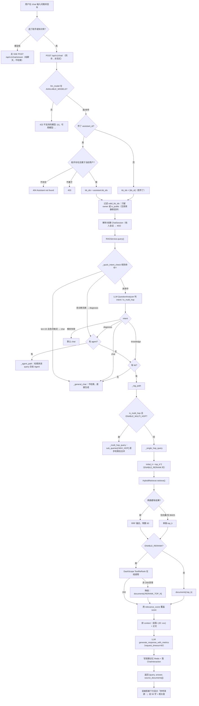

# rag-qa · 检索与问答（需求正文）

- 模块：`rag-qa`（检索与问答），需求前缀 `RAG`
- 基线提交：`bf789d9e4fff51b7a2c0b661046f9e5c72b6e483`（`main`，2026-11-11）
- 上游：`requirements/project-card.md`（对象模型、场景 A、§7.2 降级表）、`requirements/_conventions.md`
- 本模块**只**负责：用户提问 → 意图路由 → 检索/融合/重排 → 生成 → 返回答案与来源 → 会话与记忆。文档摄取见 `requirements/modules/kb-ingest.md`。
- 三态（已实现 / 已启用 / 已验证）逐条标注。本模块最易混淆的一处先说清：**混合检索是"已实现且默认启用"，但"新文档能否被检索到"取决于进程内 BM25 索引是否重建——默认不重建**（REQ-RAG-003）。

---

## 0. 一句话

用户在 `/chat` 页输入问题，系统先判断"这是闲聊还是查知识库"，再从知识库里找最相关的几段原文，重排后交给模型作答，并把用到的段落列在答案下面。**带知识库的问答是一次同步 HTTP 请求，没有流式输出**。

---

## 1. 流程 FLOW-RAG-QUERY



---

## 2. 需求正文

### REQ-RAG-001 两种提问方式：纯聊天流式、带知识库同步

**用户预期**：随便聊两句应该像 ChatGPT 一样一个字一个字冒出来；查知识库时也要有个明确的"正在检索"过程，别让页面像死了。

**系统实际处理（必须先讲清，因为它是本模块最大的体验落差）**

| 场景 | 前端判定 | 调用 | 输出形态 |
|---|---|---|---|
| 没选助手、没选知识库 | `!selectedAssistant && !selectedKB`（`frontend/src/views/Chat.vue:340-343`） | `POST /api/v1/chat/stream`（`src/api/routers/chat.py:210`） | SSE 逐 token |
| 选了助手或选了知识库 | 同上判断的 else 分支（`frontend/src/views/Chat.vue:345-358`） | `POST /api/v1/chat/`（`src/api/routers/chat.py:64`） | **一次性返回整段答案** |

- 流式端点**只是纯聊天**：内部调 `generate_general_response_stream`，不检索、不带知识库、不带助手（`src/api/routers/chat.py:243-247`）。`chat_stream` 的 docstring 明写"带 assistant_id / kb_id 的 RAG 路径仍走同步 POST /chat/，不经过这里"（`src/api/routers/chat.py:216-221`）。
- 同步端点是**同步阻塞**：`await rag_service.query(...)` 里的检索和 LLM 调用都是阻塞实现，**没有 `run_in_threadpool`**（`src/api/routers/chat.py:144-150`，对比 `:243-247` 流式端点用了 `iterate_in_threadpool`）。后果：一次问答期间该 worker 被占住，无法提前吐任何字。
- LLM 单次 `request_timeout=60`（`src/llm/llm_client.py:75`），并配了 `with_fallbacks`（`src/llm/llm_client.py:97`）。

**用户实际看到**：RAG 问答期间，界面上没有任何"检索中"提示——`Chat.vue` 在 `await api.post('/chat/')` 之前只 push 了用户消息，没有占位气泡（`frontend/src/views/Chat.vue:335-358`）。纯聊天有占位气泡 `reactive({role:'assistant', content:''})` 并逐 token 追加（`frontend/src/views/Chat.vue:385-392`）。→ **有知识库时反而没有任何进度反馈**。

**三态**：两条链路均已实现、已启用。**"RAG 路径支持流式"为否**（未实现）。本轮未验证（不联网、不调模型）。

**basis**：`observed`　**锚点**：`frontend/src/views/Chat.vue:331-374,377-427`、`src/api/routers/chat.py:64-169,210-278`

---

### REQ-RAG-002 意图路由：先规则、后模型、再分派

**用户预期**：问"你好"不该去检索知识库浪费时间；问"服务 CPU 打满怎么排查"应该走诊断；问"手册里连接拒绝怎么处理"应该查知识库。

**规则层（不调模型）**：`_quick_intent_check`（`src/services/rag_service.py:28-46`）
- `len(query) < 15` **且**含问候/客套词（`_CHAT_PATTERNS`：你好/hello/hi/谢谢/感谢/再见/拜拜/你是谁/你叫什么/早上好/晚上好/下午好，`src/services/rag_service.py:15-18`）→ `chat`。
- 含诊断词（`_DIAGNOSIS_PATTERNS`：cpu/内存/memory/磁盘/disk/网络/network/告警/alarm/alert/故障/宕机/down/延迟高/latency/超时/timeout/oom/泄漏/leak/慢/slow/报错/异常/error，`src/services/rag_service.py:20-25`）→ `diagnosis`。**注意：这一条不受长度限制**，因此"手册里超时怎么配"会先被判成 diagnosis 而不是 knowledge。
- 都没命中 → `None`，交由 LLM `QuestionAnalyzer.analyze()` 判定（`src/services/question_analyzer.py:12-57`），要求返回 JSON `{intent, is_multi_hop, sub_queries, reason}`；正则 `\{.*\}` 提取，解析失败或异常**一律默认 `intent=chat`**（`src/services/question_analyzer.py:50-57`）。

**分派矩阵**（`src/services/rag_service.py:125-153`）

| intent | 有 agent | 有可用知识库 | 走哪条 | 是否检索 |
|---|---|---|---|---|
| chat（或解析失败） | — | — | `_general_chat`（`:157-172`） | 否 |
| knowledge | — | 是 | `_rag_path`（`:174-194`） | 是 |
| knowledge | — | 否 | `_general_chat`（`:135-136`） | 否 |
| diagnosis | 是 | — | `_agent_path`（`:196-228`） | 有库则检索 |
| diagnosis | 否 | 是 | `_rag_path`（`:143-146`） | 是 |
| diagnosis | 否 | 否 | `_general_chat`（`:148-149`） | 否 |
| 兜底 | — | — | `_general_chat`（`:152-153`） | 否 |

**返回差异（用户可感知）**：只有 `_rag_path` 与 `_agent_path` 会带回 `source_documents` 内容；`_general_chat` 固定返回 `source_documents: []`（`src/services/rag_service.py:172`），`_agent_path` 也固定返回 `[]`（`src/services/rag_service.py:223-228`，尽管它其实检索过、把资料拼进了 query）。→ **诊断路径明明查了知识库，界面却不显示来源**。

**三态**：规则 + 分派已实现、已启用。诊断路径的来源丢失是已核实实现缺口，不是设计决定（`observed`）。LLM 判定的准确率**未验证**（需真实模型）。

**basis**：`observed`　**锚点**：`src/services/rag_service.py:15-46,107-153,172,223-228`、`src/services/question_analyzer.py:12-57`

---

### REQ-RAG-003 检索：混合（向量 + BM25 + RRF 融合）与它的陈旧陷阱

**用户预期**：问一个只在某份 PDF 第 7 页出现过的术语，应该能命中；命中后告诉我出自哪份文件哪一页。

**检索组织**（`src/retrieval/hybrid_retriever.py:151-193`）
1. 向量路：`VectorRetriever.retrieve(query, top_k*2, kb_ids)`（`src/retrieval/vector_retriever.py:12-27`）→ `embed_query` 再 `milvus_client.search(expr="kb_id in [...]")`。
2. 关键词路：`bm25.retrieve(query, top_k*2, kb_ids)`（`src/retrieval/bm25_retriever.py:70-122`）。
3. 两路都有 → **RRF 融合，常数 `_RRF_K = 60`**：`score += 1.0/(60+rank)` 累加后按融合分排序（`src/retrieval/hybrid_retriever.py:22,25-61`）。**不是加权求和**。
4. 只有一路有结果 → 直接用单路 top_k。
5. 两路都空 → 返回空列表，后续 prompt 里没有资料，模型按 prompt 要求回答"根据提供的信息无法回答"（`src/services/rag_service.py:267-281`）。

**融合结果的 score 语义有坑**：`_rrf_fusion` 排序用的是 RRF 分，但**返回给上层的 `score` 仍是原始分（向量优先，没有则用 BM25 分），不是 RRF 分**（`src/retrieval/hybrid_retriever.py:53-60`）。因此界面上的"相关度"数值不能当 RRF 融合分理解，两路来源的分值也不在同一量纲上。

**中文分词是 2-gram 滑窗，不是 jieba**：`_tokenize` 用 `re.findall(r"[一-鿿]+", text)` 取中文串后做相邻 2-gram 滑窗（单字保留），非中文按 `[^a-z0-9]` 切并丢弃长度 1（`src/retrieval/bm25_retriever.py:22-37`）。效果："连接拒绝"会被拆成 连接/接拒/拒绝 等二元组，词表里没有"连接拒绝"这个整体词——**召回靠字面碎片重叠，不是语义分词**。

**最大的行为陷阱：BM25 索引只在首次查询时建一次，此后不随新文档刷新**
- `_ensure_bm25_indexed` 首行短路 `if self._bm25_populated or bm25_retriever.is_indexed: return`（`src/retrieval/hybrid_retriever.py:85-86`）。
- 建索引用一条 SQL 从 SQLite 全量读 `WHERE kd.status = 2` 的 chunk（`src/retrieval/hybrid_retriever.py:97-101`）。
- 存在 `index_bm25_chunks()` 方法（`src/retrieval/hybrid_retriever.py:141-149`），但 `src/worker/tasks.py:34-232` 全文**没有任何调用**；`src/retrieval/bm25_retriever.py:43` 的 docstring 也自认"增删文档后需重新建索引"。
- 后果：**API 进程启动后第一次问答那一刻的知识库快照，就是此后 BM25 路的全部可见范围**。之后新上传并 `status=2` 的文档，向量路能查到、BM25 路查不到；纯字面命中（专有名词、型号、错误码）尤其吃亏。
- 已有索引失败时还会置 `_bm25_populated=True` 阻止重试（`src/retrieval/hybrid_retriever.py:137-139`）→ **一次建索引失败，本轮进程内 BM25 永久为空**。

**对照**：bm25 知识库的专用检索入口**每次现场重建**索引（`src/retrieval/knowledge_bm25.py:7-19`），所以它能查到新文档。**同一个"关键词检索"能力，两个入口的新鲜度不同**（见 `requirements/modules/kb-ingest.md` REQ-KB-007）。

**阈值未生效**：`RAG_MIN_SCORE = 0.10`（`src/settings.py:110`）在 `src/` 内**无任何业务引用**；`retrieve(min_score=...)` 的默认值是 `0.0`（`src/retrieval/hybrid_retriever.py:156`），调用方也没传 → **低分结果不会被过滤**。`_assess_retrieval_quality` 只把 `count/max/avg/below_0.5` 写进日志（`src/services/rag_service.py:49-64`），不参与任何判定。

**数据来源**：向量权威库是 Milvus collection `rag_documents_v2`（`src/settings.py:86`），但写入时**同时写本地** `data/vectors/vectors.npy`（`src/database/vector_db.py:128`），Milvus 不可用时读本地（`src/database/vector_db.py:172-174`）。

**三态**：混合检索、RRF、单路降级、本地向量降级全部已实现且默认启用。**索引增量刷新未实现**。本轮未验证（未启动服务，无法观测索引陈旧现象）。

**basis**：`observed`　**锚点**：`src/retrieval/hybrid_retriever.py:22-61,79-193`、`src/retrieval/bm25_retriever.py:22-122`、`src/retrieval/vector_retriever.py:12-27`、`src/retrieval/knowledge_bm25.py:7-19`、`src/settings.py:86,110`

---

### REQ-RAG-004 重排：真实在线调用，失败静默降级

**用户预期**：检索回来的段落要按"跟这个问题有多相关"重新排一遍，最相关的放最前面。

**实现**：`DashScopeReranker.rerank(query, documents)`（`src/retrieval/reranker.py:14-55`）
- `ENABLE_RERANK` 为真时调 `dashscope.TextReRank.call(model=settings.RERANK_MODEL, query, documents=texts, top_n=settings.RERANK_TOP_N, api_key=...)`（`src/retrieval/reranker.py:28-36`）。默认 `ENABLE_RERANK=True`（`src/settings.py:113`）、模型 `qwen3.7-text-rerank`（`src/settings.py:114`）、`top_n=5`（`src/settings.py:115`）。
- HTTP 200 → 用 `item.relevance_score` 覆盖 score，顺序按服务端返回（`src/retrieval/reranker.py:38-47`）。
- 非 200 → 记 `DashScope Rerank Error: {code} - {message}` 后 `documents[:top_n]`（`src/retrieval/reranker.py:49-51`）；异常同样截断（`src/retrieval/reranker.py:53-55`）。
- 检索侧因为要重排，会先多取：`initial_k = top_k*2 if ENABLE_RERANK else top_k`（`src/services/rag_service.py:241`）。

**降级后的可观察差异**：重排成功时 score 是 rerank 相关性分（0–1 语义）；降级时 score 是原始检索分（向量 L2 距离或 BM25 归一化分）。**界面只显示两位小数，用户无法区分这两种数值来源**。

**重要：助手面板里的"重排序"开关不生效** —— 见 REQ-RAG-007。

**三态**：已实现、已启用（默认开）。在线调用是否成功取决于 DashScope 网络与 key，本轮不联网 → `unresolved`。

**basis**：`observed`　**锚点**：`src/retrieval/reranker.py:14-55`、`src/settings.py:113-115`、`src/services/rag_service.py:241-253`

---

### REQ-RAG-005 生成、来源回传与界面渲染

**用户预期**：答案要基于检索到的原文，不要自己编；答案下面要能看到用了哪几段。

**prompt 约束**（`src/services/rag_service.py:267-281`）：五条硬要求——不添加外部知识、上下文无相关信息时明确说"根据提供的信息无法回答"、**引用相关段落编号**、准确简洁、Markdown 输出。同一套要求也写在 `LLMClient.generate_response` 的默认 prompt 里（`src/llm/llm_client.py:176-212`）。

**context 拼法**：`历史背景:` + `检索到的资料:` + 可选 `系统指令:`（助手 `system_prompt`）（`src/services/rag_service.py:256-263`），每段格式 `段落 {i+1} (ID: {res.id}):\n{text}`（`src/services/rag_service.py:352-356`）。

**返回结构**：`{"query","answer","source_documents":[{id,text,score,metadata}]}`（`src/services/rag_service.py:337-350`），再由 `ChatResponse` 包一层 `session_id`（`src/api/routers/chat.py:164-169`）。`metadata` 里有 `filename / page / doc_id / kb_id`（写入侧见 `src/worker/tasks.py:182-193`）。

**界面渲染（关键缺口）**：`Chat.vue` 只显示
```
参考来源：{src.text.substring(0,50)}...（相关度：{src.score.toFixed(2)}）
```
（`frontend/src/views/Chat.vue:96-103`）→ **文件名和页码在界面上完全不显示**，用户看到的是"某段文字的前 50 个字"，无法据此回到原文。而 `metadata.filename` / `metadata.page` 明明已经在响应里。这是本模块最影响可信度的一处缺口。

**性能指标**：`_single_hop_query` 把 `first_token_latency` / `total_latency` 写进 `result["metrics"]`（`src/services/rag_service.py:282-288`），但 `chat.py` 落库时把 `metrics` 写成 `{}`（`src/api/routers/chat.py:153-162`），响应里也不含 metrics → **指标采集了但没有任何出口**。

**三态**：生成与来源回传已实现、已启用。来源的"文件/页码"渲染未实现。metrics 无出口属已核实缺口。

**basis**：`observed`　**锚点**：`src/services/rag_service.py:230-292,337-356`、`frontend/src/views/Chat.vue:96-103`、`src/api/routers/chat.py:153-169`

---

### REQ-RAG-006 多跳问答

**用户预期**：难一点的问题要拆成几步查，而不是一次查完就编。

**实现**：`_rag_path` 判 `analysis and settings.ENABLE_MULTI_HOP and analysis.get("is_multi_hop")` 才走 `_multi_hop_query`（`src/services/rag_service.py:182-186`）。`ENABLE_MULTI_HOP=True`（`src/settings.py:127`），子查询上限 `MAX_HOP=3`（`src/settings.py:128`），`steps = sub_queries[:MAX_HOP]`（`src/services/rag_service.py:309`）。各步结果**按 id 去重**（`src/services/rag_service.py:317`），拼接 context 后再 rerank 或截断（`src/services/rag_service.py:320-326`），最后用 `generate_response` 生成（`src/services/rag_service.py:333`）。

**前提**：`sub_queries` 来自 LLM 分析器的 JSON（`src/services/question_analyzer.py:12-57`）。如果规则层先命中了 `chat`/`diagnosis`，**根本不会调分析器**（`src/services/rag_service.py:107-117`）→ 多跳只在"规则未命中 + 模型判为 knowledge + 判为 multi_hop"这条窄路上生效。

**可观察结果**：多跳与单跳的响应结构相同，`source_documents` 是去重后的合并集；**界面上无法区分**。

**三态**：已实现、已启用。实际触发率**未验证**（需真实模型）。

**basis**：`observed`　**锚点**：`src/services/rag_service.py:174-194,294-335`、`src/settings.py:127-128`

---

### REQ-RAG-007 助手配置：能保存、能透传、但检索参数不生效

**用户预期**：给助手设了 Top-K=10、开了重排序，问答就应该按这个来。

**实际链路（三段，断在最后一段）**
1. 前端助手面板有 `rag_config.top_k` 滑块（min 1 / max 20）和 `rag_config.enable_rerank` 开关（`frontend/src/views/Chat.vue:24,27`），保存走 `PUT /assistants/{id}` + `POST /assistants/{id}/versions`（`frontend/src/views/Chat.vue:170-209`）；后端默认 `{"top_k": 5, "enable_rerank": True}`（`src/api/routers/assistant.py:24`），字段是 JSON（`src/database/models.py:188`，注释就写着 `e.g. {"top_k": 5, "enable_rerank": true}`）。
2. `chat.py` 把 `"rag_config": assistant.rag_config` 塞进 `assistant_config` 传给 `RAGService.query`（`src/api/routers/chat.py:133-142`）。
3. **`RAGService.query` 只读 `system_prompt / agent_ids / agents / llm_model / temperature / memory_config`，从不读 `rag_config`**（`src/services/rag_service.py:84-92`）。`top_k` 始终用 `ChatRequest` 的 `top_k`（默认 5，`src/api/routers/chat.py:22-40`），而前端**根本不传 `top_k`**（`frontend/src/views/Chat.vue:346-350`）→ 永远是 5。`enable_rerank` 始终用全局 `settings.ENABLE_RERANK`。

**结论（必须写进未决）**：助手里的 Top-K 与"重排序"开关**是纯装饰**。用户在面板上把 Top-K 从 5 改到 20、把重排序关掉，检索行为与结果不变。这是一个可被判为缺陷的实现缺口（`observed`，不是设计决定）。

**三态**：配置的存取、透传已实现、已启用；**生效未实现**。

**basis**：`observed`　**锚点**：`src/services/rag_service.py:84-92`、`src/api/routers/chat.py:22-40,133-142`、`src/api/routers/assistant.py:24`、`src/database/models.py:188`、`frontend/src/views/Chat.vue:24-27,170-209,346-350`

---

### REQ-RAG-008 会话与短期记忆

**用户预期**：同一个会话里接着问，模型要记得上一轮；刷新页面能看到历史；删了会话就真没了。

**会话**：`POST /api/v1/chat/` 未传 `session_id` 时创建，传了就复用；**他人会话 → 403**（`src/api/routers/chat.py:96-123`，`_resolve_plain_session` 在 `:171-190`，403 在 `:178`）。会话 CRUD：`POST /sessions`（`:283`）、`GET /sessions`（`:312`）、`GET /sessions/{session_id}/messages`（`:319`）、`DELETE /sessions/{session_id}`（`:333`）、`DELETE /sessions`（`:358`，body 为 `List[str]`）。

**短期记忆**：Redis，key 按 session；`get_short_term_memory(session_id, limit=10)` 取 `lrange(0, limit-1)` 后 `reverse()` 成时间正序（`src/services/memory_service.py:30-53`）；写入 `lpush` + `ltrim(0, history_limit-1)` + `expire(ttl)`（`src/services/memory_service.py:55-64`）。默认 `window_size=10`（`src/services/rag_service.py:91-92`）、`SHORT_TERM_MEMORY_TTL=3600`（`src/settings.py:194`）、`MEMORY_HISTORY_LIMIT=10`（`src/settings.py:196`）。Redis 异常时**返回空列表、只记日志**（`src/services/memory_service.py:56,62`）→ 记忆失效不影响问答可用性。

**会话隔离在界面上的表现**：切换助手或切换知识库会 `newChat()` 清空当前上下文（`frontend/src/views/Chat.vue:472-481`）→ 用户切一下助手，之前的对话就"看不见了"（数据仍在库里，只是不再续着聊）。

**删会话的真实影响**：先删 `ChatInteraction` 行 → 再删 `ChatSession` → 再 `clear_short_term_memory`（清缓存失败只 `print`）（`src/api/routers/chat.py:346-356`）。**不清 Milvus / 本地向量库**（那里本来就只存文档 chunk，不含对话）。

**三态**：已实现、已启用。Redis 是否在线本轮未核实 → `unresolved`（离线时行为已明确：静默降级）。

**basis**：`observed`　**锚点**：`src/api/routers/chat.py:96-123,171-190,283-374`、`src/services/memory_service.py:30-69`、`src/settings.py:194-196`、`frontend/src/views/Chat.vue:472-481`

---

### REQ-RAG-009 权限与知识库可见性边界

**用户预期**：只能用自己有权访问的知识库问问题；不该因为传了个别人的 kb_id 就被拒绝整次问答。

**实现细节**
- 传 `assistant_id` 时：助手不存在 → 404 `Assistant not found`；`assistant.user_id != current_user.id` → 403（`src/api/routers/chat.py:74-80`）。通过后 `kb_ids = assistant.kb_ids`（`src/api/routers/chat.py:83`）。
- 否则若传 `kb_id` → `kb_ids = [kb_id]`（`src/api/routers/chat.py:84-86`）。
- 随后过滤：**只保留 owner 是当前用户、或 `is_public=True` 的库**（`src/api/routers/chat.py:89-94`）。
- **无效库被静默丢弃，不报错**（`src/api/routers/chat.py:89-94` 无 raise）。后果：
  - 传一个别人的私有库 id → 不报 403，`valid_kb_ids` 变空 → 意图若判为 knowledge，`has_kb` 为假 → **降级成纯聊天回答**，用户拿到一个没查过任何资料、却看起来正常的答案。
  - 助手绑了 3 个库，其中 1 个被删 → 静默只用剩下 2 个。
- 登录态：前端 `api` 拦截器统一加 `Authorization: Bearer ...`（`frontend/src/api/index.js:7-10`）；路由守卫**只检查 token 是否存在，不校验是否过期**（`frontend/src/router/index.js:24-31`）→ token 过期时页面能进，点发送才 401。

**三态**：已实现、已启用。"静默丢弃"是可观察的行为偏差，是否算缺陷需产品定义（`unresolved`）。

**basis**：`observed`　**锚点**：`src/api/routers/chat.py:74-94`、`frontend/src/api/index.js:4-19`、`frontend/src/router/index.js:24-31`

---

### REQ-RAG-010 模型白名单与失败时的用户可见性

**用户预期**：下拉里能选的模型就一定能用；出错了要告诉我错在哪，而不是给我一段"Error generating response: …"。

**模型白名单**：`ChatRequest.llm_model` 校验对照 `settings.AVAILABLE_MODELS`（`src/settings.py:77-79`），不在白名单时抛 `不支持的模型: {v}，可用模型: ...`（`src/api/routers/chat.py:22-40`）。前端下拉数据来自 `GET /api/v1/health/models`（`src/api/routers/health.py:176-195`，无鉴权），请求失败时兜底硬编码 `deepseek-v4.1-flash-1017`（`frontend/src/views/Chat.vue:440-448`）。`LLMClient` 内部还有一层兜底：模型不在白名单就回落到默认模型（`src/llm/llm_client.py:100-140`）。

**可重试的失败**：`APIConnectionError / APITimeoutError / InternalServerError / RateLimitError / httpx.TimeoutException / ConnectError / RemoteProtocolError` 会触发 fallback 模型（`src/llm/llm_client.py:17-25,97`）。

**失败时的界面**：
- 同步路径：异常 → 前端 push 一条 `role='system'` 消息，文案 `发送消息失败：{detail}`（`frontend/src/views/Chat.vue:372`）。
- 生成函数自身异常**不抛**，而是返回字符串 `Error generating response: {e}`（`src/llm/llm_client.py:174`、`:282`）→ **HTTP 200，answer 字段就是这句英文错误**，前端把它当正常答案渲染成 Markdown。
- 流式路径：`error` 事件 → `ElMessage.error`（`src/api/routers/chat.py:271-276`、`frontend/src/views/Chat.vue:398-400`）。
- 全局异常 handler 兜底返回 500 `{"detail":"服务处理异常，请稍后重试"}`（`src/main.py:246-252`）。

**三态**：已实现、已启用。"错误字符串当答案返回"是已核实的行为，属体验缺口（`observed`）。真实模型可用性本轮未验证。

**basis**：`observed`　**锚点**：`src/api/routers/chat.py:22-40`、`src/llm/llm_client.py:17-25,100-174,267-282`、`src/api/routers/health.py:176-195`、`frontend/src/views/Chat.vue:372,398-400,440-448`

---

## 3. 三态汇总（本模块）

| 能力 | 已实现 | 已启用 | 已验证 |
|---|---|---|---|
| 纯聊天流式（SSE，不检索） | 是 | 是 | 否 |
| RAG 问答流式 | **否**（同步一次性返回） | — | — |
| 规则意图快过滤（长度/问候/诊断词） | 是 | 是 | 否 |
| LLM 意图 + 多跳判定 | 是 | 是 | 否（需模型） |
| 六格分派矩阵 | 是 | 是 | 否 |
| 混合检索（向量 + BM25 + RRF，k=60） | 是 | 是 | 否 |
| 单路降级 | 是 | 是 | 否 |
| BM25 索引随新文档增量刷新 | **否**（仅进程首次建一次） | — | — |
| Milvus 不可用降级本地 npy | 是 | 是 | 否 |
| DashScope rerank 在线调用 | 是 | 是 | 否（不联网） |
| rerank 失败降级截断 | 是 | 是 | 否 |
| 多跳（MAX_HOP=3） | 是 | 是 | 否 |
| 来源回传 `source_documents` + metadata | 是 | 是 | 否 |
| 界面显示文件名/页码 | **否**（只显示前 50 字 + 相关度） | — | — |
| 诊断路径回传来源 | **否**（固定 `[]`） | — | — |
| `RAG_MIN_SCORE` 过滤 | **否**（死配置，调用方传 0.0） | — | — |
| 助手 `rag_config.top_k` / `enable_rerank` 生效 | **否**（RAGService 不读） | — | — |
| 短期记忆（Redis，window 10，TTL 3600） | 是 | 是 | 否 |
| 长期记忆 | **否**（`add_long_term_memory` 仅 `pass`） | — | — |
| 会话 CRUD + 他人会话 403 | 是 | 是 | 否 |
| 无效 kb 静默丢弃 | 是（行为如此） | 是 | 否 |
| metrics（首字/总时延）对外暴露 | **否**（落库写 `{}`，响应不含） | — | — |

---

## 4. 未决与缺口（汇总到 `specs/questions.md`）

1. **助手 `rag_config` 完全不生效**（`src/services/rag_service.py:84-92` 不读）：Top-K 与重排序开关是装饰品。用户可观察：改配置后答案与来源数量不变。
2. **BM25 索引不随新文档刷新**（`src/retrieval/hybrid_retriever.py:85-86,141-149`）：`index_bm25_chunks` 无调用方。新文档只能被向量路召回，纯字面命中失准；且首次建索引失败后本轮进程永久无 BM25（`src/retrieval/hybrid_retriever.py:137-139`）。
3. **界面不显示来源文件名/页码**（`frontend/src/views/Chat.vue:96-103`），而 metadata 里已有（`src/worker/tasks.py:182-193`）。
4. **RAG 路径无流式、无"检索中"反馈**（`src/api/routers/chat.py:144-150` 同步阻塞；`frontend/src/views/Chat.vue:345-358` 无占位气泡）。
5. **诊断路径固定回传 `source_documents: []`**（`src/services/rag_service.py:223-228`），即使检索过。
6. **`RAG_MIN_SCORE` / `TOP_K` 死配置**（`src/settings.py:108-110`），低分片段不过滤。
7. **无效 kb 静默丢弃**（`src/api/routers/chat.py:89-94`）：应报错还是静默降级，需产品决定。
8. **错误字符串当正常答案返回**（`src/llm/llm_client.py:174`）：HTTP 200 + `Error generating response: …`。
9. **长期记忆空实现**（`src/services/memory_service.py:72-73` 仅 `pass`），且 `LONG_TERM_MEMORY_COLLECTION`（`src/settings.py:195`）无引用；`retrieve_long_term_memory` 复用的是文档向量库（`src/services/memory_service.py:75-76`），语义上不是"用户画像"。
10. **Celery / Milvus / Redis / DashScope 在线状态**：本轮不联网，一律 `unresolved`（对应 `specs/questions.md` Q-21）。

---

## 5. 参考锚点清单

- 问答端点：`src/api/routers/chat.py:22-40,64-169,171-190,192-207,210-278,283-374`
- 编排：`src/services/rag_service.py:15-46,49-64,75-153,157-228,230-292,294-335,337-356`
- 意图：`src/services/question_analyzer.py:12-57`
- 检索：`src/retrieval/hybrid_retriever.py:22-61,79-193`、`src/retrieval/vector_retriever.py:12-27`、`src/retrieval/bm25_retriever.py:22-122`、`src/retrieval/knowledge_bm25.py:7-19`、`src/retrieval/reranker.py:14-55`
- 向量：`src/database/vector_db.py:108-218`、`src/database/local_vector_store.py:150-226`
- 模型：`src/llm/llm_client.py:17-25,60-282`、`src/settings.py:56,77-79,113-115,127-128`
- 记忆/会话：`src/services/memory_service.py:12-76`
- 前端：`frontend/src/views/Chat.vue:24-27,44-64,96-127,170-238,286-427,440-481`、`frontend/src/api/index.js:4-19`、`frontend/src/utils/chat.js:8`
- 模型对象：`src/database/models.py:169-203`（Assistant / AssistantVersion）
