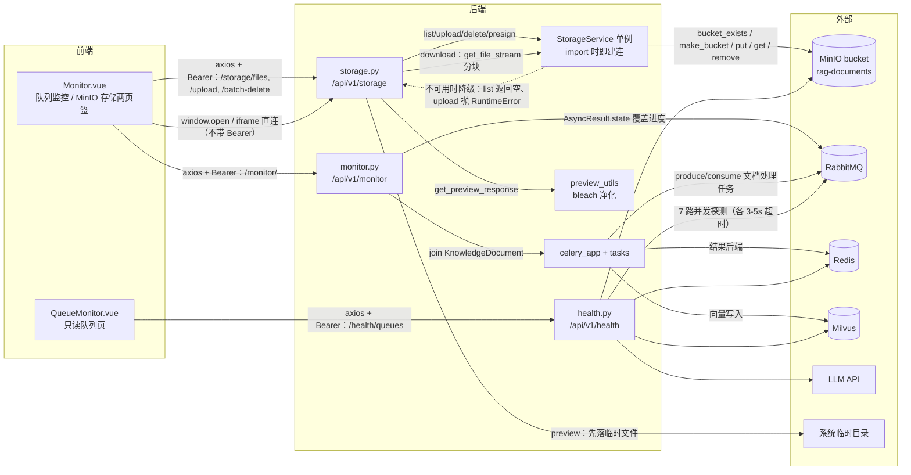

# 模块需求：storage-queue（MinIO 文件、预览、Celery 队列监控与依赖健康）

- 模块 ID：`storage-queue`（前缀 `STORE`）
- 基线提交：`bf789d9e4fff51b7a2c0b661046f9e5c72b6e483`
- 资料状态：本文按源码事实撰写，除注明 confirmed 外均为 observed
- 首次生成：2026-11-11
- 关联来源：`requirements/sources/index.json`、`requirements/project-card.md`、`requirements/overview.md`

## 0. 一句话

用户在这里浏览/上传/下载/预览自己名下的 MinIO 对象，查看 Celery 队列里正在处理的文档任务并能删除，以及一眼看出 RabbitMQ、Redis、Milvus、MinIO、LLM 等外部依赖是否在线。

## 1. 主链路图（FLOW-STORE 数据流）

链路名：`FLOW-STORE`（文件列举 → 下载/预览 → 上传 → 队列监控 → 依赖健康）。

## 2. 需求条目

### REQ-STORE-001 浏览我名下的对象

- **用户预期**：在「MinIO 存储」页签看到自己的文件列表，能按关键字搜索、按修改时间/大小/名称排序。
- **入口与前提**：前端 `/monitor` 页的「MinIO 存储」页签（`frontend/src/views/Monitor.vue:11-31` 为队列卡，存储区在模板后半）；接口 `GET /api/v1/storage/files`（`src/api/routers/storage.py:43`）。前提是已登录、MinIO 可用。
- **字段与校验**：查询参数 `prefix`（可空）、`sort_by` 默认 `last_modified`、`order` 默认 `desc`、`search_query`（可空）。服务端强制把前缀拼成 `user_{user.id}/{prefix}`（`src/api/routers/storage.py:18-20`、`:52`），用户无法越过自己的目录。
- **正常操作与反馈**：返回 `{"files": [...]}`，每项含 `object_name` / `size` / `last_modified` / `etag`（`src/services/storage.py:69-74`）。排序在后端做：`last_modified` / `size` / `name`（`src/services/storage.py:77-83`），`search_query` 在 object_name 上做子串匹配（`src/services/storage.py:66-67`）。
- **异常与恢复**：MinIO 不可用时 `list_files` 返回空列表 `[]`，接口 200 且 `files=[]`（`src/services/storage.py:56-58`、`:88`），前端只看到空列表、**没有"存储不可用"的提示**（`frontend/src/views/Monitor.vue:285-304` 只在异常时提示"获取 MinIO 文件失败"）。服务端异常 500。
- **权限**：所有 6 个端点都挂 `Depends(get_current_user)`；对象名经 `_safe_object_name` 二次加固（`src/api/routers/storage.py:23-40`）：`..` 被剥离、前导 `/` 被剥掉、已带本人前缀直接放行、带他人 `user_` 前缀的会先剥掉再拼回本人前缀。
- **数据影响**：只读。
- **可观察结果**：`GET /storage/files` 返回的 `object_name` 全部以 `user_<我的 id>/` 开头。
- **三态**：已实现·已启用·未验证。
- **basis**：observed。
- **锚点**：`src/api/routers/storage.py:18-60`、`src/services/storage.py:56-88`。

### REQ-STORE-002 下载文件

- **用户预期**：点"下载"就能拿到文件。
- **入口与前提**：`GET /api/v1/storage/download/{object_name:path}`（`src/api/routers/storage.py:62`）；前端 `downloadFile`（`frontend/src/views/Monitor.vue:306-315`）。
- **字段与校验**：对象名上做 `_safe_object_name`；`get_file_stream` 返回 None 则 404 `'File not found'`（`src/api/routers/storage.py:70-72`）。
- **正常操作与反馈**：`StreamingResponse` 以 32KB 分块输出，`media_type="application/octet-stream"`，响应头带 `Content-Disposition: attachment; filename*=UTF-8''<urlencoded>`（`src/api/routers/storage.py:89-93`），文件名取 object_name 最后一段（`:85`）。
- **异常与恢复**：**前端用 `window.open(url, '_blank')` 直连（`frontend/src/views/Monitor.vue:309-310`），不经 axios，因此不带 `Authorization` 头；而后端强制鉴权 → 实际打开的新标签页会 401。** 这是可用性缺口，见 §4-U1。
- **权限**：登录态 + 前缀隔离（同上）。
- **数据影响**：只读。
- **可观察结果**：用带 token 的 HTTP 客户端请求同一 URL → 200 且收到完整字节；用浏览器从界面点下载 → 401。
- **三态**：后端已实现·已启用；**前端调用方式有缺陷**。
- **basis**：observed。
- **锚点**：`src/api/routers/storage.py:62-96`、`frontend/src/views/Monitor.vue:306-315`、`frontend/src/api/index.js:7-13`。

### REQ-STORE-003 在线预览文件

- **用户预期**：不下载就能看内容，PDF/Markdown/纯文本/Word/Excel 都要能看。
- **入口与前提**：`GET /api/v1/storage/preview/{object_name:path}`（`src/api/routers/storage.py:98`）；前端把 URL 塞进 `<iframe>`（`frontend/src/views/Monitor.vue:137`、`:317-335`）。
- **字段与校验**：按对象名后缀决定预览方式，无后缀按 `.txt` 处理（`src/api/routers/storage.py:114-116`）。
- **正常操作与反馈**：服务端先把对象流式写到 `tempfile.mkstemp` 临时文件（32KB 分块，`src/api/routers/storage.py:118-129`），再调 `get_preview_response(tmp_path, suffix)`（`src/api/routers/storage.py:131`）。分派规则（`src/utils/preview_utils.py:56-183`）：
  - `pdf` → `FileResponse` inline；
  - `md` → `markdown.markdown(extensions=['extra','codehilite'])` 后过 `_sanitize_html`，再套内联 CSS；
  - `txt` → `html.escape` + `pre-wrap`；
  - `docx`/`doc` → 逐段 `html.escape`、Heading 转 `h{level}`、表格逐单元格转义；
  - `xlsx`/`xls` → `pd.read_excel` + `df.to_html(escape=True)`；
  - 其它 → 以 `application/octet-stream` + attachment 返回。
- **异常与恢复**：DOCX/Excel 解析异常时返回纯文本 `'Error previewing DOCX: ...'` / `'Error previewing Excel: ...'`（`src/utils/preview_utils.py:106-146`、`:148-172`），HTTP 仍 200。**临时文件在响应后不删除**（代码里无 cleanup），长期运行会累积。
- **权限**：同 REQ-STORE-001。前端 iframe 同样不带 Authorization → 401（与 REQ-STORE-002 同源缺口）。
- **数据影响**：只读源对象；在系统临时目录留下副本（潜在信息泄露面：临时文件名随机但内容未加密）。
- **可观察结果**：PDF 在 iframe 内内联渲染；Markdown 的 `<script>` 被剥离；HTML 白名单外的标签被 `strip=True` 去掉内容（`src/utils/preview_utils.py:19-53`）；无 bleach 环境下退化为正则剥 `script/iframe/object/embed` 与三种 `on*` 写法（`src/utils/preview_utils.py:45` 起）。
- **三态**：已实现·已启用；前端 iframe 鉴权缺口同上。
- **basis**：observed。
- **锚点**：`src/api/routers/storage.py:98-135`、`src/utils/preview_utils.py:12-183`。

### REQ-STORE-004 上传文件到我的存储区

- **用户预期**：把自己的文件传到 MinIO，传完能在列表里看到。
- **入口与前提**：`POST /api/v1/storage/upload`（`src/api/routers/storage.py:137`），multipart 字段 `file` + 可选 `prefix`。
- **字段与校验**：`safe_filename = file.filename.replace("..","").replace("/","_").lstrip("\\")`，清洗后为空 → 400 `'Invalid filename'`（`src/api/routers/storage.py:149-151`）；对象名是 `user_{id}/{prefix}/{filename}` 拼接（`:161`）。**没有扩展名白名单、没有大小上限**（对比知识库上传有 50MB 上限与 10 种扩展名，`src/api/routers/knowledge_base.py:143-148`）。
- **正常操作与反馈**：写 MinIO 成功返回 `{"message": "File uploaded successfully", "object_name": ...}`（`src/api/routers/storage.py:163`）。
- **异常与恢复**：MinIO 不可用时 `upload_file` 抛 `RuntimeError('MinIO 不可用,无法上传文件')`（`src/services/storage.py:39-41`），接口层未捕获该具体类型 → 500。MinIO 写失败时原样抛出（`src/services/storage.py:54`）。
- **权限**：登录态 + 前缀强制。
- **数据影响**：在 `rag-documents` bucket 写一个对象（`src/settings.py:99`）。
- **可观察结果**：`GET /storage/files` 能看到新对象；对象名以 `user_<id>/` 开头。
- **三态**：已实现·已启用·未验证。
- **basis**：observed。
- **锚点**：`src/api/routers/storage.py:137-168`、`src/services/storage.py:39-54`。

### REQ-STORE-005 批量删除对象与获取临时访问链接

- **用户预期**：勾选多个文件一次删除；或拿到一个可直接访问的链接分享给自己。
- **入口与前提**：`POST /api/v1/storage/batch-delete`（`src/api/routers/storage.py:170`）body `{"object_names": [...]}`；`GET /api/v1/storage/url/{object_name:path}`（`src/api/routers/storage.py:187`）。
- **字段与校验**：批量删除逐个过 `_safe_object_name`；URL 接口对象不存在时 404 `'File not found or error generating URL'`（`src/api/routers/storage.py:196`）。
- **正常操作与反馈**：删除返回 `{"message": "Deleted N files"}`（`src/api/routers/storage.py:182`）；预签名返回 `{"url": ...}`，有效期 1 小时（`src/services/storage.py:100-111`，注释说明不用默认 7 天）。
- **异常与恢复**：MinIO 不可用时 `batch_delete_files` 抛 `RuntimeError('MinIO 不可用,无法删除文件')`（`src/services/storage.py:124-126`）→ 500；单个删除失败只 `logger.error` 不中断其它（`src/services/storage.py:131-132`）。
- **权限**：同 REQ-STORE-001；预签名 URL 有效期内**不再校验身份**，拿到链接即可访问。
- **数据影响**：删除是不可逆的对象删除（MinIO 未启用版本管理）。
- **可观察结果**：删除后 `GET /storage/files` 不再出现该对象；`url` 接口返回的链接可被无 token 的客户端直接下载。
- **三态**：已实现·已启用·未验证。
- **basis**：observed。
- **锚点**：`src/api/routers/storage.py:170-197`、`src/services/storage.py:100-137`。

### REQ-STORE-006 MinIO 缺席时系统仍可启动

- **用户预期**：没装 MinIO 也能把系统跑起来做别的事（上传知识库等），只是文件存储功能受限。
- **入口与前提**：后端启动即触发——`storage_service = StorageService()` 是模块级单例（`src/services/storage.py:139`），**import 时就会尝试连接并建 bucket**。
- **字段与校验**：连接用短超时 + 零重试的 http_client（`src/services/storage.py:10-13`，`_MINIO_TIMEOUT_SECONDS = 3`），注释明确说明"默认客户端会重试+backoff 累积约 30s 才失败，拖垮启动与请求"（`src/services/storage.py:7-8`）。
- **正常操作与反馈**：`_ensure_bucket` 先 `bucket_exists`，不存在则 `make_bucket`（`src/services/storage.py:28-37`）；失败时只记 `logger.warning("MinIO 不可用(<endpoint>),文件存储降级: ...")` 并返回 False，**不阻断启动**。
- **异常与恢复**：降级后各方法行为不同——`list_files` → `[]`（静默）、`get_file_stream` → None（接口 404）、`upload_file` / `delete_file` / `batch_delete_files` → 抛 `RuntimeError`（接口 500）。即"读静默空、写明确失败"。
- **权限**：不适用。
- **数据影响**：无（连接失败时无写入）。
- **可观察结果**：MinIO 关掉后启动服务，日志出现"文件存储降级"warning，`GET /health` 仍 200，`GET /storage/files` 返回 `{"files": []}`，`POST /storage/upload` 返回 500。
- **三态**：已实现·已启用·未验证。
- **basis**：observed。
- **锚点**：`src/services/storage.py:7-41`、`src/services/storage.py:124-139`。

### REQ-STORE-007 知识库上传的 MinIO 备份是尽力而为

- **用户预期**：上传知识库文档时文件同时存一份到 MinIO；MinIO 挂了也不能挡住上传。
- **入口与前提**：`POST /api/v1/knowledge-bases/{kb_id}/upload`（`src/api/routers/knowledge_base.py:311`）；属本模块与 kb-ingest 的交界，此处只记录与存储相关的行为。
- **字段与校验**：主路径先落本地磁盘 `UPLOAD_DIR`，落盘后再 try 备份到 MinIO，对象名 `f"{doc_uid}_{safe_filename}"`（`src/api/routers/knowledge_base.py:367-373`）。
- **正常操作与反馈**：备份成功则对象出现在 MinIO；失败仅 `print(f"Failed to upload to MinIO: {e}")`（`src/api/routers/knowledge_base.py:374-380`），**上传接口仍返回成功**。
- **异常与恢复**：无重试、无告警推送；用户不知道备份失败。事后要恢复只能重新上传。
- **权限**：受知识库归属校验保护（kb-ingest 模块负责）。
- **数据影响**：本地文件是权威副本，MinIO 是可能缺失的副本。因此 `GET /storage/files` 里看不到所有已上传文档属正常现象。
- **可观察结果**：MinIO 关闭时上传文档仍 200；stdout 出现 `Failed to upload to MinIO`；`GET /storage/files` 无该对象而本地磁盘有文件。
- **三态**：已实现·已启用（尽力而为）·未验证。
- **basis**：observed。
- **锚点**：`src/api/routers/knowledge_base.py:356-383`、`src/settings.py:15`。

### REQ-STORE-008 查看队列中的文档处理任务

- **用户预期**：看到自己知识库下正在处理/排队/失败的文档任务、进度和报错。
- **入口与前提**：前端 `/monitor` 的「队列监控」页签（`frontend/src/views/Monitor.vue:11-71`）；接口 `GET /api/v1/monitor/`（`src/api/routers/monitor.py:32`）与 `GET /api/v1/monitor/stats`（`:91`）。
- **字段与校验**：`status_filter` 可空或 `processing`/`pending`/`failed`（`src/api/routers/monitor.py:41-46`）；join `KnowledgeBase` 过滤 `owner_id == current_user.id`；按 `created_at` 倒序取前 50 条（`:48`）。
- **正常操作与反馈**：每行含 `task_id` / `doc_id` / `filename` / `kb_name` / `status` / `progress` / `message` / `created_at`（`src/api/routers/monitor.py:76-85`）。`task_id` 取 `celery_task_id or str(doc.id)`（`:53`）——**这是字符串，可能是 Celery 的 UUID，也可能是数字 id 的字符串形式**。进度规则：有 `celery_task_id` 且 `status==1` 时用 `AsyncResult(...).state` 覆盖状态，并按 PENDING=10 / STARTED=50 / SUCCESS|FAILURE=100 给值（`:58-70`）；否则 `status==1 → 50`、`status==2 → 100`（`:71-74`）。状态文案 0 PENDING / 1 PROCESSING / 2 SUCCESS / 3 FAILURE（`:165-167`）。
- **异常与恢复**：`AsyncResult` 查询异常被 `pass` 吞掉（没连上 broker 时降级为本地状态值）（`:69-70`）。前端 3 秒轮询且只在队列页签生效（`frontend/src/views/Monitor.vue:193-201`）。
- **权限**：登录态 + `KnowledgeBase.owner_id` 过滤。
- **数据影响**：只读。
- **可观察结果**：表格 50 行上限、进度条百分比、状态 tag 颜色。
- **三态**：已实现·已启用·未验证。
- **basis**：observed。
- **锚点**：`src/api/routers/monitor.py:14-103`、`frontend/src/views/Monitor.vue:11-71`、`:170-201`。

### REQ-STORE-009 删除队列任务

- **用户预期**：把卡住或失败的任务从列表里删掉。
- **入口与前提**：表格行内删除按钮（`frontend/src/views/Monitor.vue:210-220`）与批量删除（`:222-233`）；接口 `DELETE /api/v1/monitor/tasks/{task_id}`（`src/api/routers/monitor.py:108`）、`POST /api/v1/monitor/tasks/batch-delete`（`:134`）。
- **字段与校验**：单条端点的 `task_id` 声明为 `str`，但内部执行 `doc_id = int(task_id)`，转换失败 → 400 `'Invalid ID format'`（`src/api/routers/monitor.py:110`、`:117-119`）。批量端点 body 为 `{"task_ids": [...]}`，逐个 `int(tid)`，失败的直接 `pass` 跳过（`:141-146`），全部无效时返回 `{"message": "No valid IDs provided"}`（`:148-149`）。
- **正常操作与反馈**：逐条校验知识库归属后删除文档行，返回 `{"message": "Deleted"}`（单条 `:132`）或 `f"Deleted {count} tasks"`（批量 `:163`）。
- **异常与恢复**：**前端传的是 `row.task_id`（`frontend/src/views/Monitor.vue:213`、`:225`），而 `task_id` 可能是 Celery 的 UUID 字符串 → 后端 `int()` 抛 ValueError → 400 `'Invalid ID format'`，前端只显示"删除失败"。** 这是"有端点但界面删不掉"的缺口，见 §4-U2。
- **权限**：登录态 + `kb.owner_id` 校验，不匹配 403 `'Not authorized'`（`:125-127`）。
- **数据影响**：删除 `knowledge_documents` 行；**不撤销已提交的 Celery 任务**（代码里无 `AsyncResult.revoke`），也不删已产生的 chunk/向量。
- **可观察结果**：删除后 `GET /monitor/` 不再出现该行；`GET /monitor/stats` 计数下降。
- **三态**：后端已实现·已启用；**前端调用参数类型不匹配**。
- **basis**：observed。
- **锚点**：`src/api/routers/monitor.py:105-163`、`frontend/src/views/Monitor.vue:210-233`。

### REQ-STORE-010 查看 Celery worker 侧队列统计

- **用户预期**：看到 worker 上正在跑/已预留/已排期的任务数，以及各 worker 的池配置。
- **入口与前提**：前端 `/queue-monitor` 页面（`frontend/src/router/index.js:16`、`frontend/src/views/QueueMonitor.vue:99`）；接口 `GET /api/v1/health/queues`（`src/api/routers/health.py:19`），**需要鉴权**。
- **字段与校验**：无参数。实现用 `celery_app.control.inspect()` 拉 `active()` / `reserved()` / `scheduled()` / `stats()`（`src/api/routers/health.py:23-30`）。
- **正常操作与反馈**：返回 `{"status": "ok", "summary": {active_tasks, reserved_tasks, scheduled_tasks}, "details": {active, reserved, scheduled, worker_stats}}`（`src/api/routers/health.py:37-50`）；前端渲染三张计数卡与 per-worker 表格（`frontend/src/views/QueueMonitor.vue:28-78`），5 秒轮询（`:113`）。
- **异常与恢复**：三种失败形态都要注意——① 检查器不可用返回 `{"error": "Could not connect to Celery inspector"}`，**HTTP 仍是 200 且无 `status` 键**（`src/api/routers/health.py:24-25`），前端因 `res.data.status === 'error'` 判断不到，会走到渲染分支拿到 undefined；② 抛异常时返回 `{"status": "error", "message": ...}`，**HTTP 同样 200**（`:51-52`），前端能识别并显示 message（`frontend/src/views/QueueMonitor.vue:100-101`）；③ 网络层失败则前端显示 `'获取队列统计失败'`（`:106`）。
- **权限**：登录态（任意登录用户都能看，不区分角色）。
- **数据影响**：只读，但 `inspect()` 会向 broker 广播查询。
- **可观察结果**：RabbitMQ 关闭时 `GET /health/queues` 返回 200 + `{"error": "Could not connect to Celery inspector"}`。
- **三态**：已实现·已启用·未验证。
- **basis**：observed。
- **锚点**：`src/api/routers/health.py:19-52`、`frontend/src/views/QueueMonitor.vue:90-113`。

### REQ-STORE-011 查看外部依赖健康状态

- **用户预期**：一眼看出 RabbitMQ / Redis / Milvus / MinIO / LLM / 两个 MCP 服务是否可达。
- **入口与前提**：`GET /api/v1/health/dependencies`（`src/api/routers/health.py:155`），需要鉴权。**当前前端没有页面调用它**（`frontend/src/views/Monitor.vue` 与 `QueueMonitor.vue` 都未引用该路径）。
- **字段与校验**：无参数，固定探测 7 项，顺序为 `mcp_monitor` / `mcp_cls` / `rabbitmq` / `redis` / `milvus` / `minio` / `llm`（`src/api/routers/health.py:161-170`），`asyncio.gather` 并发。
- **正常操作与反馈**：返回 `{"services": [...], "overall": "ok"|"degraded"}`，任一项不是 ok 则 `degraded`（`src/api/routers/health.py:172-173`）。每项含 `name` / `status`（`ok` 或 `unavailable`）/ `error`（截断 80 字）。
- **异常与恢复**：各探测器独立超时——HTTP 探测 3s、RabbitMQ 3s、Redis 3s、Milvus 3s、MinIO 3s、LLM 5s（且要求 HTTP 200，否则 `HTTP <code>`）。`_check_http` 注释明确"任何 HTTP 响应都算可达，不要求 200"（`src/api/routers/health.py:59-67`），与 LLM 探测口径不同。
- **权限**：登录态；`GET /api/v1/health`（:14）与 `GET /api/v1/health/models`（:176）**不需要鉴权**，但 `/queues` 与 `/dependencies` 需要。
- **数据影响**：只读。
- **可观察结果**：关掉 MinIO 后该次返回中 `minio.status == "unavailable"` 且 `overall == "degraded"`。
- **三态**：已实现·已启用·**前端未接线**·未验证。
- **basis**：observed。
- **锚点**：`src/api/routers/health.py:59-173`。

### REQ-STORE-012 Celery 与 broker 缺席时的降级

- **用户预期**：没起 RabbitMQ/Redis 也不影响上传文档（走同步后台处理）。
- **入口与前提**：文档上传后的派发路径（`src/api/routers/knowledge_base.py:131-141`）。
- **字段与校验**：生产者侧配置 `broker_connection_timeout=4` 且 `broker_connection_retry=False`（`src/worker/celery_app.py:23-24`），即连不上立刻失败而不是重试。派发用 `ThreadPoolExecutor(max_workers=1)` + `future.result(timeout=5)` 硬超时（`src/api/routers/knowledge_base.py:29-41`），超时后回落同步后台任务（`background_tasks.add_task(process_document, doc.id)`），且该路径下 `celery_task_id` 置 None。
- **正常操作与反馈**：broker 可用 → 派发成功并记 `celery_task_id`；不可用 → 5 秒内抛异常、回落 FastAPI BackgroundTasks，用户看到上传成功的响应里 `task_id` 为 null。
- **异常与恢复**：Celery worker 侧另有 `task_time_limit=600`、`task_acks_late=True`、`worker_prefetch_multiplier=1`（`src/worker/celery_app.py:15-25`）。任务失败时文档 `status=3`，在队列监控页显示为 FAILURE。
- **权限**：不适用（内部链路）。
- **数据影响**：`knowledge_documents.celery_task_id` 是否有值取决于派发路径。
- **可观察结果**：关掉 RabbitMQ 后上传文档，响应 `task_id` 为 null，5 秒内返回，文档仍能被处理；`GET /monitor/` 里该行的 `task_id` 是数字 id 字符串。
- **三态**：已实现·已启用·未验证。
- **basis**：observed。
- **锚点**：`src/api/routers/knowledge_base.py:29-41`、`:125-141`、`src/worker/celery_app.py:6-25`。

## 3. 三态汇总

| 需求 | 已实现 | 已启用 | 已验证 | basis |
| --- | --- | --- | --- | --- |
| REQ-STORE-001 文件列举 | 是 | 是 | 否 | observed |
| REQ-STORE-002 下载 | 后端是 / 前端方式有缺陷 | 是 | 否 | observed |
| REQ-STORE-003 预览 | 后端是 / 前端方式有缺陷 | 是 | 否 | observed |
| REQ-STORE-004 上传 | 是 | 是 | 否 | observed |
| REQ-STORE-005 批量删除与预签名 | 是 | 是 | 否 | observed |
| REQ-STORE-006 MinIO 缺席降级 | 是 | 是 | 否 | observed |
| REQ-STORE-007 KB 上传的 MinIO 备份 | 是（尽力而为） | 是 | 否 | observed |
| REQ-STORE-008 队列列表 | 是 | 是 | 否 | observed |
| REQ-STORE-009 删除队列任务 | 后端是 / 前端参数不匹配 | 后端是 | 否 | observed |
| REQ-STORE-010 worker 队列统计 | 是 | 是 | 否 | observed |
| REQ-STORE-011 依赖健康 | 是 | 是（无前端） | 否 | observed |
| REQ-STORE-012 Celery 缺席降级 | 是 | 是 | 否 | observed |

## 4. 未决与缺口

- **U1（可用性缺口，高）**：前端下载与预览用 `window.open` / `<iframe :src>` 直连后端 URL，不经 axios 拦截器，因此不带 `Authorization` 头；后端两个端点都要求 `Depends(get_current_user)` → 401。证据：`frontend/src/views/Monitor.vue:309-310`、`:329`、`:137` 对比 `src/api/routers/storage.py:62`、`:98`，以及 `frontend/src/api/index.js:7-13`（token 只在 axios 层注入）。修法有两条路（改成 axios blob 下载 / 后端支持一次性签名 URL），需产品与实现共同决定。已登记 `specs/questions.md` Q-09。
- **U2（可用性缺口，高）**：队列删除传 `row.task_id`（可能是 Celery UUID 字符串），后端强制 `int()` → 400 `'Invalid ID format'`。证据：`frontend/src/views/Monitor.vue:213`、`:225` 对比 `src/api/routers/monitor.py:117-119`、`:141-146`。已登记 Q-10。
- **U3（文档失真，高）**：README 声称的"MinIO 版本管理"**没有任何端点实现**——`src/api/routers/storage.py` 全文无版本相关路由，`src/services/storage.py` 也无版本 API 调用。需求口径应按"无版本管理"写，README 需修正。已登记 `specs/questions.md`（文档冲突表）。
- **U4（前端假功能，中）**：`frontend/src/views/Monitor.vue:264-283` 的"MinIO 登录"是纯前端模拟：只校验输入非空，然后往 `localStorage` 写 `minio_auth_status=connected`，**不发任何请求**，也不参与后端认证。用户以为登录了 MinIO，实际权限完全来自 JWT。是否保留该交互需产品决定。
- **U5（响应契约隐患，中）**：`GET /health/queues` 在"检查器不可用"时返回 `{"error": ...}`（无 `status` 键，HTTP 200，`src/api/routers/health.py:24-25`），在"抛异常"时返回 `{"status":"error","message":...}`（HTTP 200，`:51-52`）。前端只识别后者（`frontend/src/views/QueueMonitor.vue:100-101`），前者会渲染出空统计而不报警。
- **U6（资源泄漏，中）**：预览端点把对象落成临时文件后不删除（`src/api/routers/storage.py:118-131` 无 `os.unlink`/`finally` 清理），长期运行会在系统临时目录累积文件副本。
- **U7（写入无边界，中）**：`POST /storage/upload` 无扩展名白名单、无体积上限（对比知识库上传的 50MB 与 10 种扩展名）。是否需要限制需产品决定。
- **U8（删除语义不完整，低）**：`DELETE /monitor/tasks/{id}` 只删数据库行，不 `revoke` 已提交的 Celery 任务、不清理 chunk 与向量（`src/api/routers/monitor.py:130`）。"删除任务"到底应停止任务还是仅清列表，需产品定性。
- **U9（未核实）**：MinIO / RabbitMQ / Redis / Milvus / LLM 的真实在线状态均未核实（本次只读源码，`network_calls=0`）；`GET /health/dependencies` 的实际返回未采样。已登记 `specs/questions.md` Q-21。
- **U10（未核实）**：`docker-compose` 里的 minio 镜像被指认为非官方替代（`pgsty/silo`），与 `src/settings.py:96-100` 的 `MINIO_ENDPOINT` 默认值是否匹配未验证。已登记 Q-22。

## 5. 参考锚点清单

- `src/api/routers/storage.py:18-60`（前缀隔离与文件列举）
- `src/api/routers/storage.py:62-96`（下载与分块流）
- `src/api/routers/storage.py:98-135`（预览与临时文件）
- `src/api/routers/storage.py:137-197`（上传、批量删除、预签名）
- `src/services/storage.py:7-13`（快速失败 http_client）
- `src/services/storage.py:28-41`（bucket 自愈与上传异常）
- `src/services/storage.py:56-139`（列举/流/URL/删除与单例）
- `src/api/routers/monitor.py:14-103`（队列列表与统计）
- `src/api/routers/monitor.py:105-167`（删除端点与状态映射）
- `src/api/routers/health.py:19-52`（Celery 检查器）
- `src/api/routers/health.py:59-173`（依赖探测）
- `src/worker/celery_app.py:6-25`（broker/backend 与快速失败配置）
- `src/api/routers/knowledge_base.py:29-41`（5 秒派发超时回落）
- `src/api/routers/knowledge_base.py:356-383`（落盘 + MinIO 尽力备份）
- `src/utils/preview_utils.py:19-53`（HTML 净化）
- `src/utils/preview_utils.py:56-183`（按类型预览分派）
- `frontend/src/views/Monitor.vue:11-71`、`:170-233`、`:264-335`（队列与存储页签、假登录、下载预览）
- `frontend/src/views/QueueMonitor.vue:90-113`（worker 统计轮询）
- `frontend/src/api/index.js:7-13`（token 仅注入 axios）
