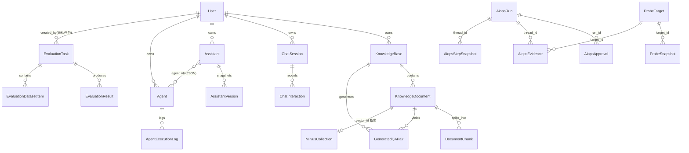

# ragPdfSystem 产品与系统总览

- 基线提交：`bf789d9e4fff51b7a2c0b661046f9e5c72b6e483`（分支 `main`，2026-11-11 09:10）
- 采集时间：2026-11-11（Asia/Shanghai）
- 资料来源与哈希：`requirements/sources/index.json`
- 基础认知（人读入口）：`requirements/project-card.md`
- 本文只写**产品与系统层面**的事实；分模块细节见 `requirements/modules/<module>.md`，规则与断言见 `specs/modules/<module>.md`，用例见 `cases/<module>.json`。

> **阅读前必读的三个区分**（本项目最容易混淆，全文反复使用）：
> 1. **已实现**：代码路径存在且能走通（静态可核）。
> 2. **已启用**：默认配置下开关是打开的。很多能力已实现但默认关闭（HITL、Supervisor、步级快照、动态分类、证据裁判、上下文压缩……）。
> 3. **已验证**：有真实运行证据（本项目只有 AIOps 诊断链路有 15 轮真实付费验收记录，且 10/15 通过）。
>
> 三者不能互相替代。本文每条都会标出它处在哪一态。

---

## 1. 产品目标

### 1.1 一句话
把"文档问答"和"运维故障诊断"两件事收进同一个 Web 系统：**RAG 侧让文档可检索可溯源，AIOps 侧让故障诊断有证据链可审计**。

### 1.2 为谁解决什么问题

| 侧 | 目标用户 | 痛点 | 本产品的解法 | 依据 |
|---|---|---|---|---|
| RAG | 需要从自有文档里找答案的人（运维/研发/业务） | 文档格式杂、找不到、答案不可信不可溯源 | 多格式解析 → 页号感知切分 → BM25+向量混合检索 → rerank → 强约束"引用段落编号" | `observed` `src/services/rag_service.py:266-289`、`src/retrieval/hybrid_retriever.py:176-189` |
| AIOps | 值班/运维工程师 | 告警后要跨多个后台人肉比对（尤其"应用实际连的下游端口 vs 注册登记端口"），易漏判；模型容易凭空编根因 | 结构化调查 + 证据账本 + 严格报告引用校验 + 判定规则回放门禁 + 生产纪律（真实后端不可达不回退 Mock） | `confirmed` `docs/aiops-goal-handover-20261108.md`；`observed` `src/agent/aiops/reporting.py:133-145` |

### 1.3 本阶段目标（`unresolved`：只能从文档推断，用户本次未确认）
- `observed` 事实：仓库处于"真实模型验收迭代期"。`docs/aiops-goal-handover-20261108.md` 记录 036–050 共 15 轮真实付费诊断，**10 轮通过 / 5 轮未通过**；5 次失败中 3 次是判定逻辑缺陷（已修，有 checkpoint 回放证据）、2 次是模型侧失误（故意不修）。
- `observed` 事实：`AGENTS.md` 2026-11-06 记录"目标已由用户暂停"。
- `unresolved`：项目性质（本科毕设 / 产品化）与"本期范围"未经用户确认，资料中不宣称已上线或可生产使用。

### 1.4 本期范围与后续范围

**本期（本资料覆盖）**：RAG 摄取与问答、AIOps 诊断与审计、评测、助手/Agent 配置、存储与队列监控、鉴权与控制台、平台运行约束。

**后续（文档提到的目标，未确认）**
- `observed` 把 AIOps 从"10/15"推向稳定复现（handover 的"别宣称"清单明确当前不能宣称可靠）。
- `observed` `ENABLE_SUPERVISOR` 的 `/supervisor/chat` 端点**尚未实现**（全仓仅注释 + 默认 False 两行）。
- `proposed`（AI 建议，不自动成立）：统一 `docs/` 里互相冲突的 15 轮验收口径；补齐 `docs/api.md`（现只覆盖 4/11 组路由）。

---

## 2. 用户角色

| 角色 | 能做什么 | 授权方式 | 依据 |
|---|---|---|---|
| 未登录访客 | 注册、登录、看 `/health` 与 `/models` | 无需 token | `observed` `src/api/routers/auth.py`、`src/api/routers/health.py:14,176` |
| 普通用户 `role=user`（默认） | 管理自己的知识库/文档/会话/助手/Agent/评测任务；发起诊断；读自己的证据**摘要** | JWT Bearer | `observed` `src/database/models.py:14`、`src/api/dependencies.py:12-37` |
| `admin` / `auditor` | 额外可读**原始证据引用**（`can_read_raw=true`、`include_raw=true`） | 同上，角色判定 | `observed` `src/api/routers/aiops.py:190,203` |
| `editor` | 模型里注释存在（`# admin, user, editor`），**无任何代码分支消费该角色** | — | `observed` `src/database/models.py:14`（`unresolved`：是否弃用未核实） |
| 项目作者（运维开发本人） | 跑真实付费验收轮次、注入故障、维护门禁 | 本地脚本 + 一次性闸门 | `confirmed` `docs/aiops-goal-handover-20261108.md`、`.github/workflows/tests.yml` |

**越权边界**（都是 `observed`）：
- 知识库/文档：`owner_id` 比对。
- 评测任务：`_check_task_ownership`（有 kb 看 kb.owner_id，无 kb 看 `created_by`）。
- 诊断运行：`_owned_run` 用 `run.user_id != user.id` → 404（**不泄露存在性**）。
- 对象存储：`_user_prefix`/`_safe_object_name` 强制 `user_{id}/` 前缀、剥他人前缀、去 `..`。

---

## 3. 核心业务对象与关系



> 图的依据：`src/database/models.py`（20 个 ORM 模型）。
> 两处**非外键**关系必须注意：`AiopsApproval.run_id`、`AiopsStepSnapshot.thread_id`、`AiopsEvidence.thread_id` 都是普通字符串列，**没有数据库级外键约束**（`observed` `src/database/models.py:291,305,353`）。

### 3.1 权威存储分工

| 数据 | 权威存储 | 副本/缓存 | 依据 |
|---|---|---|---|
| 用户/知识库/文档元数据/切片正文/会话/评测/助手/Agent | SQLite `rag_system.db` | — | `observed` `src/settings.py:103` |
| 切片向量 | Milvus `rag_documents_v2`（dim 1024, IVF_FLAT/L2） | `data/vectors/vectors.npy` + `vectors_meta.json`（**双写，降级可读**） | `observed` `src/database/vector_db.py:61-105,127-151` |
| 文档原始文件 | `data/raw` | MinIO 镜像（**失败不阻断**） | `observed` `src/api/routers/knowledge_base.py:360-399` |
| 诊断图状态 | LangGraph checkpointer：默认内存 MemorySaver；managed_run 才用 `data/aiops_checkpoints.sqlite` | 步级快照表（**默认不写**） | `observed` `src/agent/aiops/graph.py:106,148-156,348-353` |
| 诊断证据 | `aiops_evidence` 表只存**脱敏摘要**+`raw_ref`+`raw_hash` | 原始 JSON 在 `data/aiops-evidence/{evidence_id}.json` | `observed` `src/agent/aiops/run_store.py:223-242` |
| 会话短期上下文 | Redis list `session:{id}:history`，TTL 3600 | — | `observed` `src/services/memory_service.py:55-64` |
| 前端登录态 | 浏览器 `localStorage.token` | — | `observed` `frontend/src/views/Login.vue:53-54` |

**派生视图（不是权威数据，不能当事实源）**：BM25 索引（进程内，懒加载构建一次后不随新文档增量刷新）、前端列表缓存、`/health/dependencies` 的即时探测结果。

---

## 4. 服务与模块职责

### 4.1 独立启动/部署入口（按入口统计，不是按包统计）

| 服务 | 启动入口 | 端口 | 默认状态 | 依据 |
|---|---|---|---|---|
| 后端 API（FastAPI） | `src/main.py` → `uvicorn.run("src.main:app", host=0.0.0.0, port=8200)` | 8200 | 启用 | `observed` `src/main.py:283-288` |
| 前端 SPA（开发） | `frontend/` Vite dev server | 5273（`strictPort`，`/api` 代理到 8200） | 启用 | `observed` `frontend/vite.config.js:31-42` |
| Celery worker | `src/worker/celery_app.py` | — | 未核实是否在跑 | `observed`（代码存在） |
| MCP monitor | `mcp_servers/monitor_server.py` | 8104 | 依赖是否起：未核实 | `observed` `src/settings.py` |
| MCP cls | `mcp_servers/cls_server.py` | 8103 | 同上 | 同上 |
| MCP rag | `mcp_servers/rag_server.py` | 8105 | 同上（`main.py` 内同进程挂载已注释掉） | `observed` `src/main.py:267-276` |
| MCP change | `mcp_servers/change_server.py` | 8106 | 同上 | 同上 |
| MCP diagnostic | `mcp_servers/diagnostic_server.py` | 8107 | **默认关**（`DIAGNOSTIC_ENABLED=False`） | `observed` `src/settings.py` |
| MCP Termcp | `mcp_servers/termcp_gateway.py` | 18766 | **默认关**（`TERMCP_ENABLED=False`） | 同上 |
| Probe 网关 | `mcp_servers/probe_gateway.py`（**无 `__main__`，需外部启动**） | 18767 | **默认关**（`PROBE_ENABLED=False`） | `observed` `mcp_servers/probe_gateway.py:390` |
| Windows 采集端 | `scripts/windows_probe.py` → `src/probe/windows/worker.py` | 主动 ws 外连网关 | **默认关** | `observed` |

> `unresolved`：各 MCP 服务与 Celery worker 的**实际在线实例数未知**（本任务禁联网核实）。资料只能声明"有独立启动入口"。

### 4.2 只作为库/包/页面存在（不单独部署）
- `src/services/*`、`src/retrieval/*`、`src/processors/*`、`src/database/*`、`src/llm/*`、`src/embedding/*`、`src/agent/*`：进程内库。
- `frontend/src/views/*.vue`：页面，由 SPA 单实例承载（后端**不托管** `frontend/dist`，无 StaticFiles 挂载）。
- `mcp_servers/*_client.py`、`mock_scenario.py`、`service_map.py`：被服务 import 的模块，不是服务。

### 4.3 外部依赖
LLM（DashScope 兼容接口，可回退 DeepSeek）、Embedding（DashScope 或 OpenAI 兼容，实际 .env 配硅基流动 bge-m3/1024 维）、Rerank（DashScope TextReRank，**在线调用**）、Milvus、Redis、RabbitMQ、MinIO、Prometheus（可选）、各 MCP 服务、Windows Probe。

### 4.4 模块职责表（九个模块，见 `specs/catalog.json`）

| module_id | 职责 | 主要入口 | 文档 |
|---|---|---|---|
| `platform` | 启动、配置、安全面、CI 门禁、依赖与降级纪律 | `src/main.py` | `requirements/modules/platform.md` |
| `auth-console` | 注册登录、JWT 携带、对象级越权边界、前端路由与控制台 | `src/api/routers/auth.py`、`frontend/src/router/index.js` | `requirements/modules/auth-console.md` |
| `kb-ingest` | 建库、上传、异步解析切分向量化、重试/重处理、QA 对生成 | `POST /api/v1/knowledge-bases/{kb_id}/upload` | `requirements/modules/kb-ingest.md` |
| `rag-qa` | 意图路由、混合检索、rerank、生成与溯源、会话与短期记忆 | `POST /api/v1/chat/`、`POST /api/v1/chat/stream` | `requirements/modules/rag-qa.md` |
| `aiops-diagnosis` | 诊断提交、图执行、证据取证、判定收敛、报告生成、SSE 推送 | `POST /api/v1/aiops` | `requirements/modules/aiops-diagnosis.md` |
| `aiops-audit` | 运行记录、续跑审批、证据读取与脱敏、步级快照、探针目标状态 | `GET /api/v1/aiops/runs/{thread_id}` 等 | `requirements/modules/aiops-audit.md` |
| `evaluation` | 评测集生成/上传、执行、打分、报告 | `POST /api/v1/evaluations/generate` | `requirements/modules/evaluation.md` |
| `assistant-agent` | 助手与 Agent 的配置、版本、执行 | `POST /api/v1/assistants/`、`POST /api/v1/agents/{id}/execute` | `requirements/modules/assistant-agent.md` |
| `storage-queue` | MinIO 文件与预览、Celery 队列监控、依赖健康 | `GET /api/v1/storage/files`、`GET /api/v1/monitor/` | `requirements/modules/storage-queue.md` |

---

## 5. 主要业务闭环

```mermaid
flowchart TD
    A[用户登录] --> B[RAG 闭环]
    A --> C[AIOps 闭环]
    A --> D[评测闭环]

    B --> B1[建知识库]
    B1 --> B2[上传文档<br/>扩展名/MIME/魔数/50MB]
    B2 --> B3{retrieval_mode}
    B3 -->|bm25| B4[进程内 BackgroundTasks]
    B3 -->|hybrid| B5[Celery 派发<br/>5s 超时则回落同步]
    B4 --> B6[解析: 逐页取文]
    B5 --> B6
    B6 --> B7[页号感知切分<br/>doc>kb>1000/200]
    B7 --> B8[Embedding]
    B8 --> B9[先删旧chunk<br/>写SQL+写Milvus+双写本地]
    B9 --> B10[status=2 就绪]
    B10 --> B11[提问]
    B11 --> B12[意图路由<br/>chat/knowledge/diagnosis]
    B12 --> B13[BM25+向量各取top_k*2<br/>RRF融合]
    B13 --> B14[Rerank 在线模型]
    B14 --> B15[生成: 强制引用段落编号]
    B15 --> B16[答案 + source_documents 带页码]

    C --> C1[提交 query]
    C1 --> C2{terminal_enabled<br/>且 TERMCP 关闭?}
    C2 -->|是| C3[503 直接拒绝]
    C2 -->|否| C4[planner 出计划]
    C4 --> C5[executor 逐步执行<br/>MCP/Probe 取证]
    C5 --> C6[replanner 决策<br/>continue/replan/respond]
    C6 -->|continue/replan| C5
    C6 -->|respond| C7{ENABLE_HITL}
    C7 -->|true| C8[interrupt 挂起<br/>pending_review]
    C7 -->|false| C9[生成报告]
    C8 --> C9
    C9 --> C10[报告证据引用强校验<br/>不符则降级为保守正文]
    C10 --> C11[SSE 推送 + 落 aiops_runs]
    C11 --> C12[usage 事件: 调用数与预估费用]

    D --> D1[生成数据集<br/>BackgroundTasks 异步]
    D1 --> D2[真实调 LLM 出题]
    D2 --> D3[可选上传自定义集]
    D3 --> D4[执行评测]
    D4 --> D5[自研 LLM-as-Judge 打分]
    D5 --> D6[写 SQLite + data/reports/eval_{id}.md]
```

（图依据：`src/api/routers/knowledge_base.py`、`src/worker/tasks.py`、`src/services/rag_service.py`、`src/agent/aiops/graph.py`、`src/api/routers/evaluation.py`、`src/services/evaluator.py`。）

### 5.1 五条链路的一句话状态

| 链路 | 一句话状态 | 态 |
|---|---|---|
| `FLOW-KB-INGEST` | 全链路已接通，但"Celery 异步"在 bm25 库与 broker 不可用时会退化为进程内/同步 | 已实现·已启用 |
| `FLOW-RAG-QUERY` | 全链路已接通；rerank 失败会静默降级为截断，`RAG_MIN_SCORE` 从不生效 | 已实现·已启用 |
| `FLOW-DIAG` | 全链路已接通；但默认配置下 `managed_run=false`（不建 run 记录、不用持久 checkpointer），HITL/Termcp/Probe 三条高级链路全关 | 已实现·**部分未启用**·已验证 10/15 |
| `FLOW-DIAG-RESUME` | **HITL 无 HTTP 审批端点**；唯一 HTTP 恢复入口只处理 Termcp 命令审批 | 已实现（仅 Termcp 路径）·默认未启用 |
| `FLOW-EVAL` | 全链路已接通；打分是自研 LLM-as-Judge，**不是 RAGAS**，且无 Recall 维度 | 已实现·已启用 |
| `FLOW-STORE` | 后端 6 端点齐全；**前端下载/预览不带 Authorization 头 → 401** | 已实现·**前端有可用性缺口** |

---

## 6. 版本与证据

- 本文所有源码锚点均基于提交 `bf789d9e4fff51b7a2c0b661046f9e5c72b6e483`；逐文件 SHA-256 见 `requirements/sources/index.json`。
- 未提交差异：仅 3 个未跟踪条目（`cleanup-flash-fix.ps1`、`pelican-bicycle.html`、`pytest-of-Administrator/`），**未参与任何结论**。
- 本次**未运行**任何测试/服务/模型，`model_calls: 0`、`network_calls: 0`；所有 `observed` 均来自静态阅读。

## 7. 与文档口径的冲突（详见 `specs/questions.md`）

| 文档说法 | 代码事实 | 处理 |
|---|---|---|
| API 端口 8000（`README.md`） | 8200（`src/main.py:288`） | 采信代码，登记冲突 |
| 前端端口 5173（`README.md`） | 5273（`frontend/vite.config.js:34`）；后端开发 CORS 白名单里也没有 5173 | 采信代码，登记冲突 |
| "上传后自动触发 Celery 异步任务"（`README.md`） | bm25 库走进程内 BackgroundTasks；Celery 派发有 5s 超时回落 | 采信代码，登记冲突 |
| MinIO 提供"版本管理"（`README.md`） | storage 6 端点中无任何 version 端点 | 采信代码，登记缺失 |
| 评测"召回率/基于 RAGAS"（`README.md`） | 自研 LLM-as-Judge，四维度，无 Recall；`src/` 零 ragas 引用 | 采信代码，登记冲突 |
| "离线 137 / 集成 98 个测试"（`README.md`） | 与 handover 的"全量 2071 passed/37 failed"口径不同；均未运行核实 | 两者都登记为 `unresolved` |
| "无独立 HTTP 审批端点"（`README.md`） | **属实**：HITL 无 HTTP 端点，只有 Termcp 命令审批有 `/runs/{id}/continue` | 一致，无冲突 |
